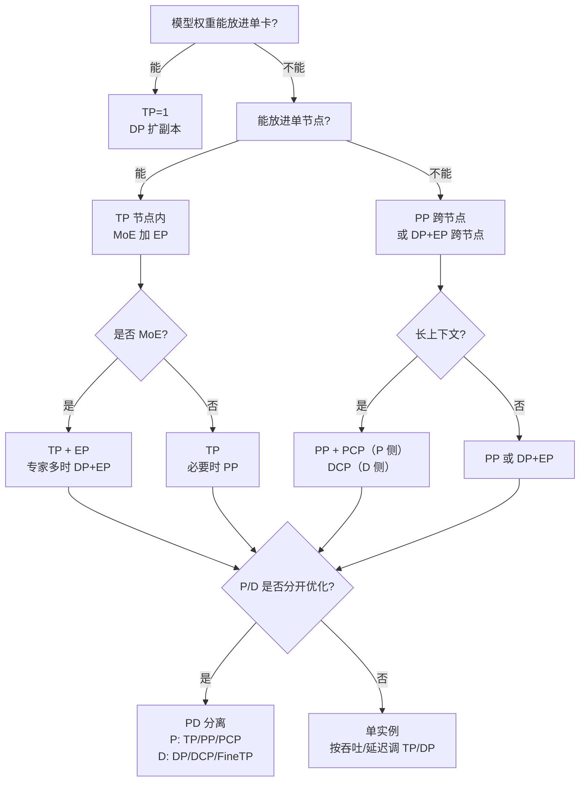

# vLLM Ascend 并行策略使用手册（TP / DP / PP / EP / CP / SP）

> 适用版本：vLLM Ascend v0.30.0rc1 线（仓库 `main` 快照，2026-10）。
> 范围：推理侧并行维度、部署拓扑、组合约束、选型方法、容量估算、调优与排障。
> 定位：一份可以独立阅读的“选型 + 配置 + 排障”手册；原理只讲到“够做决策”为止。
>
> 配套文档：`SCHEDULING.zh-CN.md`（调度器视角）、`WALKTHROUGH-inference.zh-CN.md`（代码路线）、
> `FLOW-end-to-end.zh-CN.md`（请求全流程）。本文只讲并行。
>
> 说明：文中的“卡”指一张 NPU；“rank”指一个参与通信的进程。版本漂移后，参数与约束请以文末链接的
> 官方文档和代码为准。

---

## 目录

- [0. 三十秒选型](#quick)
- [1. 心智模型：并行到底在切什么](#model)
- [2. TP：张量并行](#tp)
- [3. DP：数据并行](#dp)
- [4. PP：流水并行](#pp)
- [5. EP：专家并行](#ep)
- [6. CP：上下文并行（PCP / DCP）](#cp)
- [7. SP：序列并行](#sp)
- [8. PD 分离：部署级并行（xPyD）](#pd)
- [9. 组合关系与互斥清单](#combine)
- [10. 选型建议：决策树、配方与调优](#select)
- [11. 参数速查](#params)
- [12. 参考文档](#refs)

---

<a id="quick"></a>

## 0. 三十秒选型

### 0.1 一张表看懂六个维度

| 维度 | 切什么 | 关键参数 | 主要收益 | 主要代价 | 典型场景 |
| --- | --- | --- | --- | --- | --- |
| **TP** 张量并行 | 层内权重与计算（head、FFN、vocab） | `--tensor-parallel-size` | 单层算得快、单卡权重小 | 每层集合通信，跨机代价高 | 单机放得下、延迟敏感 |
| **DP** 数据并行 | 请求/批次，每 rank 一份完整副本 | `--data-parallel-size` 等 | 吞吐近线性、扩容简单 | 每 rank 复制权重与 KV，显存不共享 | 多副本、请求独立 |
| **PP** 流水并行 | 按 Transformer 层切 stage | `--pipeline-parallel-size` | 突破单机层数/显存限制 | 流水气泡、激活传输 | 模型跨机、层数多 |
| **EP** 专家并行 | MoE 专家权重与计算 | `--enable-expert-parallel` | 专家分散到更多卡 | all-to-all 通信、负载均衡 | MoE 模型 |
| **CP** 上下文并行 | 序列 token / KV cache | `--prefill-context-parallel-size`、`--decode-context-parallel-size` | 降 TTFT、省 KV 显存 | PCP 加卡、DCP 约束多 | 长上下文 |
| **SP** 序列并行 | MoE 路径的 token 维 | `enable_flashcomm1` + EP + TP>1 | 减少重复专家计算 | 额外通信、组合条件多 | MoE + TP/EP |
| **FineTP** 细粒度 TP | 指定模块沿 DP 轴切分 | `finegrained_tp_config` | 降单卡权重（尤其 D 节点） | 仅 MoE、约束多 | PD 的 Decode 节点 |
| **PD 分离** | P/D 实例级拆分 | `--kv-transfer-config` | P/D 分别选型、独立扩缩容 | 部署复杂、要 connector/proxy | 高吞吐在线服务 |

> 表中 TP/DP/PP/EP/CP 在支持矩阵中均为 🟢 Functional；SP 通过 FlashComm1 提供；
> FineTP 与 PD 属于“有条件的功能组合”。详见
> [supported_features.md](docs/source/user_guide/support_matrix/supported_features.md)。

### 0.2 症状 → 先加哪个维度

| 你遇到的现象 | 优先尝试 | 原因 |
| --- | --- | --- |
| 单卡 OOM，但单机放得下 | **TP** | 层内切分，通信在机内最快 |
| 单机 OOM，模型层数很多 | **PP**（跨机） | 按层切，避免超大 TP 组 |
| 单机放得下，但吞吐不够 | **DP** | 多副本，请求级并行 |
| MoE 专家权重放不下 | **EP**（+DP） | 专家分散到 DP×TP 平面 |
| 长 prompt 的 TTFT 高 | **PCP** | prefill token 分到额外 rank |
| 长上下文 KV 显存不够 | **DCP / KVPP / KV Pool** | KV 分片或下沉 |
| Decode 节点权重显存吃紧 | **FineTP** | LM head / embedding / o_proj / MLP 沿 DP 切 |
| 想把 P 和 D 分别优化 | **PD 分离** | P 计算密集、D 访存密集 |

### 0.3 三条铁律

1. **先算显存，再谈并行。** 权重放不下时，TP/PP/EP 是“能不能跑”的问题；放得下之后，DP/CP 才是“跑得好不好”的问题。
2. **TP 尽量留在节点内，跨机优先 PP 或 DP。** TP 是每层都要通信的维度，跨机 TP 对网络最敏感。
3. **每加一个维度，先检查整除与互斥。** 大多数启动失败不是性能问题，而是 `world_size`、head 数、DP 整除或功能互斥没对齐。

---

<a id="model"></a>

## 1. 心智模型：并行到底在切什么

### 1.1 五种被切分的东西

| 被切分的东西 | 对应维度 | 一句话 |
| --- | --- | --- |
| 单层内的权重/计算 | TP | 每个 rank 算这一层的一部分，再集合通信拼起来 |
| 模型的层 | PP | 每个 stage 只跑一段连续的层 |
| 请求 | DP | 每个 rank 跑完整模型，但喂不同的请求 |
| 专家 | EP | 每个 rank 只放一部分 expert |
| 序列 / KV | CP | 一条长序列的 token 或 KV 分到多个 rank |
| token（MoE 路径） | SP | 在 TP/EP 组内按 token 切，减少重复专家计算 |

注意：这些维度不是互斥的“单选”，而是可以叠乘的“坐标系”。真正的约束来自
**显存、通信、整除关系、功能互斥**，不是来自维度数量。

### 1.2 全局 rank 布局与 world size

在本仓库的 Ascend 实现里，全局进程组按下面的顺序展平（`vllm_ascend/distributed/parallel_state.py`）：

```text
全局 rank 顺序（最后一维变化最快）：

[ external_dp ] × DP × PP × PCP × TP

rank = ((((edp × DP + dp) × PP + pp) × PCP + pcp) × TP + tp)
```

因此：

```text
全局进程数（world size） = external_dp × DP × PP × PCP × TP
单机可见卡数需求       = DP × PP × PCP × TP        （external_dp 通常为 1）
```

几个特殊说明：

- **PCP 会额外加卡**：`world_size_with_pcp = PCP × 原来的 world_size`。
- **DCP 不额外加卡**：DCP 复用 TP（或 TP×PCP）内的 rank，只改变 KV cache 的分布。
- **external_dp** 主要用于 RL/verl 等“模型外部还有一层数据并行”的场景；普通在线服务可视为 1。
- 每个 DP rank 内部是一个完整的 `PP × PCP × TP` 模型并行组；DP rank 之间通过 DP 协调器/EP 组通信。

一个 2 机 16 卡、`TP8 PP2 DP1 PCP1` 的布局示意：

```text
节点 0：rank 0..7   = PP stage 0 的 TP8
节点 1：rank 8..15  = PP stage 1 的 TP8

tp 组：{0..7}、{8..15}
pp 组：{0,8}、{1,9}、...、{7,15}
dp 组：每个 rank 自己（DP=1）
```

### 1.3 通信域：谁和谁说话

| 组 | 成员范围 | 主要通信 | 说明 |
| --- | --- | --- | --- |
| TP 组 | 固定 `dp/pp/pcp`，变化 `tp` | all-reduce、all-gather、reduce-scatter | 每层都可能发生，最敏感 |
| PP 组 | 固定 `dp/pcp/tp`，变化 `pp` | send/recv 激活 | 只在 stage 边界发生 |
| DP 组 | 固定 `pp/pcp/tp`，变化 `dp` | 协调、dummy step、负载均衡 | dense 模型无模型层内通信 |
| EP / MC2 组 | 固定 `pp`，包含 `dp × pcp × tp` | all-to-all / all-gather + reduce-scatter | MoE 的专家分发与合并 |
| KVPP 组 | 固定 `dp/pp`，包含 `tp × pcp` | KV cache 按层归属 | 实验性，见 KVPP 文档 |
| FineTP 组 | 固定 `pp/tp`，在 `dp` 轴取连续一段 | all-gather / reduce-scatter / all-to-all | 只用于指定模块 |

### 1.4 显存账本：选型的第一性原理

一张卡的显存大致由四块组成：

```text
每卡显存 ≈ 权重 / 并行切分 + KV cache + 激活/临时区 + 框架与图捕获开销
```

常用的粗略估算：

| 组成 | 估算方式 | 备注 |
| --- | --- | --- |
| Dense 权重 | `参数量 × 每参数字节 / (TP × PP)` | W8A8 约 1 B/参数，BF16 约 2 B/参数 |
| MoE 权重 | `(稠密部分 + 专家部分 / EP) × 字节 / PP` | `EP = DP × TP`（有 PCP 时再乘 PCP） |
| KV cache | `2 × 本 stage 层数 × 本 rank KV 头数 × head_dim × token 数 × KV 字节 / DCP` | MLA 的 KV 是压缩 latent，常跨 TP 复制；DCP/KVPP 才切 |
| 激活 | 与 `max_num_batched_tokens`、hidden size、batch 相关 | 图模式还会额外占捕获内存 |

一个直观例子（只用于说明方法，不是性能承诺）：

```text
DeepSeek-R1 类 MoE，W8A8，约 671B 参数：
- 专家部分约 640B，稠密部分约 30B
- TP8 PP2 EP16（EP = DP2 × TP8）：
  每卡专家权重 ≈ 640 / (16 × 2) = 20B 参数 ≈ 20 GB
  每卡稠密权重 ≈ 30 / (8 × 2) ≈ 1.9B 参数 ≈ 2 GB
  再叠加 KV、激活、图捕获，才落到 64 GB 卡的预算里
```

**结论：选型顺序应该是“权重 → KV → 激活 → 通信”。** 权重决定最小并行度，KV 决定能扛多少并发，
通信决定这个并行度是否划算。

---

<a id="tp"></a>

## 2. TP：张量并行

### 2.1 原理

TP 把单层内的矩阵乘按列/行切开：

- **Column parallel**：权重按输出维切，每个 rank 算一部分，得到部分结果。
- **Row parallel**：权重按输入维切，每个 rank 算一部分后做 all-reduce。
- Attention 的 Q/K/V、MLP 的 gate/up/down、LM head 的 vocab 维都可以按这种方式切。

因此 TP 的特点是：**每个 rank 都参与每一层，通信发生在层内**。这让 TP 的延迟最好，但也最依赖互联带宽。

### 2.2 用法

```bash
vllm serve <model> \
    --tensor-parallel-size 8
```

TP 组的大小就是 `--tensor-parallel-size`；一个 DP rank 内部可以有自己的 TP 组。

### 2.3 什么时候用 / 不用

**适合：**

- 模型单卡放不下，但单机放得下。
- 延迟敏感、并发不高的在线服务。
- 希望把权重切小以留出更多 KV 空间。

**不适合：**

- TP 组需要跨节点，而模型其实可以用 PP/DP 解决。
- attention head / KV head 数量无法被 TP 整除。
- 模型已经能放进单卡，且瓶颈是吞吐而不是单请求延迟（此时 DP 更划算）。

### 2.4 约束与坑

1. **整除关系**：TP 通常要能整除 attention head 数；GQA/MQA 还要满足 KV head 的整除或复制规则；
   部分融合算子还要求 hidden size / intermediate size 可整除。不同模型和 attention backend 的具体要求不同，
   启动报错时优先检查这一条。
2. **MoE 层不要同时用 MoE TP 和 EP**：MoE 层要么走 TP（专家内切分），要么走 EP（专家间切分）。
   官方教程明确提示“不要在同一 MoE 层混用 MoE tensor parallelism 和 expert parallelism”。
3. **图模式**：TP 与 ACLGraph 基本兼容，但“大 TP + 图模式”在部分模型/后端仍有边界，建议先 `--enforce-eager`
   跑通，再逐级开图。
4. **跨机 TP**：不是禁止，而是“最后手段”。跨机 TP 会把每层集合通信放到最贵的链路上；
   能用 PP 跨机、TP 留在机内，通常更稳。
5. **TP 与 LM head / embedding 的细粒度切分**：见下一节，二者可以叠加，但语义不同。

### 2.5 细粒度 TP（Fine-grained TP）

细粒度 TP 不是“更大的 TP”，而是**对指定模块单独指定切分大小**，并且切分轴是 **DP 轴**，不是 TP 轴。

四个开关（都在 `--additional-config` 的 `finegrained_tp_config` 下）：

| 参数 | 作用 | 默认 | 关键约束 |
| --- | --- | --- | --- |
| `oproj_tensor_parallel_size` | 切 attention 输出投影 `o_proj`（DSA 模型是 `wo_a/wo_b`） | 0 | 仅 MoE；`TP=1`；PD 的 D 节点；图模式；recompute scheduler；PCP=1 |
| `mlp_tensor_parallel_size` | 切稠密 MLP 层 | 0 | 同上 |
| `lmhead_tensor_parallel_size` | 切 LM head 的 vocab 维 | 0 | 仅 MoE；size ≤ DP 且整除 DP；可与标准 TP 叠加 |
| `embedding_tensor_parallel_size` | 切 token embedding 表 | 0 | 仅 MoE；size ≤ DP 且整除 DP；可与标准 TP 叠加 |

**最重要的三条：**

1. **它沿 DP 轴切**。所以 `size` 必须 ≤ `data_parallel_size` 且整除 `data_parallel_size`；
   违反时报 `finegrained tp sizes must divide by data_parallel_size.`。
2. **只支持 MoE 模型**。dense 模型的 DP rank 是独立副本，没有跨 rank 的 DP 组可供切分；
   违反时报 `The finegrained tp sizes can be enabled only for MOE models.`。
3. **o_proj / MLP TP 的前置条件最严**：`TP=1`、PD 的 Decode 节点（`kv_role=kv_consumer`）、
   graph mode、`scheduler_config.recompute_scheduler_enable=true`、`PreemptOffloadConnector`、
   `PCP=1`。少一项都会在配置加载时失败。

**能省多少：** 官方在 DeepSeek-R1-W8A8、DP32+EP32、FineTP=8 的 Decode 节点上测得四开关合计约
**9.72 GB/卡** 的权重节省，TPOT 净影响约 -1.7 ms（小幅改善），其中 o_proj TP 单项有约 +1.5 ms 的回退。
这说明它是**显存工具**，不是无脑提速开关。

示例（只开 LM head / embedding，和标准 TP 叠加）：

```bash
vllm serve <moe-model> \
    --data-parallel-size 4 \
    --tensor-parallel-size 4 \
    --enable-expert-parallel \
    --additional-config '{
        "finegrained_tp_config": {
            "lmhead_tensor_parallel_size": 4,
            "embedding_tensor_parallel_size": 4
        }
    }'
```

启动后确认：

```bash
grep "finegrained_tp_config enabled" <serve-log>
# 期望：finegrained_tp_config enabled: lmhead_tensor_parallel_size=4, embedding_tensor_parallel_size=4
```

如果 o_proj / MLP 没出现在这一行，检查是否被“capture bound 不覆盖最大 decode step”自动关闭，
日志关键字是 `Disabling oproj_tensor_parallel_size`。此时提高 `max_cudagraph_capture_size` 再试。

### 2.6 TP 调优清单

- [ ] TP 组是否完全落在节点内？跨机 TP 是否有 PP/DP 替代方案？
- [ ] head / KV head / hidden size 是否整除？
- [ ] 先 eager 跑通，再开 `FULL_DECODE_ONLY` / `PIECEWISE`。
- [ ] MoE 层确认走 TP 还是 EP，不要混用。
- [ ] 需要省权重显存时，优先考虑 LM head / embedding TP（可与 TP 叠加）。
- [ ] o_proj / MLP TP 只在 PD Decode 节点、图模式、recompute scheduler 下使用。

---

<a id="dp"></a>

## 3. DP：数据并行

### 3.1 原理

DP 的每个 rank 持有**一份完整的模型副本**（副本内部可以再 TP/PP/EP），并拥有**独立的 scheduler 和 KV cache**。
请求被分发到不同 DP rank，彼此之间不共享 KV，也不共享 prefix cache。

对 dense 模型，DP 主要是“多副本扩容”，rank 之间没有模型层内的集合通信。
对 MoE 模型，DP 会进入 EP/MC2 通信域：专家权重在 **DP×TP** 平面上切分，DP rank 之间需要 all-to-all /
all-gather + reduce-scatter 来交换 token。因此 **DP+EP 是 MoE 的常见组合**，而 dense 的 DP 更接近“多开几个引擎”。

### 3.2 参数

| 参数 | 含义 | 典型用法 |
| --- | --- | --- |
| `--data-parallel-size N` | 全局 DP rank 数 | 单机内部 LB：`N` 等于本机 rank 数 |
| `--data-parallel-size-local M` | 本机 DP rank 数 | 多机内部 LB：每机 `M` 个 |
| `--data-parallel-rank R` | 本实例的全局 DP rank | 外部 LB：每个实例一个 rank |
| `--data-parallel-start-rank S` | 本机第一个全局 rank | 多机内部 LB：worker 节点用它对齐 |
| `--data-parallel-address IP` | DP 协调器地址 | 多机/外部 LB 必填 |
| `--data-parallel-rpc-port P` | DP 协调器 RPC 端口 | 同一 DP 组内一致 |
| `--headless` | 本节点不启动 API server | 只用于内部 LB 的非 head 节点 |

### 3.3 三种负载均衡模式

| 模式 | 启动方式 | API 入口 | 适用 |
| --- | --- | --- | --- |
| **单机内部 LB** | `--data-parallel-size N`（`local=N`） | head 节点一个入口 | 单机多副本，最简单 |
| **多机内部 LB** | head：`--data-parallel-size N --data-parallel-size-local M --data-parallel-address ...`；worker：`--headless --data-parallel-start-rank ...` | head 节点一个入口 | 多机但希望统一调度 |
| **外部 LB** | 每个实例显式 `--data-parallel-rank R`，各自起 API；前面挂 proxy | 每实例一个入口 | 大规模、P/D 分离、独立扩缩容 |
| **Hybrid（PD 场景）** | P 侧外部 LB，D 侧内部 LB | 由 proxy 统一 | P/D 拓扑不对称时 |

**外部 LB 的硬性要求：**

- `DP_SIZE > 1` 时才需要显式 `--data-parallel-rank`。
- 外部/混合 LB 模式下**不能用 `--headless`**；否则会报
  `Remote engine must not use --headless in external or hybrid dp lb mode`。
- 每个实例的 rank 范围不能重叠，proxy 要把请求送到正确的端口。

**多机内部 LB 的关键点：**

- 所有节点使用相同的 `--data-parallel-size`、`--data-parallel-address`、`--data-parallel-rpc-port`。
- worker 节点必须 `--headless`，并用 `--data-parallel-start-rank` 指定本机起始 rank。
- 只有 head 节点起 API server；所有节点共享同一套模型路径和 TP/PP/EP 配置。

### 3.4 DP + EP：MoE 的关键组合

```bash
vllm serve <moe-model> \
    --data-parallel-size 8 \
    --tensor-parallel-size 8 \
    --enable-expert-parallel
```

- 专家权重按 **DP×TP** 切分；DP rank 越多，单卡专家越少。
- DP rank 之间每层要做 token 分发/合并（all-to-all 或 all-gather + reduce-scatter）。
- 不要在同一 MoE 层混用 MoE TP 和 EP。
- 如果专家负载不均，再考虑 EPLB（见第 5 章）。

### 3.5 DP 相关的调度增强

这些不是“并行维度”，但在 DP 部署里经常一起出现：

| 功能 | 配置 | 作用 | 限制 |
| --- | --- | --- | --- |
| **Balance Scheduling** | `scheduler_config.enable_balance_scheduling: true` | 全局准入闸门：任一 rank 的 running 达到上限时，所有 rank 暂停接纳新请求，缓解 DP 间堆积 | 主要面向 PD-mixed/非分离场景；PD 分离时不建议；不能与 CPP 同开 |
| **Recompute Scheduler** | `scheduler_config.recompute_scheduler_enable: true` | 让 Decode 节点的 step 保持 decode 形状，配合细粒度 TP | 仅 PD 的 D 节点（`kv_role=kv_consumer`）；P 节点开启会报错 |
| **DyntraLB** | `scheduler_config.dyntra_lb_config.enabled: true` | 在单节点 Decode DP 组内按 KV block 负载暂停/接纳请求，减少 DP 气泡 | 仅 PD D 节点；`DP>1`；单节点；不能与 Balance/CPP 同开 |
| **ShortRequestFirst** | `scheduler_config.short_request_first_config` | 优先短 prefill，降低短请求 TTFT | 与 batch-job-aware、CPP、D 节点调度不兼容 |

### 3.6 约束与坑

1. **DP 不共享 KV / prefix cache**：每个 rank 独立算前缀。相同前缀很多时，DP 会重复计算；
   考虑 prefix caching、KV Pool 或 PD 分离。
2. **`max_num_seqs` 是“每个 DP rank”的上限**：总并发约 `max_num_seqs × data_parallel_size`；
   压测时不要只按单 rank 估算。
3. **显存要按“单副本”算**：DP 不减少单卡权重，只增加副本数；单卡放不下时，DP 帮不上忙。
4. **多机内部 LB 与外部 LB 的语义不同**：前者是“一个前端调度所有 rank”，后者是“每个 rank 一个前端 + proxy”；
   混用 `--data-parallel-rank` 和 `--headless` 会直接报错。
5. **DP 的 rank 顺序**：见 1.2 的展平公式；手工写启动脚本时，`dp` 是仅次于 external_dp 的外层维度。
6. **PD 场景的 DP 拓扑必须与 connector 对齐**：`kv_transfer_config` 里的 `prefill/decode` 的
   `dp_size/tp_size/pp_size` 要与两侧真实配置一致，否则握手/传输会失败。

### 3.7 示例

**单机 8 卡、dense 模型、2 副本 × TP4：**

```bash
vllm serve <dense-model> \
    --data-parallel-size 2 \
    --tensor-parallel-size 4
```

**多机内部 LB（GLM5 教程风格）：**

```bash
# node 0
vllm serve <model> \
    --data-parallel-size 8 \
    --data-parallel-size-local 4 \
    --data-parallel-address <node0_ip> \
    --data-parallel-rpc-port 12980 \
    --tensor-parallel-size 1 \
    --enable-expert-parallel

# node 1
vllm serve <model> \
    --headless \
    --data-parallel-size 8 \
    --data-parallel-size-local 4 \
    --data-parallel-start-rank 4 \
    --data-parallel-address <node0_ip> \
    --data-parallel-rpc-port 12980 \
    --tensor-parallel-size 1 \
    --enable-expert-parallel
```

**外部 LB（每个实例一个 rank，前置 proxy）：**

```bash
# 实例 i
vllm serve <model> \
    --data-parallel-size 32 \
    --data-parallel-rank <i> \
    --data-parallel-address <dp_master_ip> \
    --data-parallel-rpc-port 12321 \
    --tensor-parallel-size 1
```

---

<a id="pp"></a>

## 4. PP：流水并行

### 4.1 原理

PP 把模型的 Transformer 层按顺序切成若干 stage，每个 stage 由一个 TP 组执行，stage 之间只传激活。
它解决的是“模型层数/权重跨机放不下”的问题，而不是“单层算得慢”的问题。

PP 的代价是**流水气泡**：一个请求要依次穿过所有 stage；低并发时，后面的 stage 在等前面的结果。
高并发时，不同请求/不同 prefill chunk 可以填满不同 stage，气泡被摊薄。

### 4.2 参数与层切分

```bash
vllm serve <model> \
    --tensor-parallel-size 8 \
    --pipeline-parallel-size 2
```

默认自动切分：层数不能被 PP 整除时，余数从倒数第二个 stage 开始往前放，避免最后一个 stage
（通常还要跑 final norm、LM head、logits、sampling）过载。

自定义切分用环境变量 `VLLM_PP_LAYER_PARTITION`：

```bash
export VLLM_PP_LAYER_PARTITION="32,29"

vllm serve <61-layer-model> \
    --tensor-parallel-size 8 \
    --pipeline-parallel-size 2
```

规则：

- 每个 PP rank 一个正整数，逗号分隔。
- 条目数必须等于 `--pipeline-parallel-size`。
- 总和必须等于目标模型的 hidden layer 数。
- 不要包含 embedding、final norm、LM head、draft 层。
- 同一个服务实例的所有 worker 必须用同一个值。
- Ray 集群要在每个节点启动 Ray 之前设置。

### 4.3 什么时候用 / 不用

**适合：**

- 模型跨节点放不下，必须按层切。
- 想保持“TP 在节点内、PP 跨节点”的通信局部性。
- PD 分离的 Prefill 节点需要更多设备做长上下文。

**不适合：**

- 低并发、延迟敏感的 Decode（气泡会放大延迟）。
- 模型实现没有 `SupportsPP` 标记（启动会直接拒绝）。
- 与 Xlite graph 同用（不兼容）。

PP 支持的模型家族（以当前文档为准）：DeepSeek-V4/V4.1、GLM-5.2、MiniMax-M3、Qwen3.6、Kimi K3 等；
其他模型若上游实现继承了 `SupportsPP`，在 Ascend 上行为一致。部署前查
[supported_models.md](docs/source/user_guide/support_matrix/supported_models.md) 的 **Pipeline Parallel** 列。

### 4.4 动态分块流水并行（CPP）

CPP 是 PP 的 Prefill 侧优化：根据 profiling 数据动态选择 chunk size，减少长序列的流水气泡。
它只建议用在 **PD 分离的 P 节点**，D 节点不需要。

```bash
--additional-config '{"scheduler_config": {"profiling_chunk_config": {"enabled": true}}}'
```

关键参数：

| 参数 | 默认 | 说明 |
| --- | --- | --- |
| `enabled` | false | 开启 CPP；要求 `PP > 1` 且 `--enable-chunked-prefill` |
| `smooth_factor` | 1.0 | 越高越信模型预测；0.6~0.85 平衡预测与调度开销；0 退化为固定 chunk |
| `min_chunk` | 4096 | 最小 chunk；应小于 `max_num_batched_tokens` |
| `need_timing` | true | 在线校准；默认开启，必须按规范做校准，否则性能会明显退化 |
| `max_fit_chunk` | 30 | 在线校准的样本数 |

调优建议：

- 先不用 CPP，用固定 chunk 找到最优 `--max-num-batched-tokens`（典型搜索空间 8192/16384/24576/32768）。
- 开 CPP 后，`max_num_batched_tokens` 一般取固定 chunk 的 2~4 倍。
- 64k 序列建议 20480；128k 建议 32768。
- `need_timing=true` 时不要调 `smooth_factor`；关掉 `need_timing` 才用 0.5~0.8 补偿。
- CPP 不能与 `enable_balance_scheduling` 同开。
- CPP 的异步调度只在 Model Runner V2 下支持（`VLLM_USE_V2_MODEL_RUNNER=1`）。

### 4.5 PP 与其它特性的组合

以 Model Runner V2 为准（`VLLM_USE_V2_MODEL_RUNNER=1`）：

| 组合 | 支持 | 说明 |
| --- | --- | --- |
| Graph mode | ✅ | `FULL_DECODE_ONLY` / `PIECEWISE` |
| MTP | ✅ | — |
| EAGLE3 | 🟠 | 仅 MiniMax-M3 稀疏模型 |
| DFlash | ❌ | 不支持 |
| DSpark | ✅ | 仅 DeepSeek-V4 / GLM-5.2 MoE-DSA |
| PCP / DCP | ✅ | DCP 用 `MooncakeConnectorV2` |
| Prefix caching / chunked prefill | ✅ | — |
| KV Cache Pool / KV offload | ✅ | offload 用 layerwise connector |
| Lmhead TP / MLAPO / 多模态 / 量化 | ✅ | 按各特性自身约束 |
| P/D 分离 | ✅（仅 P 节点） | D 节点必须 `PP=1`（MooncakeConnectorV1） |
| Sequence Parallelism | ✅ | — |
| **Fine-grained TP** | ❌ | 任何细粒度 TP 开关都不能与 PP 同用 |
| **Xlite graph** | ❌ | 不兼容 |

### 4.6 限制与坑

1. **`SupportsPP` 是硬门槛**：模型没有该标记，`--pipeline-parallel-size > 1` 直接启动失败。
2. **跨节点 RoCE MoE 的 PP+DP 不能同开**：`MoeDistributeDispatch` 路径不支持该组合；
   报错/挂起时先把 PP 或 DP 其中一个设为 1。
3. **MooncakeConnectorV1 要求 Decode 侧 `PP=1`**：P 侧可以 PP，D 侧不行；
   两侧的 `prefill.pp_size` / `pp_layer_partition` 要一致。
4. **draft 模型总在最后一个 stage**：推测解码的 drafter 不参与 PP 切分；
   最后一个 stage 可能同时承载 target 层、输出模块和 drafter，容易 OOM。
5. **最后一个 stage 的层数不要贪多**：自定义 partition 时，优先把层从最后 stage 往前移，
   但一次只移一层，并重新测内存与延迟。
6. **PP 的收益依赖并发**：低并发 Decode 下，PP 往往不如 TP；先用 TP 做 baseline。

### 4.7 示例

```bash
# 2 机 16 卡：TP8 PP2，TP 在机内，PP 跨机
vllm serve <model> \
    --distributed-executor-backend mp \
    --tensor-parallel-size 8 \
    --pipeline-parallel-size 2 \
    --nnodes 2 \
    --node-rank 0 \
    --master-addr <HEAD_NODE_IP> \
    --master-port <MASTER_PORT>
```

worker 节点加 `--headless`，其余参数一致。

---

<a id="ep"></a>

## 5. EP：专家并行

### 5.1 原理

MoE 层由 router 选择 top-k 专家。EP 把专家集合切到不同 rank：

- 每个 rank 只持有部分 expert 的权重。
- 每个 token 经过 router 后，被 all-to-all 分发到持有目标专家的 rank。
- 专家算完后，再把结果合并回原 rank。

在 Ascend 上，EP 通信通常与 MC2（融合的 dispatch/combine）或 all-gather + reduce-scatter 绑定。
EP 组的大小是 **`DP × PCP × TP`**（按 PP stage 分组）；没有 PCP 时就是 `DP × TP`。

### 5.2 用法

```bash
vllm serve <moe-model> \
    --tensor-parallel-size 8 \
    --enable-expert-parallel
```

- 只对 MoE 模型有意义；dense 模型开启不会带来专家切分。
- `--enable-expert-parallel` 打开后，MoE 层从“专家内 TP”切换为“专家间 EP”。
- 专家数通常要能被 EP 组大小整除；不整除时的行为取决于模型/算子，建议在启动前确认。
- 不要在同一 MoE 层混用 MoE TP 和 EP。

### 5.3 拓扑：EP 到底有多大

```text
EP 组大小 = DP × PCP × TP        （每个 PP stage 内）
```

例子：

| 配置 | EP 组大小 | 单卡专家占比 |
| --- | --- | --- |
| `TP8 DP1` | 8 | 1/8 |
| `TP8 DP2` | 16 | 1/16 |
| `TP1 DP16` | 16 | 1/16 |
| `TP8 DP2 PCP2` | 32 | 1/32 |

注意：**DP 不只是“多副本”**。在 MoE 模型里，DP 会实质性地参与专家切分和 token 分发；
这也是为什么 MoE 的 DP 扩展通常能同时降低单卡专家权重。

### 5.4 EPLB：专家负载均衡

EP 的天然问题是“热门专家忙死、冷门专家闲着”。EPLB 通过记录专家负载、重新放置专家/副本，
把负载摊平。MRv1 与 MRv2 的配置方式不同，不能混用。

#### MRv2（推荐，异步）

```bash
export VLLM_USE_V2_MODEL_RUNNER=1
unset DYNAMIC_EPLB
unset EXPERT_MAP_RECORD

vllm serve <moe-model> \
    --tensor-parallel-size 16 \
    --enable-expert-parallel \
    --enable-eplb \
    --eplb-config.window_size 50 \
    --eplb-config.step_interval 50 \
    --eplb-config.num_redundant_experts 16 \
    --eplb-config.use_async true \
    --additional-config '{"eplb_config":{"load_collection_phase":"all"}}'
```

MRv2 要点：

- 只支持异步移动；`use_async=false` 会被归一化为 true。
- Ascend 默认策略是 `stair`；可用 `--eplb-config.policy default` 做对照。
- `load_collection_phase`：`all` / `prefill` / `decode`，决定哪些 batch 计入负载窗口。
- 通信器默认自动选择 HIXL（可用时）或 Gloo；也可显式 `hixl` / `torch_gloo`。
- 与权重 offload/prefetch 不兼容（`cpu_offload_gb > 0` 或 `offload_group_size > 0` 会报错）。

#### MRv1（legacy）

三种模式：

| 模式 | 配置 | 环境变量 |
| --- | --- | --- |
| Dynamic EPLB | `eplb_config.dynamic_eplb: true` | `DYNAMIC_EPLB=true` |
| Recording（生成 map） | `eplb_config.expert_map_record_path` | `DYNAMIC_EPLB=true` 或 `EXPERT_MAP_RECORD=true` |
| Static EPLB（加载 map） | `eplb_config.expert_map_path` | 不需要 |

Dynamic/Recording 模式下，环境变量是安全闸门：只写配置不写环境变量会触发断言
`The environment variable DYNAMIC_EPLB or EXPERT_MAP_RECORD of the EPLB must be set to true.`。

MRv1 常用参数：

| 参数 | 默认 | 说明 |
| --- | --- | --- |
| `dynamic_eplb` | false | 开启动态 EPLB |
| `expert_heat_collection_interval` | 600 | 收集热度的迭代间隔 |
| `algorithm_execution_interval` | 50 | 执行均衡算法的间隔 |
| `eplb_policy_type` | 2 | 0=Random、1=DefaultEplb、2=SwiftBalanceEplb、3=FlashLB |
| `num_redundant_experts` | 0 | 冗余专家数；**A2 必须为 0** |
| `eplb_heat_collection_stage` | all | `all` / `prefill` / `decode` |

#### 什么时候不建议开 EPLB

- P 节点输入普遍短于 1024 token。
- D 节点每 die 的专家数 > 8（950DT 上 > 16），或每 die 负载低于 128 token。
- 接近 8 专家/die 时，收益可能被运行时开销抵消；先 A/B 测。

#### 硬件/量化限制

- **A2 不支持冗余专家**，`num_redundant_experts` 必须为 0。
- W4A16 / W4A16 MXFP / W4A8 MXFP 目前在 MRv2 EPLB 中是拒绝的；
  W8A8、W4A8（融合 MC2）、MXFP4/8 等按文档支持。
- 950PR&950DT 上 EPLB 与部分 MXFP4/ MXFP8 量化组合不兼容，按 EPLB 文档确认。

### 5.5 大规模 EP 与分布式 DP Server

大规模 EP 通常跨多机，采用“分布式 DP Server + 外部 DP LB”：

```bash
export VLLM_DP_SIZE=...
export VLLM_DP_RANK=...
export VLLM_DP_RANK_LOCAL=...
export VLLM_DP_SIZE_LOCAL=...
export VLLM_DP_MASTER_IP=...
export VLLM_DP_MASTER_PORT=...
export VLLM_ASCEND_EXTERNAL_DP_LB_ENABLED=1
```

然后用 `examples/external_online_dp/launch_online_dp.py` 和 `run_dp_template.sh` 起多个实例，
前置 proxy 做负载均衡。P/D 两侧可以有不同的 DP/TP/PP 拓扑（xPyD），
但 `kv_transfer_config` 里的拓扑必须与真实配置一致。

### 5.6 Shared Expert DP

`additional_config.enable_shared_expert_dp=true` 会把 shared expert 的权重在 TP rank 间复制，
并以 DP 方式运行 shared expert，减少 shared expert 的重复计算。

- 只对 MoE 模型生效。
- 需要 `--enable-expert-parallel` 且 `TP > 1`；否则会被自动降级为 false。
- 提升性能，但增加权重显存。
- 与 `multistream_overlap_shared_expert` 可以配合，按模型教程选择。

### 5.7 EP 约束小结

- [ ] 模型确实是 MoE，且专家数/EP 组大小关系满足模型要求。
- [ ] `EP = DP × PCP × TP`，不要只按 TP 估算单卡专家。
- [ ] 确认没有在同一 MoE 层混用 MoE TP 和 EP。
- [ ] EPLB 的 MRv1/MRv2 配置不要混写；A2 冗余专家必须为 0。
- [ ] 大规模 EP 先验证 HCCL/RDMA 和 `kv_port`，再压测。

---

<a id="cp"></a>

## 6. CP：上下文并行（PCP / DCP）

CP 专门解决长上下文：**PCP 降 TTFT，DCP 省 KV 显存**。两者可以单独开，也可以叠加。

### 6.1 Prefill Context Parallel（PCP）

**原理**：把一条长 prefill 的 token 切到额外 rank 上并行算，降低首 token 延迟。PCP 会**增加卡数**：

```text
world_size_with_pcp = PCP × 原 world_size
```

**用法：**

```bash
vllm serve <model> \
    --tensor-parallel-size 8 \
    --prefill-context-parallel-size 2 \
    --enforce-eager
```

PCP > 1 时，默认会把 embedding / LM head 权重按 `TP × PCP` 做驻留分片；
可用 `enable_pcp_embedding_lmhead_weight_sharding=false` 关掉。
SFA-PCP 和 DSA-PCP 的 O-projection 默认也会做权重分片，可用
`enable_pcp_o_proj_weight_sharding=false` 关掉。O-projection 分片与同模块的细粒度 TP 互斥。

**支持范围（按 attention backend）：**

| Backend | 基本 PCP | Prefix Cache | Chunked Prefill | MLAPO | Graph | Spec Decode | P/D | KV Pool | SP |
| --- | --- | --- | --- | --- | --- | --- | --- | --- | --- |
| MLA | ✅ | ✅ | ✅ | ✅ | 🟠（不支持 FULL） | 🟠（MTP） | ✅ | 🟠（AscendStore 非 layerwise） | ✅ |
| GQA | ✅ | ✅ | ✅ | — | 🟠（不支持 FULL） | 🟠（Eagle3） | ✅ | 🟠（同上） | ✅ |
| SFA | ✅ | ✅ | ✅ | ✅ | 🟠（不支持 FULL） | 🟠（MTP/DSpark） | ✅ | 🟠（同上） | ✅ |
| DSA | ✅ | ✅ | ✅ | — | 🟠（不支持 FULL） | 🟠（MTP/DSpark） | ✅（Hybrid/V2） | 🟠（同上） | ✅ |
| DSA V4.1 | ✅ | ✅ | ✅ | — | 🟠（不支持 FULL） | 🟠（DSpark） | ✅（Hybrid/V2） | 🟠（同上） | ✅ |

**主要限制：**

- PCP 不支持 `FULL` CUDA graph；用 eager、`PIECEWISE`、`FULL_AND_PIECEWISE` 或 `FULL_DECODE_ONLY`。
- Encoder-decoder 模型、LoRA 不支持 PCP。
- PCP 的推测解码只支持 MTP（MLA/SFA/DSA）、Eagle3（GQA）、DSpark（SFA/DSA）。
- KV Pool + PCP 只支持 `AscendStoreConnector` 且 `use_layerwise=false`。
- PCP 与 o_proj / MLP 的细粒度 TP 互斥；PCP 默认权重分片与 embedding/LM head 细粒度 TP 互斥。
- PCP 与 `enable_dsa_cp` 不能同开（DSA-CP 是旧的等价机制，见 6.3）。

### 6.2 Decode Context Parallel（DCP）

**原理**：把 KV cache 按序列维切到多个 rank，降低单卡 KV 占用、提升 decode 并发。
DCP 复用 TP rank（或 PCP×TP），**不增加 world size**。

**用法：**

```bash
vllm serve <model> \
    --tensor-parallel-size 8 \
    --decode-context-parallel-size 2 \
    --cp-kv-cache-interleave-size 128
```

`--cp-kv-cache-interleave-size` 在 KV transfer / KV Pool 场景要设置为 `block_size`（默认 128）。

**单独 DCP（PCP=1）的拓扑约束：**

| 模型类型 | 约束 |
| --- | --- |
| MLA | `TP >= DCP` 且 `TP % DCP == 0` |
| 稀疏 SFA（DCP>1） | `DCP == TP` |
| GQA | `(TP / num_kv_key_value_heads) >= DCP` 且整除 |

**PCP + DCP 叠加：**

- MLA / SFA：支持 `DCP = PCP` 和 `DCP = PCP × TP`。
- GQA：只支持 `DCP = PCP`；`TP > 1` 时不支持 `DCP = PCP × TP`。
- DCP 复用 PCP/TP 引入的 rank，叠加不额外加卡；例如 `TP2 + PCP2 + DCP4` 是合法的 MLA/SFA 拓扑。

### 6.3 DSA-CP（legacy）

`additional_config.enable_dsa_cp=true` 是 DeepSeek 稀疏注意力时代的上下文并行开关，
现在推荐迁移到 PCP：

- 仅对带 indexer 的 DSA 模型有意义。
- 会自动开启 FlashComm（`enable_flashcomm1` 的等价效果）。
- 与 PCP 互斥；Model Runner V2 不支持 DSA-CP。
- 迁移建议：`TP=n` 的 DSA-CP 部署可尝试 `TP=1 + PCP=n`，世界大小不变。

### 6.4 CP 组合与示例

| 组合 | 结论 |
| --- | --- |
| PCP + TP | ✅，PCP 加卡，TP 在 PCP 内 |
| PCP + DP | ✅，`world = DP × PCP × TP` |
| PCP + PP | ✅，长 prefill 常用 |
| PCP + PD | ✅，只建议在 P 节点开 PCP；D 节点 `PCP=1` |
| PCP + SP | ✅，`max_num_batched_tokens` 会被对齐到 `TP×PCP` 的倍数 |
| PCP + KVPP | ✅（MRv2） |
| DCP + TP | ✅，DCP 复用 TP rank |
| DCP + PD | ✅，KV transfer 时 `cp_kv_cache_interleave_size=block_size` |
| DCP + PP | ✅，用 `MooncakeConnectorV2` |
| DCP + KVPP | ❌，不能同开 |
| DCP + PCP | ✅（MLA/SFA；GQA 仅 `DCP=PCP`） |

**长上下文 Decode 示例：**

```bash
vllm serve <glm-5.2-model> \
    --tensor-parallel-size 8 \
    --prefill-context-parallel-size 2 \
    --decode-context-parallel-size 4 \
    --cp-kv-cache-interleave-size 128 \
    --enforce-eager
```

---

<a id="sp"></a>

## 7. SP：序列并行

### 7.1 原理

SP 只覆盖 MoE 路径。Attention 的 `o_proj` 末尾有一个 TP all-reduce，导致每个 TP rank 上的 token 是重复的；
如果直接把这些重复 token 喂给专家，在 EP 下会重复计算、重复通信。

SP MoE 的做法是：在 Transformer 层内按 token 维切分，让不同 TP rank 处理不同 token，
在 MoE 输出边界再恢复布局。主数据流：

```text
序列并行切 token
  -> TP all-gather：收集所有 rank 的 token
  -> attention
  -> TP reduce-scatter
  -> RMS Norm
  -> Router
  -> all-to-all
  -> MoE
```

### 7.2 开启条件

```bash
vllm serve <moe-model> \
    --data-parallel-size 1 \
    --tensor-parallel-size 2 \
    --enable-expert-parallel \
    --additional-config '{"enable_flashcomm1": true}'
```

必须同时满足：

- `tensor_parallel_size > 1`
- `enable_expert_parallel`（MoE 模型）
- `additional_config.enable_flashcomm1 = true`（或环境变量 `VLLM_ASCEND_ENABLE_FLASHCOMM1=1`）
- 底层 all2all backend 在支持列表内（插件默认会处理；手工改 backend 时要确认）

### 7.3 与上游的差异

上游 vLLM 的 MoE 序列并行通常还要求 `data_parallel_size > 1`。Ascend 的 FlashComm 支持
`DP=1` 的 TP/EP 拓扑，所以 **DP 不是 Ascend 上 SP 的必要条件**。`DP>1` 仍然支持。

### 7.4 融合 GEMM 与通信

在支持的 Ascend 设备上，可以把“无 bias 的行并行投影 + token 维 reduce-scatter”融合：

```bash
--compilation-config '{"pass_config":{"fuse_gemm_comms":true}}'
```

支持 BF16/FP16、TP=2/4/8；不满足条件的图会走未融合路径。

### 7.5 约束与坑

- SP 不是“打开就更快”：它减少重复专家计算，但增加了 all-gather/reduce-scatter；
  小 batch 或短序列时可能不划算。
- 与 PCP 同开时，`max_num_batched_tokens` 会被自动向上对齐到 `TP × PCP` 的倍数，
  并在日志里给出 warning；这是预期行为。
- `enable_flashcomm1` 关闭时，插件会把 all2all backend 设为 `flashinfer_all2allv` 来禁用 SP MoE；
  所以不要只看 backend 名字判断 SP 是否生效。
- 与 EPLB、PD、PP 的组合按各特性文档验证；SP 本身主要受 TP/EP 条件约束。

---

<a id="pd"></a>

## 8. PD 分离：部署级并行（xPyD）

### 8.1 为什么需要 PD 分离

Prefill 和 Decode 的瓶颈完全不同：

- **Prefill**：计算密集、突发、长 prompt 时 TTFT 压力大 → 适合大 TP、PP、PCP。
- **Decode**：访存密集、持续、KV 增长 → 适合大 DP、小 TP、DCP、FineTP。

PD 分离把两者拆成独立实例，各自选型、各自扩缩容，KV 通过 connector 从 P 传到 D。
`xPyD` 表示 P 侧 x 个实例、D 侧 y 个实例，两侧拓扑可以不对称。

### 8.2 角色、参数与 connector

| 角色 | `kv_role` | 关键参数 |
| --- | --- | --- |
| Prefill | `kv_producer` | TP/PP/PCP、`kv_port`、`kv_connector_extra_config.prefill/decode` |
| Decode | `kv_consumer` | DP/TP/DCP、`kv_port`、`kv_connector_extra_config` |
| Proxy | — | 把请求先送 P，再送 D；示例 `load_balance_proxy_server_example.py` |

`--kv-transfer-config` 的最小结构：

```json
{
  "kv_connector": "MooncakeConnectorV1",
  "kv_role": "kv_producer",
  "kv_port": "30000",
  "kv_connector_extra_config": {
    "prefill": {"dp_size": 1, "tp_size": 4, "pp_size": 4},
    "decode": {"dp_size": 8, "tp_size": 4, "pp_size": 1}
  }
}
```

要点：

- `prefill/decode` 里的拓扑必须与两侧真实启动参数一致，否则握手失败。
- `kv_port` 要避开 AscendDirectTransport 的随机端口段：
  8 卡节点建议 `>= 28000`，16 卡节点建议 `>= 36000`，否则可能遇到 `Address already in use`。
- `MooncakeConnectorV1` 对 PP 的支持更完整；`MooncakeConnectorV2` 用于 PCP/DCP、KV Pool 等新组合。
- P 侧 TP 通常要求 `>=` D 侧 TP，且能整除；不满足时按模型/connector 文档调整。

### 8.3 拓扑设计：P 和 D 不必一样

一个常见的非对称拓扑（来自 MiniMax-M3 教程的 A3 三节点示例）：

| 角色 | 节点 | DP | TP | PP | 说明 |
| --- | --- | --- | --- | --- | --- |
| P | 1 台 | 1 | 4 | 4 | 计算密集，PP 跨层，TP 在机内 |
| D | 2 台 | 8 | 4 | 1 | 访存密集，大 DP，PP=1 |

另一个方向是 D 侧 all-DP（`TP=1`）+ FineTP，把权重摊到更多 rank 上，换取更大的 KV 空间。
选择逻辑：

- **P 侧**：优先 TP（机内）+ PP（跨机）+ PCP（长 prefill）；目标是把 TTFT 压下来。
- **D 侧**：优先 DP（多副本）+ DCP（长 KV）+ FineTP（权重显存）；目标是把 TPOT 和并发做上去。
- **不要把 P 的拓扑抄到 D**：P 的 PP/PCP 在 D 上通常没有收益，甚至有害。

### 8.4 PD 与各并行维度的组合

| 维度 | P 侧 | D 侧 | 备注 |
| --- | --- | --- | --- |
| TP | ✅ | ✅ | D 侧常配小 TP（1/2/4） |
| DP | ✅ | ✅✅ | D 侧的主力维度；P 侧也可多副本 |
| PP | ✅ | ⚠️ | V1 connector 要求 D 侧 PP=1；V2 按文档 |
| EP | ✅ | ✅ | MoE 两侧都可 EP；D 侧常 all-DP + EP |
| PCP | ✅ | ❌ | 只建议 P 侧开；D 侧 `PCP=1` |
| DCP | ⚠️ | ✅ | D 侧省 KV；P 侧一般不用 |
| SP | ✅ | ✅ | 需 TP>1 + EP + FlashComm1 |
| FineTP | ❌ | ✅ | 仅 D 侧、图模式、recompute scheduler |
| EPLB | ✅ | ✅ | 按负载决定；P 短序列时慎用 |

**PD 分离的额外限制：**

- `recompute_scheduler_enable` 只在 D 节点合法；P 节点开启会报错。
- PCP 只在 P 节点开；D 节点 `PCP=1`。
- `MooncakeConnectorV1` 的 D 侧 PP 必须为 1。
- `enable_kv_nz` 等特性只允许在 D 节点。
- KV Pool / KV offload 与 PD 组合时，注意 `cp_kv_cache_interleave_size` 和 connector 版本。

### 8.5 示例：1P1D 最小结构

```bash
# P 节点
vllm serve <model> \
    --tensor-parallel-size 8 \
    --pipeline-parallel-size 2 \
    --kv-transfer-config '{
        "kv_connector": "MooncakeConnectorV1",
        "kv_role": "kv_producer",
        "kv_port": "30000",
        "kv_connector_extra_config": {
            "prefill": {"dp_size": 1, "tp_size": 8, "pp_size": 2},
            "decode": {"dp_size": 4, "tp_size": 2, "pp_size": 1}
        }
    }'

# D 节点
vllm serve <model> \
    --data-parallel-size 4 \
    --tensor-parallel-size 2 \
    --kv-transfer-config '{
        "kv_connector": "MooncakeConnectorV1",
        "kv_role": "kv_consumer",
        "kv_port": "30000",
        "kv_connector_extra_config": {
            "prefill": {"dp_size": 1, "tp_size": 8, "pp_size": 2},
            "decode": {"dp_size": 4, "tp_size": 2, "pp_size": 1}
        }
    }'
```

Proxy 参考 `examples/disaggregated_prefill_v1/load_balance_proxy_server_example.py`。

### 8.6 PD 的坑

1. **拓扑不一致**：P/D 两侧的 `kv_connector_extra_config` 必须描述同一套真实拓扑。
2. **`kv_port` 冲突**：见 8.2 的端口建议。
3. **D 侧开了 PCP**：多数 connector 不支持，直接把 D 的 `PCP` 设为 1。
4. **P 侧开了 recompute scheduler**：会报错；它只属于 D。
5. **外部 LB 与 headless 混用**：见 3.3；外部 LB 的实例不能 `--headless`。
6. **P/D 的 `max_num_seqs` 独立**：两侧都要按各自 KV 预算设置，不能只调一侧。

---

<a id="combine"></a>

## 9. 组合关系与互斥清单

### 9.1 公式与 rank 布局（再强调一次）

```text
全局进程数 = external_dp × DP × PP × PCP × TP
每 DP rank 内部 = PP × PCP × TP
EP 组 = DP × PCP × TP（每个 PP stage 内）
KVPP 组 = TP × PCP（每个 DP 副本 / PP stage 内）
FineTP 组 = 指定 size，在 DP 轴上取连续一段
```

DCP 不进入 world size 公式：它复用 TP/PCP 的 rank。

### 9.2 维度组合速查

> 图例：✅ 文档声明支持；🟠 有条件/部分支持；❌ 不支持；“—” 未在文档中明确。
> 具体模型/硬件仍需查官方支持矩阵；这张表是“选型初筛”，不是最终结论。

| | TP | DP | PP | EP | PCP | DCP | SP | FineTP | PD |
| --- | --- | --- | --- | --- | --- | --- | --- | --- | --- |
| **TP** | — | ✅ | ✅ | ✅ | ✅ | ✅ | ✅ | ✅* | ✅ |
| **DP** | ✅ | — | ✅ | ✅ | ✅ | ✅ | ✅ | ✅ | ✅ |
| **PP** | ✅ | ✅ | — | ✅ | ✅ | ✅ | ✅ | ❌ | ✅** |
| **EP** | ✅ | ✅ | ✅ | — | ✅ | ✅ | ✅ | ✅ | ✅ |
| **PCP** | ✅ | ✅ | ✅ | ✅ | — | ✅*** | ✅ | 🟠 | ✅** |
| **DCP** | ✅ | ✅ | ✅ | ✅ | ✅*** | — | ✅ | — | ✅ |
| **SP** | ✅ | ✅ | ✅ | ✅ | ✅ | ✅ | — | — | ✅ |
| **FineTP** | ✅* | ✅ | ❌ | ✅ | 🟠 | — | — | — | ✅ |
| **PD** | ✅ | ✅ | ✅** | ✅ | ✅** | ✅ | ✅ | ✅ | — |

\* FineTP 的 `lmhead/embedding` 可与标准 TP 叠加；`o_proj/mlp` 要求 `TP=1`。
\** PD 的 P 侧可 PP/PCP，D 侧通常 `PP=1`、`PCP=1`。
\*** PCP+DCP 的合法尺寸取决于 backend：MLA/SFA 支持 `DCP=PCP` 或 `DCP=PCP×TP`；GQA 仅 `DCP=PCP`。

### 9.3 互斥/受限清单（最容易踩的 20 条）

| # | 组合/配置 | 结论 | 说明 |
| --- | --- | --- | --- |
| 1 | PP + 任意 FineTP 开关 | ❌ | 启动前配置校验即失败 |
| 2 | PP + Xlite graph | ❌ | Xlite 明确不兼容 PP |
| 3 | 跨节点 RoCE MoE 的 PP + DP | ❌ | `MoeDistributeDispatch` 不支持该组合 |
| 4 | MooncakeConnectorV1 + D 侧 PP>1 | ❌ | V1 connector 要求 D 侧 PP=1 |
| 5 | PCP + FineTP 的 o_proj/MLP | ❌ | PCP 会逐 rank 重算 token 数，破坏组内 step 对齐 |
| 6 | PCP 默认权重分片 + embedding/LM head FineTP | ❌ | 同一模块不能同时按 PCP 和 FineTP 切 |
| 7 | PCP + `FULL` graph | 🟠 | 只支持 eager/PIECEWISE/FULL_AND_PIECEWISE/FULL_DECODE_ONLY |
| 8 | PCP + LoRA / encoder-decoder | ❌ | 文档明确不支持 |
| 9 | PCP + DSA-CP | ❌ | 二选一，PCP 是新路径 |
| 10 | DSA-CP + MRv2 | ❌ | 用 PCP 替代 |
| 11 | DCP + KVPP | ❌ | 启动时报 `KVPP and DCP cannot be enabled at the same time.` |
| 12 | FineTP o_proj/MLP + 非 D 节点 | ❌ | 只允许 `kv_role=kv_consumer` |
| 13 | FineTP o_proj/MLP + eager | ❌ | 必须 graph mode |
| 14 | FineTP o_proj/MLP + 缺 recompute scheduler | ❌ | 配置校验直接失败 |
| 15 | FineTP o_proj/MLP + `TP>1` | ❌ | 要求 `TP=1` |
| 16 | FineTP + dense 模型 | ❌ | 只支持 MoE |
| 17 | FineTP size 不整除 DP | ❌ | `finegrained tp sizes must divide by data_parallel_size.` |
| 18 | CPP + Balance Scheduling | ❌ | 二者互斥 |
| 19 | DyntraLB + Balance/CPP | ❌ | 启动时拒绝 |
| 20 | `enable_shared_expert_dp` 但未开 EP/TP=1 | 🟠 | 会被自动降级为 false |
| 21 | `recompute_scheduler_enable` 在 P 节点 | ❌ | 仅 D 节点 |
| 22 | Batch-sharded sampling + LM head FineTP | ❌ | 采样路径互斥 |
| 23 | Sparse KV offload + CP/PP | ❌ | 文档明确不支持 |
| 24 | EPLB + 权重 offload/prefetch（MRv2） | ❌ | 配置报错 |
| 25 | A2 + `num_redundant_experts>0` | ❌ | A2 不支持冗余专家 |

### 9.4 特性组合矩阵

更完整的“特性 × 特性”兼容性（ACLGraph、APC、Chunked Prefill、Eagle3、MLAPO、量化等）见
[feature_matrix.md](docs/source/user_guide/support_matrix/feature_matrix.md)。
本文只覆盖并行维度；具体模型的 TP/PP/EP/DP 支持列见
[supported_models.md](docs/source/user_guide/support_matrix/supported_models.md)。

---

<a id="select"></a>

## 10. 选型建议：决策树、配方与调优

### 10.1 决策树



用文字复述：

1. **先看单卡**：放得下就 `TP=1`，用 DP 扩副本；放不下再往上加。
2. **再看单机**：单机放得下 → TP 留在机内；MoE → 加 EP。
3. **单机放不下**：优先 PP 跨机；MoE 也可以 DP+EP 把专家摊到多机。
4. **看序列长度**：长上下文 → P 侧 PCP、D 侧 DCP；PP 长 prefill 可配 CPP。
5. **看 P/D 是否值得拆**：P 计算密集、D 访存密集，拆开后各自选型；否则单实例更简单。

### 10.2 场景配方（起点，不是最优）

| 场景 | 硬件 | 建议起点 | 说明 |
| --- | --- | --- | --- |
| 7B~32B dense，单机 8 卡，低延迟 | 1×8 | `TP8` | 延迟优先；KV 不够再 DP |
| 7B~32B dense，单机 8 卡，高吞吐 | 1×8 | `TP2 DP4` 或 `TP1 DP8` | 多副本；前面挂 proxy（外部 LB） |
| 72B dense，单机 8 卡 | 1×8 | `TP8` | 权重优先；长上下文再加 DCP |
| 72B dense，2 机 16 卡 | 2×8 | `TP8 PP2` | TP 在机内，PP 跨机 |
| Qwen3-30B-A3B 类 MoE，单机 8 卡 | 1×8 | `TP8 + EP` | 专家少时 EP 收益有限，先 A/B |
| MoE，多机，专家权重压力大 | 2~4×8 | `DP×TP + EP` | EP 组 = DP×TP；必要时 EPLB |
| MoE，PD Decode 节点，权重吃紧 | 多机 | `DP16 + TP1 + EP + FineTP` | o_proj/MLP 需图模式 + recompute |
| 128k 长上下文 | 1~2×8 | `TP8 + PCP2 + DCP2` | PCP 加卡；DCP 约束按 backend |
| 长 prefill + PP | 多机 | `TP8 PP2 + CPP（P 侧）` | CPP 只建议 P 节点 |
| 高吞吐在线服务 | 多机 | `PD 分离`，P: TP/PP/PCP，D: DP/DCP | 两侧独立扩缩容 |
| 多模态 | 多机 | `E + PD`（encoder 分离） | 见 EPD 文档 |

### 10.3 经验法则

**TP：**

- 优先 2/4/8；单机内 8 卡是常见上限，16 卡要评估 HCCS 拓扑与 head 整除。
- TP 越大，单卡权重越小，但每层通信越多；延迟敏感并不等于 TP 越大越好。
- 跨机 TP 只作为最后手段；能 PP 就 PP。

**DP：**

- 吞吐扩展的首选；请求越独立、前缀越不重复，DP 越接近线性。
- 每 rank 独立 KV，长上下文时 DP 会放大 KV 总占用；此时先看 DCP/KVPP。
- 外部 LB 适合大规模；单机内部 LB 最省事。

**PP：**

- 跨机的默认选择；stage 要平衡，最后一个 stage 通常最重。
- 低并发 Decode 慎用；高并发/长 prefill 更合适。
- 自定义 partition 一次只动一层，改完必须重测。

**EP：**

- MoE 的核心维度；`EP = DP × PCP × TP`，不要只按 TP 估。
- 专家数不能被 EP 整除时，先调 EP 或 TP，不要硬上。
- EPLB 不是默认必开；短序列/专家少时可能负收益。

**CP：**

- PCP 是“用更多卡换 TTFT”，DCP 是“用分片换 KV 容量”。
- DCP 的约束比 PCP 多；先确认 backend 和 head 数。
- PCP 不要开 `FULL` graph；用 PIECEWISE/FULL_DECODE_ONLY。

**FineTP：**

- 它是“权重显存工具”，不是通用加速；只在 MoE、DP 轴、D 节点上考虑。
- 先开 LM head/embedding（约束少），再评估 o_proj/MLP（约束多）。

**PD：**

- P 和 D 的拓扑不要互相抄；P 偏 TP/PP/PCP，D 偏 DP/DCP/FineTP。
- 先用 1P1D 跑通，再扩 xPyD；每次改 TP/DP/PP 都要同步改 connector 拓扑。

### 10.4 容量估算模板

```text
输入：
  P_total      总参数量（B）
  P_expert     专家参数量（B），dense 模型为 0
  bytes_w      每参数字节（BF16=2，W8A8≈1，W4A8≈0.5）
  L            层数
  H_kv         本 rank KV 头数
  D_head       head_dim
  S            目标上下文长度
  bytes_kv     KV 每元素字节（BF16=2，INT8=1）
  DP/TP/PP/EP/PCP/DCP

权重/卡 ≈ ((P_total - P_expert) / (TP × PP) + P_expert / (EP × PP)) × bytes_w
KV/卡   ≈ 2 × (L / PP) × H_kv × D_head × S × bytes_kv / DCP
激活     ≈ 由 max_num_batched_tokens、hidden、batch 决定，建议实测
总需求   ≈ 权重 + KV + 激活 + 图捕获 + 余量
```

使用建议：

- 先用 `gpu-memory-utilization=0.9` 估上限，再留 5%~10% 余量给图捕获和碎片。
- MLA 模型的 KV 常跨 TP 复制；只有 DCP/KVPP 才真正切 KV，估算时不要误除 TP。
- MoE 的 EP 组包含 DP，估算专家权重时不要只除 TP。
- 最后一个 PP stage 还要放 final norm/LM head/drafter，单独给它留余量。

### 10.5 调优 checklist

**启动前：**

- [ ] `world_size = DP × PP × PCP × TP` 与可见卡数一致。
- [ ] TP/PP/EP 的整除关系满足模型要求。
- [ ] PD 两侧的 `kv_transfer_config` 拓扑一致。
- [ ] `VLLM_PP_LAYER_PARTITION` 条目数/总和正确（如使用）。
- [ ] 先 `--enforce-eager` 跑通，再开图。

**性能：**

- [ ] Decode 用 `FULL_DECODE_ONLY`；混合负载用 `PIECEWISE`。
- [ ] 开 `--async-scheduling`（模型/后端支持时）。
- [ ] 开 `--enable-chunked-prefill`，调 `max_num_batched_tokens`。
- [ ] 前缀复用明显时开 prefix caching / KV Pool。
- [ ] MoE：确认 EP 负载，必要时 EPLB；确认 `enable_shared_expert_dp` 是否划算。
- [ ] TP/EP 通信：设 `HCCL_BUFFSIZE`、`HCCL_OP_EXPANSION_MODE=AIV`，按机型调。
- [ ] DP 气泡：Balance Scheduling（非 PD）或 DyntraLB（PD D 节点）。
- [ ] 长 prefill：PP + CPP（P 节点），并按文档做在线校准。
- [ ] 长 Decode：DCP / KVPP / KV Pool，按 KV 瓶颈选。

**环境：**

- [ ] `HCCL_IF_IP`、`HCCL_SOCKET_IFNAME`、`GLOO_SOCKET_IFNAME`、`TP_SOCKET_IFNAME` 正确。
- [ ] `PYTORCH_NPU_ALLOC_CONF=expandable_segments:True`。
- [ ] `TASK_QUEUE_ENABLE=1`、`OMP_PROC_BIND=false`（按教程）。
- [ ] 多机 `--master-addr/--master-port/--node-rank` 一致。

### 10.6 常见故障排查

| 现象 | 优先检查 | 处理 |
| --- | --- | --- |
| 启动报 world size 不匹配 | `DP×PP×PCP×TP` 与卡数 | 改并行度或加卡；PCP 容易漏乘 |
| `finegrained tp sizes must divide by data_parallel_size.` | FineTP size 与 DP | 让 size ≤ DP 且整除 |
| `... only for MOE models` | 模型是否 MoE | dense 改用标准 TP |
| `... require tensor_parallel_size == 1` | o_proj/MLP FineTP + TP | 设 `TP=1` |
| `... only supported in graph mode` | 是否 `--enforce-eager` | 去掉 eager，开图 |
| `... only supported in pd scenario ... D node` | `kv_role` | 只在 D 节点开 |
| `profiling_chunk_config requires pipeline parallelism` | `PP` | `PP>1` 或关 CPP |
| `CPP + balance scheduling` 冲突 | 两者 | 关一个 |
| `KVPP and DCP cannot be enabled at the same time.` | KVPP/DCP | 二选一 |
| `DSA-CP and PCP cannot be enabled at the same time.` | DSA-CP/PCP | 用 PCP，移除 `enable_dsa_cp` |
| `Remote engine must not use --headless in external or hybrid dp lb mode` | 外部 LB + headless | 外部 LB 实例不要 `--headless` |
| `DYNAMIC_EPLB ... must be set to true` | MRv1 EPLB | 设 `DYNAMIC_EPLB=true` 或改用 MRv2 |
| `kv_port` 冲突 / `Address already in use` | 端口段 | 8 卡 `>=28000`，16 卡 `>=36000` |
| 首个请求卡住 | HCCL/图捕获 | 先 `--enforce-eager`；检查多机网络 |
| 最后一个 PP stage OOM | 层数/drafter | 自定义 partition 往前移一层；给 drafter 留余量 |
| DP 负载不均 | 请求长度分布 | Balance Scheduling / DyntraLB；或改路由 |
| MoE 吞吐低 | EP 负载/EPLB | 看专家热度；必要时开 EPLB |
| 长 prefill TTFT 高 | 是否 PCP/CPP | P 侧 PCP + PP + CPP |
| 长 Decode KV 不够 | DCP/KVPP | 开 DCP（注意约束）或 KV Pool |

---

<a id="params"></a>

## 11. 参数速查

### 11.1 CLI 参数

| 参数 | 作用 | 备注 |
| --- | --- | --- |
| `--tensor-parallel-size` | TP 大小 | 最基础的并行度 |
| `--data-parallel-size` | 全局 DP 大小 | 与 `-local/-rank/-start-rank` 配合 |
| `--data-parallel-size-local` | 本机 DP 大小 | 单机可省略 |
| `--data-parallel-rank` | 本实例全局 rank | 显式设置 → 外部 LB 语义 |
| `--data-parallel-start-rank` | 本机起始 rank | 多机内部 LB 用 |
| `--data-parallel-address` | DP 协调器地址 | 多机/外部 LB 必填 |
| `--data-parallel-rpc-port` | DP 协调器端口 | 同组一致 |
| `--pipeline-parallel-size` | PP 大小 | 需模型 `SupportsPP` |
| `--enable-expert-parallel` | 开 EP | MoE 模型 |
| `--enable-eplb` | 开 EPLB | MRv2 路径 |
| `--eplb-config.*` | EPLB 参数 | MRv2；MRv1 用 `additional_config` |
| `--prefill-context-parallel-size` | PCP 大小 | 会增加卡数 |
| `--decode-context-parallel-size` | DCP 大小 | 复用 TP/PCP rank |
| `--cp-kv-cache-interleave-size` | CP KV 交织大小 | KV transfer 时设为 block_size |
| `--enable-chunked-prefill` | 分块 prefill | CPP 前置条件 |
| `--max-num-seqs` | 每 DP rank 最大并发 | 总并发 ≈ × DP |
| `--max-num-batched-tokens` | 每步 token 预算 | CPP/长 prefill 关键 |
| `--gpu-memory-utilization` | 显存利用率 | 0.9 起步，留余量 |
| `--kv-transfer-config` | PD connector 配置 | JSON |
| `--additional-config` | 插件扩展配置 | JSON |
| `--compilation-config` | 图/编译配置 | 如 `FULL_DECODE_ONLY` |
| `--distributed-executor-backend` | `mp` / `ray` | 多机启动方式 |
| `--nnodes/--node-rank/--master-addr/--master-port` | 多机 MP | PP/DP 多机 |
| `--headless` | 不启 API server | 仅内部 LB 的非 head 节点 |

### 11.2 `additional_config` 关键项

| 键 | 默认 | 作用 |
| --- | --- | --- |
| `enable_flashcomm1` | false | SP MoE 开关 |
| `enable_shared_expert_dp` | false | shared expert 走 DP；需 EP + TP>1 |
| `enable_kvpp` | false | KV 层并行（实验性） |
| `enable_dsa_cp` | false | 旧 DSA-CP；建议迁移 PCP |
| `enable_pcp_embedding_lmhead_weight_sharding` | PCP>1 时 true | PCP 下 embedding/LM head 权重分片 |
| `enable_pcp_o_proj_weight_sharding` | SFA/DSA 默认 true | PCP 下 O-projection 分片 |
| `finegrained_tp_config.*` | 0 | 细粒度 TP 四个开关 |
| `scheduler_config.enable_balance_scheduling` | false | DP 全局准入 |
| `scheduler_config.recompute_scheduler_enable` | false | D 节点 recompute；FineTP 前置 |
| `scheduler_config.profiling_chunk_config` | `{}` | CPP |
| `scheduler_config.dyntra_lb_config` | `{}` | DyntraLB |
| `eplb_config.load_collection_phase` | `"all"` | MRv2 负载收集阶段 |
| `eplb_config.dynamic_eplb` | false | MRv1 动态 EPLB |
| `xlite_graph_config.enabled` | false | Xlite graph；与 PP 不兼容 |

### 11.3 常用环境变量

| 变量 | 作用 |
| --- | --- |
| `HCCL_IF_IP` | 本机 HCCL 通信 IP |
| `HCCL_SOCKET_IFNAME` / `GLOO_SOCKET_IFNAME` / `TP_SOCKET_IFNAME` | 通信网卡 |
| `HCCL_BUFFSIZE` | HCCL 缓冲区大小；MoE/EP 常调大 |
| `HCCL_OP_EXPANSION_MODE=AIV` | 算子展开模式（按机型） |
| `PYTORCH_NPU_ALLOC_CONF=expandable_segments:True` | 显存碎片优化 |
| `TASK_QUEUE_ENABLE=1` | 任务队列 |
| `OMP_PROC_BIND=false` / `OMP_NUM_THREADS` | CPU 绑核 |
| `VLLM_USE_V2_MODEL_RUNNER=1` | 使用 MRv2（EPLB/CPP/PP 新特性） |
| `VLLM_PP_LAYER_PARTITION` | 自定义 PP 层切分 |
| `VLLM_DP_SIZE` / `VLLM_DP_RANK` / `VLLM_DP_RANK_LOCAL` / `VLLM_DP_SIZE_LOCAL` | 外部 DP 启动参数 |
| `VLLM_DP_MASTER_IP` / `VLLM_DP_MASTER_PORT` | 外部 DP 协调器 |
| `VLLM_ASCEND_EXTERNAL_DP_LB_ENABLED=1` | 大规模 EP/分布式 DP server |
| `DYNAMIC_EPLB=true` / `EXPERT_MAP_RECORD=true` | MRv1 EPLB 安全闸门 |

### 11.4 代码位置（排障用）

| 主题 | 位置 |
| --- | --- |
| rank 布局、EP/MC2/KVPP/FineTP 组 | `vllm_ascend/distributed/parallel_state.py` |
| FineTP 前置条件与校验 | `vllm_ascend/ascend_config.py`（`FineGrainedTPConfig`） |
| FlashComm/SP、shared expert DP | `vllm_ascend/ascend_config.py`（`derive_and_validate`） |
| DyntraLB 启动校验 | `vllm_ascend/platform.py` |
| PP/CPP 校验 | `vllm_ascend/ascend_config.py`（`ProfilingChunkConfig`） |
| 并行配置 patch | `vllm_ascend/patch/platform/patch_parallel_config.py` |
| DP 示例 | `examples/offline_data_parallel.py`、`examples/external_online_dp/` |

---

<a id="refs"></a>

## 12. 参考文档

**支持矩阵：**

- [Supported Features](docs/source/user_guide/support_matrix/supported_features.md)
- [Feature Matrix](docs/source/user_guide/support_matrix/feature_matrix.md)
- [Supported Models](docs/source/user_guide/support_matrix/supported_models.md)

**并行特性：**

- [Pipeline Parallelism](docs/source/user_guide/feature_guide/pipeline_parallel.md)
- [Dynamic Chunked Pipeline Parallel](docs/source/user_guide/feature_guide/dynamic_chunk_pipeline_parallel.md)
- [Context Parallel Guide（PCP/DCP）](docs/source/user_guide/feature_guide/context_parallel.md)
- [Sequence Parallelism](docs/source/user_guide/feature_guide/sequence_parallelism.md)
- [Fine-Grained Tensor Parallelism](docs/source/user_guide/feature_guide/Fine_grained_TP.md)
- [Expert Parallelism Load Balancer](docs/source/user_guide/feature_guide/expert_parallelism_load_balancer.md)
- [Large Scale EP / Distributed DP Server](docs/source/user_guide/feature_guide/large_scale_ep.md)
- [DyntraLB](docs/source/user_guide/feature_guide/dyntra_lb.md)
- [KVPP（实验性）](docs/source/user_guide/feature_guide/kvpp.md)
- [Disaggregated Encoder（EPD）](docs/source/user_guide/feature_guide/epd_disaggregation.md)

**配置与部署：**

- [Additional Configuration](docs/source/user_guide/configuration/additional_config.md)
- [PD Disaggregation（单机）](docs/source/tutorials/features/pd_disaggregation_mooncake_single_node.md)
- [PD Disaggregation（多机）](docs/source/tutorials/features/pd_disaggregation_mooncake_multi_node.md)
- [GLM5 多机/PD 示例](docs/source/tutorials/models/GLM5.md)
- [MiniMax-M3 P/D 拓扑示例](docs/source/tutorials/models/MiniMax-M3.md)
- [DeepSeek-V4-Flash DP/EP 示例](docs/source/tutorials/models/DeepSeek-V4-Flash.md)

**代码与示例：**

- [offline_data_parallel.py](examples/offline_data_parallel.py)
- [parallel_state.py](vllm_ascend/distributed/parallel_state.py)
- [ascend_config.py](vllm_ascend/ascend_config.py)
- [platform.py](vllm_ascend/platform.py)

**上游参考：**

- [vLLM Data Parallel Deployment](https://docs.vllm.ai/en/latest/serving/data_parallel_deployment/)
- [vLLM Expert Parallel Deployment](https://docs.vllm.ai/en/latest/serving/expert_parallel_deployment/)
- [vLLM Context Parallel Deployment](https://docs.vllm.ai/en/latest/serving/context_parallel_deployment/)

---

> 最后更新：2026-10。并行策略的约束会随模型、CANN、vLLM 版本变化；生产前请用目标模型和目标硬件
> 跑一遍“启动 + 正确性 + 压测”三件套，并以官方文档的当前版本为准。
