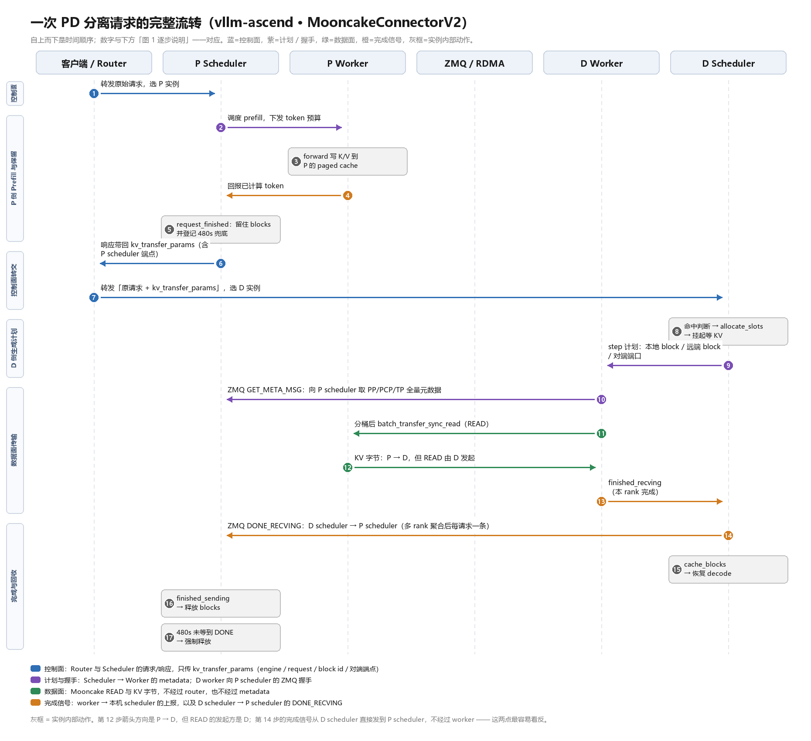
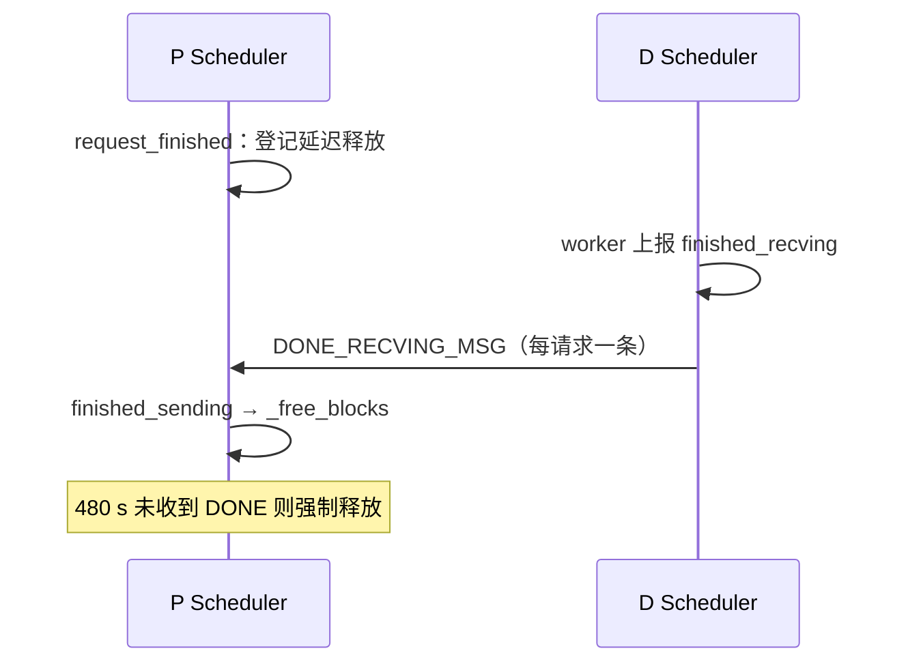

# vLLM-Ascend PD 分离交互机制详解（MooncakeConnectorV2）

> **这篇文档只回答一个问题**：一次 PD 分离的请求，从进入 P 实例到在 D 实例上吐出第一个 token，中间到底发生了什么。
>
> **写给谁**：刚接触推理，知道 KV cache 大概是什么，但被 `kv_p2p`、`kv_pool`、`MooncakeConnectorV2`、`AscendStoreConnector` 这一堆名字绕晕的人。
>
> **怎么读**：第 1、2 章是概念地基，请按顺序读，不要跳；第 3 章是主流程，配一张大图，是全篇的核心；第 4 章讲三个关键机制；第 5 章之后是查阅用的，不必通读。
>
> **代码依据**：`vllm-ascend` 仓库的 `vllm_ascend/distributed/kv_transfer/kv_p2p/mooncake/` 包（即 `MooncakeConnectorV2`），以及上游 `vllm` 的调度器代码。文中行号都可以直接翻代码核对。

## 1. 三个概念

读后面所有内容之前，只需要把这三件事想清楚：KV cache 是什么、PD 分离在拆什么、请求会经过哪些进程。

### 1.1 KV cache：每层、每个位置，一对 K/V

Transformer 有 L 层，每一层的 attention 都有自己的 K/V 投影。当 3000 个 token 一起过这 L 层时（这就是 prefill），每一层都会为**每一个位置**算出该位置专属的 K 和 V，并把它们留下来——留下的这些数字，就是 KV cache。

所以它既不是"一个请求一份"，也不是"一个 token 一份"，而是：

```
KV cache 的形状 = 层数 L × 序列长度 N × 2(K,V) × KV 头数 H × 头维 D × 字节数
```

一个具体的例子（32 层、8 个 KV 头、head_dim 128、bf16）：

| 量 | 数值 |
| --- | --- |
| 每 token 每层 | `2 × 8 × 128 × 2 B = 4 KB` |
| 每 token（全部 32 层） | 128 KB |
| 3000 token 的 prompt | 约 384 MB |
| 再生成 4096 token | 约 512 MB |

两个推论，后面会反复用到：

1. **它随生成线性增长**。每生成一个 token，每个层都多留一对 K/V。1000 个输出就是 128 MB（此例），这是 D 侧显存被逐步填满的原因。
2. **decode 每一步都要读全部历史**。算第 3001 个位置时，它的 attention 要覆盖位置 1..3001 的所有 K；少一个都不行，不是"差不多"，是结果直接错。这是 PD 分离必须整段搬 KV 的根本原因，也是长上下文推理慢的根本原因（读的数据量随上下文线性涨）。

> 一句话记住：**KV cache 是一张「层 × 位置」的表，每个格子里一对 K/V；它只增不减，而且每一步都要被完整读一遍。**

### 1.2 PD 分离：把两种性质的活拆开

一个请求在推理引擎里要干两件性质完全相反的事：

| | Prefill（处理 prompt） | Decode（逐 token 生成） |
| --- | --- | --- |
| 每次前向算什么 | 整段 prompt，几千 token 一起过 | 1 个 token |
| 瓶颈 | **算力**：大矩阵乘，NPU 打满 | **显存带宽**：权重和全部 KV 都要读一遍 |
| 时长特征 | 几十毫秒到几秒，随 prompt 长度剧烈波动 | 每 token 十几到几十毫秒，要求平稳 |
| 关键指标 | TTFT（首 token 延迟） | TPOT / ITL（token 间隔） |

放在同一个实例里混跑，问题就是互相拖累：一个长 prompt 进来做 prefill，同 batch 里正在 decode 的请求 token 间隔立刻抖动；两种 SLO 抢同一份资源，batch 怎么调都是在妥协；P 和 D 的机器比例也没法分开扩。

PD 分离的做法是：**P 实例只做 prefill，D 实例只做 decode**。P 算完不生成 token，而是把"这段 KV 放在我的哪几块显存里、来哪台机器取"写成一小段参数交给 Router；Router 把原请求连同这段参数转发给 D；D 把 KV 取过来，从第一个 token 开始 decode。

这里先纠正一个几乎人人都有的形态误解：**PD 分离的部署形态单位是「服务组（service group）」，并不以「一台 vllm-serve」为单位**。

- **P 组** = 一个或多个 Prefill 实例（`kv_role=kv_producer`）；
- **D 组** = 一个或多个 Decode 实例（`kv_role=kv_consumer`）；
- 前面再加一个 proxy（`load_balance_proxy_server_example.py`，即本文的 Router）：先 `select_prefiller`，再 `select_decoder`，做两次转发；P 与 D 之间通过 Mooncake 走 KV P2P 传输。

在最常见的"1P1D 单机"和"1P1D 单实例/单机"场景中，确实是"P 起一个 serve、D 起一个 serve"，所以"每组各一个大 serve"的直觉在这一类例子里成立。但把这一点推广出去就不对了：一个 `vllm-serve` 只是一个**实例**（占用一组卡，用 `tp/dp/pp` 描述，可以是单机的一部分，也可以带 `--headless` worker 跨机），P 组和 D 组各自要起几个实例、用什么样的并行度，是可以不对称的（文末列出的部署文档里就有"P 侧 4 个实例、D 侧 32 个实例"这种真实拓扑）。另外 P 和 D 必须是两组独立实例——`kv_role` 强制二选一（§3.2 第 1 步、§7），单机上也能按卡切成两个实例、两个端口。

三个必须知道的代价，否则会误判它"总是更优"：

1. **权重存两份**。P 和 D 各自加载完整模型。PD 省的不是显存，是让两种负载互不打扰。
2. **带宽是硬门槛**。8K prompt 在这个例子里约 1 GiB，TP8 下每 rank 也要传 128 MiB，必须走 RDMA 一类的高速网络；拿 TCP 跑，收益会被传输吃光。
3. **短请求不划算**。两跳 HTTP 加一次握手的固定开销，可能比本地算完还慢。它的甜点区是长 prompt + 高并发。

> 一句话记住：**PD 分离把"算力密集"和"带宽密集"拆到两台机器，代价是权重两份、KV 必须过网。**

### 1.3 一次请求会经过哪些进程

| 角色 | 是什么 | 负责什么 | 不负责什么 |
| --- | --- | --- | --- |
| 客户端 / Router | 外部代理 | 选 P、选 D，把 P 返回的 `kv_transfer_params` 原样塞进给 D 的请求 | 不知道 KV 在哪、传没传完 |
| P Scheduler | 一个**进程** | 调度 prefill、决定借不借 block、什么时候回收 | 不知道显存地址 |
| P Worker | 另一个**进程** | 算 forward、把自己 rank 的显存地址注册上报 | 全程不参与控制消息 |
| D Scheduler | 一个**进程** | 判断"多少 token 要从远端拿"、分配本地 block、挂起请求 | 不知道也不发起 RDMA 读写 |
| D Worker | 另一个**进程** | 握手、算地址、真正发 RDMA READ、上报完成 | 不决定读哪些块 |
| 传输引擎 | 库（Mooncake TransferEngine） | 按地址和长度搬字节 | 不知道请求、block、角色 |

请求在这几个角色之间走三条完全不同的通路，排障时必须分清是哪一条出了问题：

| 通路 | 端点 | 传什么 | 形式 |
| --- | --- | --- | --- |
| 控制面 | Router → P → Router → D | 请求体 + `kv_transfer_params`（块号、端点、token 数） | HTTP |
| 数据面 | D Worker → P Worker 显存 | KV 字节 | RDMA READ |
| 完成面 | D Scheduler → P Scheduler | "这块 KV 我用完了" | ZMQ |

> 一句话记住：**调度器管"放不放、等不等"，worker 管"算和搬"，两者是不同进程——所以"谁该跟谁说话"会成为后面最容易搞错的地方。**

## 2. kv_p2p 和 kv_pool：两条产品线

进入流程之前，必须先把这两个目录分清。它们是本仓库里名字最乱、最容易混的一块，本文后续所有"D 拉 KV"的内容都只属于其中一条。

### 2.1 一句话区别

| | `kv_p2p/` | `kv_pool/` |
| --- | --- | --- |
| 两端是谁 | **两个正在跑推理的实例** | **一个实例 + 一个存储层**（共享池 / 本机 CPU / 分层存储） |
| 干什么 | 把 KV 从 A 实例搬到 B 实例 | 把 KV 存进去，以后的请求再来取 |
| 生命周期 | 一次请求内，搬完就弃 | 跨请求、跨实例，可持久 |
| 服务什么场景 | PD 分离（prefill 的 KV 交给 decode） | 前缀复用、显存扩容（池化、卸载） |
| 典型失败 | 传输超时、对端崩了、块被提前回收 | 池子 lookup 未命中、后端连不上 |

判断口诀只有一句：**这份 KV 是给"某一次请求的下一步"用的，还是给"以后可能出现的相同前缀"用的？**

- 给这一次请求的下一步用 → `kv_p2p`；
- 给以后的请求复用 → `kv_pool`。

### 2.2 `kv_p2p/` 里提供了什么

`kv_p2p` 是 peer-to-peer 的缩写，同一个请求的 KV 在两个实例之间直接流动。目录里注册了六个连接器，配置形态几乎一样（`kv_role` + `kv_port` + 对端拓扑），差别在**传输方向**和**适用模型**：

| 注册名 | 方向 | 用途 | 代码位置 |
| --- | --- | --- | --- |
| `MooncakeConnectorV1` | D 拉 | 旧版 PD 连接器，仍在用 | `kv_p2p/mooncake_connector.py` |
| `MooncakeConnectorV2` | D 拉 | **本文主角**，元数据中心化握手、无 worker 连接 | `kv_p2p/mooncake/` |
| `MooncakeLayerwiseConnector` | **P 推** | 逐层传输，把传输和计算重叠起来 | `kv_p2p/mooncake_layerwise_connector.py` |
| `MooncakeHybridConnector` | D 拉 | 混合注意力模型（多个 cache group）的变体，配置同 V2 | `kv_p2p/mooncake_hybrid_connector.py` |
| `MooncakeD2RHConnectorV1` | D 拉，先落 host | 先把 KV 拉到 D 的 host 内存再进 HBM，用于 UBoE 场景 | `kv_p2p/mooncake_d2rh_connector.py` |
| `SfaRemoteD2HConnector` | D 拉 | SFA 模型专用，P 暴露 buffer、D 按 buffer 拉 | `kv_p2p/sfa_pd_rd2h/` |

方向这一列可以自己验证：V2 和 Hybrid 的 worker 里调用的是 `batch_transfer_sync_read`（`pull_worker.py:1430`），Layerwise 调用的是 `batch_transfer_sync_write`（`mooncake_layerwise_connector.py:557`）——**读是 D 发起的，写是 P 发起的**，这是 pull 和 push 两种模式的分界。

V2 还额外注册了一个同义名 `MooncakePullConnector`（`kv_transfer/__init__.py:97-101`），和 `MooncakeConnectorV2` 指向同一个类；看到两个名字不要以为是两代产品。

### 2.3 `kv_pool/` 里提供了什么

`kv_pool` 的关键词是"先存后用"。但要注意：**它里面的东西并不都是"共享池"**，按存储位置分三类：

| 注册名 | KV 存在哪 | 用途 | 代码位置 |
| --- | --- | --- | --- |
| `AscendStoreConnector`（旧名 `MooncakeConnectorStoreV1`） | 共享池：Mooncake Store / Memcache / Yuanrong | 跨实例前缀复用，降 TTFT；可选逐层传输 | `kv_pool/ascend_store/` |
| `UCMConnector` | 本机 DRAM 做快速缓存 + 共享存储（NFS/3FS）做持久层 | 大容量、可持久的前缀缓存 | `kv_pool/ucm_connector/` |
| `OffloadingConnector`、`SimpleCPUOffloadConnector` | **本机 CPU 内存** | NPU 显存不够时把不活跃的块卸载出去，命中后再拉回 | `kv_pool/kv_offload/native/`、`.../simple/` |
| `PreemptOffloadConnector` | **本机 CPU 内存** | D 侧请求被抢占时先存 KV，避免之后重算 | `kv_pool/kv_offload/preempt_offload/` |

两处容易踩的命名坑：

- **`MooncakeConnectorStoreV1` 是弃用别名**，和 `AscendStoreConnector` 是同一个模块、同一个类（`kv_transfer/__init__.py:109-119`）。用旧名启动会打警告：

  ```python
  if connector_name == "MooncakeConnectorStoreV1":
      logger.warning(
          "It is recommended to use the AscendStoreConnector, "
          "as the MoonCakeStoreConnector will be removed in the future.")
  ```

  （`kv_pool/ascend_store/ascend_store_connector.py:154-159`）

- **`kv_pool` 不等于"池化"**。`kv_offload` 系列只用本机 CPU，不过网络；`UCMConnector` 是"本地 DRAM + 共享存储"的分层。真正的"多实例共享一个池子"只有 `AscendStoreConnector` 这一类。

### 2.4 它们不是二选一，可以叠在一起

既然一个是"实例之间搬"，一个是"实例和存储之间存取"，方向正交，就可以同时挂。官方文档给的就是组合配置（`docs/source/user_guide/feature_guide/kv_cache_pool_ascend_store.md:299-329`）：

```json
{
  "kv_connector": "MultiConnector",
  "kv_role": "kv_producer",
  "kv_connector_extra_config": {
    "connectors": [
      {"kv_connector": "MooncakeConnectorV2",
       "kv_role": "kv_producer",
       "kv_port": "30000",
       "kv_connector_extra_config": {"prefill": {"dp_size": 2, "tp_size": 1},
                                     "decode":  {"dp_size": 16, "tp_size": 1}}},
      {"kv_connector": "AscendStoreConnector",
       "kv_role": "kv_producer",
       "kv_connector_extra_config": {"backend": "mooncake", "lookup_rpc_port": "30001"}}
    ]
  }
}
```

（原文示例用的是 `MooncakeConnectorV1`；每个子连接器都要各自写 `kv_role`。昇腾把上游的 `MultiConnector` 覆盖成了 `AscendMultiConnector`，见 `kv_transfer/__init__.py:74-79`。）

组合起来之后，两侧的分工是：

- **P**：先查池子——命中就少算一段 prefill；算完既 `put` 进池子，又把 blocks 留着给 D 拉；
- **D**：先查池子——可能直接命中别的实例写过的前缀，连 P 都不用找；没命中再走 V2 从 P 拉。

这就是为什么第 2 章要放在流程之前：**后面讲的"D 拉 KV"只是整条链路中的一环，池化是另一环，两者可以同时存在。**

### 2.5 为什么名字里全是 Mooncake

Mooncake 是一套开源的 KV 组件，它同时提供了两样东西：一个**传输引擎**（`mooncake.engine.TransferEngine`，做 RDMA 读写）和一个**存储后端**（Mooncake Store，做分布式缓存）。两条产品线各用了它的一半：

- `MooncakeConnectorV2` 用的是 `TransferEngine` → 点对点传输；
- `AscendStoreConnector` 默认 `backend="mooncake"`（`ascend_store_connector.py:133`）→ 用 Store 做池子，但还能换成 Memcache / Yuanrong。

所以**名字里带 Mooncake 不代表同一个家族**。判断归属只看一件事：两端是谁。这也是 `AscendStoreConnector` 为什么要改名——它的后端已经可换了，再叫 Mooncake 只会误导。

> 一句话记住：**`kv_p2p` 是"把这一份 KV 交给下一次计算"，`kv_pool` 是"把这份 KV 留给以后的请求"；一个服务 PD，一个服务前缀复用，可以叠加。**

## 3. 一次请求走完的 17 步

这一章是全文的主干。

先说清楚"为什么需要 17 步"。如果不考虑任何工程约束，PD 分离只需要三步：**P 算完、把 KV 复制给 D、D 继续生成**。多出来的十几步全部在回答两个问题：

1. 双方怎么知道"去哪台机器的哪块显存拿"？
2. P 什么时候才能确定"D 已经拿走了"，从而安全释放？

把这两个问题记住，每一步就不再是零散的知识点，而是这两个问题的某个答案。



*图：六条泳道、17 个步骤；图上的编号与下文的小标题一一对应，可以先扫一遍图，再按编号读文字。*

> 如果预览器没有把相对路径的图片渲染出来（例如在网页预览里打开），直接点开这个文件看：[./images/pd-interaction-timeline.png](./images/pd-interaction-timeline.png)。

### 3.1 这张图怎么读

横轴是从左到右的时间，图里自上而下是六条泳道：

1. **客户端 / Router**：外部代理，负责选 P、选 D、转交参数；
2. **P Scheduler**：生产端实例的调度进程；
3. **P Worker**：生产端实例的执行进程；
4. **ZMQ / RDMA**：跨实例的两条网络线。蓝色是 HTTP 控制面，紫色是计划与握手（元数据），绿色是 KV 字节，橙色是完成信号与上报；
5. **D Worker**：消费端实例的执行进程；
6. **D Scheduler**：消费端实例的调度进程。

图上有两个容易看错的地方，先说明：

1. 第 12 步的绿色箭头画的是 P → D，但**发起方是 D**。D 发起的是一次 READ，数据从 P 的显存读到 D 的显存，方向看起来是"从 P 来"，实际是"被 D 取走"。
2. 整个流程里，**P 的 worker 一条控制消息都不收**；能和 D 通信的只有 P 的调度器。原因在 4.1 展开。

第一次读图建议只盯七个转折点：**1（进 P）、6（出 P）、8（D 接单）、10（取地址）、12（搬数据）、14（还通知）、16（真释放）**。其余十步都是这七步的前置准备或善后。

下面把 17 步分成四个阶段讲。

### 3.2 阶段一（第 1-6 步）：P 算完了，但故意不撒手

**第 1 步 · Router → P Scheduler：转发普通请求，选定 P 实例。**
这一步还没有任何 PD 语义，就是一个普通 OpenAI 请求。P 实例启动时配置 `kv_role: kv_producer`，D 实例配置 `kv_consumer`，V2 在构造阶段就强制"一个实例只能有一个角色"，两边都配或都不配会直接报错（`base_scheduler.py:50-53`、`base_worker.py:117-120`）：

```python
if self.kv_transfer_config.is_kv_consumer == self.kv_transfer_config.is_kv_producer:
    raise ValueError(
        f"Mooncake scheduler requires exactly one KV transfer role, got {self.kv_transfer_config.kv_role!r}"
    )
```

**第 2 步 · P Scheduler → P Worker：调度 prefill，下发 token 预算。**
标准调度路径。有一个细节先记一笔：对带固定状态缓存的模型（Mamba、线性注意力这类），P 会在 `on_new_request` 里把最后一个 prompt token 摘掉再算（`base_scheduler.py:194-225`），并把自己的 `max_tokens` 设成 1。原因是这类模型除 KV 之外还有一份固定大小的状态页；把这最后一步留给 D，D 才能在生成 logits 的同时把状态页推进到正确位置。无状态模型不需要这么做。

**第 3 步 · P Worker 做 forward，把 K/V 写进分页 cache。**
到这一步为止，KV 已经实实在在躺在 P 的显存里了，但除了 P 自己，没人知道它在哪。

**第 4 步 · P Worker → P Scheduler：回报已计算的 token 数。**
调度器据此推进请求状态。对 P 来说，这个请求"计算"这件事到此结束。

**第 5 步 · P Scheduler：`request_finished` 里留住 blocks，不释放。**
这是整条流程的转折点。正常请求结束时调度器会回收显存，这里反过来——它把 blocks 登记进一张"延迟释放表"，然后继续干别的。只有"请求参数要求远端 decode"且状态是 `FINISHED_LENGTH_CAPPED` 时才走这条路径（`pull_scheduler.py:707-712`）：

```python
computed_block_ids = self._get_transfer_block_ids(block_ids, prompt_len)
num_computed_blocks = sum(len(group_block_ids) for group_block_ids in computed_block_ids)
delay_free_blocks = num_computed_blocks > 0
if delay_free_blocks:
    logger.info(
        "Delaying free of %d blocks for request %s",
        num_computed_blocks,
        request.request_id,
    )
    delay_start_time = time.time()
    self._reqs_need_send[request.request_id] = delay_start_time
```

（`pull_scheduler.py:716-726`，省略了 `_sending_thread` 的空值断言和 `add_delayed_request` 调用，那部分见 §4.2。）

**注意它是"登记"不是"等"**：登记完就返回，调度线程不会阻塞。真正需要等的时候是 480 秒以后（§4.2）。

**第 6 步 · P Scheduler → Router：响应里带回 `kv_transfer_params`。**
这一小段参数是整个机制的传送带（`pull_scheduler.py:734-744`），每个字段各司其职：

| 字段 | 作用 |
| --- | --- |
| `remote_block_ids` | D 要读 P 的哪几块（按 cache group 分组） |
| `remote_num_prompt_tokens` | prompt 总长度，D 据此算"要拉多少 token 的 KV" |
| `remote_engine_id` | P 实例的 engine 标识，D 用它做元数据缓存和去重 |
| `remote_request_id` | 请求在 P 侧的名字，回收时对账用 |
| `remote_host` / `remote_port` | **去哪台机器的哪个端口取地址表**——注意这是 P 的调度器端口，不是 worker 端口 |
| `last_token_id` | P 侧最后一个 token 的 id，纯透传（V2 自身不读它） |
| `do_remote_prefill` / `do_remote_decode` | 角色开关：告诉 D"这活该你干"，告诉 P 自己"这活不是你干" |

### 3.3 阶段二（第 7-9 步）：请求换手到 D

**第 7 步 · Router → D Scheduler：转发「原请求 + `kv_transfer_params`」。**
从这一步开始，同一个请求同时存在于两个实例里：P 那边认为"算完了，等回收"，D 这边认为"还没开始算，要先取数"。

**第 8 步 · D Scheduler：判断要拉多少 → 分配显存 → 挂起请求。**
框架调度器在给请求分配块之前，会调用连接器的这个钩子：

```python
def get_num_new_matched_tokens(self, request: "Request", num_computed_tokens: int) -> tuple[int, bool]:
    params = request.kv_transfer_params
    if params is not None and params.get("do_remote_prefill"):
        token_ids = request.prompt_token_ids or []
        actual = self._state_prefill_token_count(len(token_ids))
        params["num_computed_tokens"] = num_computed_tokens
        count = max(actual - num_computed_tokens, 0)
        if count > 0:
            return count, True
    return 0, False
```

返回 `(count, True)` 表示"这些 token 的 KV 会从远端来，别本地算"；框架随即把请求挂进 `RequestStatus.WAITING_FOR_REMOTE_KVS`（`scheduler.py:1582-1611`）。此时 D 已经占住了显存，但一个 token 都还没算。（`pull_scheduler.py:579-596`，省略了一行 `logger.debug`。）

一句话理解这个钩子：**它在回答"这个请求里有多少 token 我不用算"**。供给方可以是池子，也可以是对端节点——在纯 PD 拉取场景里只有 D 会返回非零，P 也调这个钩子，但因为 P 的请求参数里只有 `do_remote_decode`，会直接走到最后的 `return 0, False`。

**第 9 步 · D Scheduler → D Worker：把活派下去。**
`build_connector_meta` 把"本地 block id + 远端 block id + 对端端点"打包成 `MooncakeConnectorMetadata`（`pull_scheduler.py:651-671`），随本步执行一起交给 worker；worker 在 `start_load_kv` 里把它们按对端实例分组入队（`pull_worker.py:1603-1615`）：

```python
def start_load_kv(self, metadata: MooncakeConnectorMetadata) -> None:
    """Start the pull operations described by scheduler metadata."""
    if not metadata.requests:
        return
    if self.kv_transfer_config.is_kv_consumer:
        assert self._recving_thread is not None
        request_groups: dict[str, dict[str, ReqMeta]] = {}
        for request_id, request_metadata in metadata.requests.items():
            requests = request_groups.setdefault(request_metadata.remote_engine_id, {})
            requests[request_id] = request_metadata
        for remote_engine_id, requests in request_groups.items():
            self._recving_thread.add_requests(remote_engine_id, requests)
```

注意这只是"入队"，真正的传输在后台线程里进行，`start_load_kv` 立刻返回，不阻塞调度。

### 3.4 阶段三（第 10-13 步）：D 把 KV 拉过来

**第 10 步 · D Worker → P Scheduler：`GET_META_MSG`，取地址表。**
worker 用 `kv_transfer_params` 里的端点连 P 的**调度器**，发一条 `GET_META_MSG`（线上字节是 `b"get_meta_msg"`），一次取回**整机**的显存地址表——包括所有 PP / PCP / TP rank（`pull_worker.py:1513-1552`，P 侧的处理在 `pull_scheduler.py:365`）。拿到的表按 `remote_engine_id` 缓存，之后同一个 P 实例的请求都复用它。这是全程唯一一次"元数据全量交换"。

**第 11 步 · D Worker → P Worker：分桶后批量 READ。**
worker 把请求按 `(remote_pp_rank, remote_pcp_rank, remote_tp_rank)` 拆成若干桶，丢进 32 线程池并发处理（`pull_worker.py:121-125`、`:573-590`），每个桶算出地址列表后调用：

```python
ret = self.engine.batch_transfer_sync_read(session_id, src_list, dst_list, length_list)
if ret < 0:
    raise RuntimeError(f"Mooncake KV transfer failed ... ret={ret}")
```

（`pull_worker.py:1430-1435`）`session_id` 是 P 那个 rank 的 `local_ip:te_rpc_port`（`:1420`），也就是**直连 P 的 worker 显存**——注意这一步跳过了 P 的调度器，数据面完全不经过它。

**第 12 步 · P Worker → D Worker：KV 字节。**
箭头方向是从 P 到 D，但发起方是 D，语义是 READ。这是 pull 模式最容易看反的一处。

**第 13 步 · D Worker → D Scheduler：上报 `finished_recving`。**
每个请求的所有桶跑完（无论成功还是失败）都会进结果队列（`pull_worker.py:204-207`），worker 把它们汇总进 `KVConnectorTransferResults`，随本步输出回到调度器。

### 3.5 阶段四（第 14-17 步）：出 token 与回收

**第 14 步 · D Scheduler → P Scheduler：`DONE_RECVING_MSG`。**
worker 已经把多 rank 的完成汇总过一遍，所以调度器这一层对每个请求只发一条（`pull_scheduler.py:746-767`）：

```python
# D 侧：worker 的完成已经聚合过，这里发一条 scheduler-to-scheduler 的确认
for req_id in connector_output.finished_recving or ():
    remote = self._reqs_recv_info.pop(req_id, None)
    if remote is not None:
        if self._recving_thread is None:
            raise RuntimeError("Producer Mooncake scheduler received a receive-completion event")
        self._recving_thread.add_request(*remote)
```

`_reqs_recv_info` 里存的是 `(host, port, remote_request_id)`，`add_request` 把它交给 D 侧的发送线程，由后者连 P 的调度器把 DONE 发出去。

**第 15 步 · D Scheduler：`cache_blocks` → 恢复 decode。**
框架收到完成信号后把请求从 `WAITING_FOR_REMOTE_KVS` 里拉出来（`scheduler.py:3654-3704`），然后**把 `num_computed_tokens` 回退一位**——没有滑窗重放需求时就是 `num_tokens - 1`（`:3702-3703`），也就是说 D 要自己重算最后一个 prompt token。

为什么要重算这一个？因为 P 只传 KV，**不传 logits**。要采样出第一个输出 token，必须有最后一个位置的 logits，而 logits 是 forward 的产物、不在 KV 里。所以 D 从倒数第二个位置开始"假装还没算最后一个 token"，把最后一个 token 再算一遍，顺手拿到 logits——这一步在调度器看来是一次 `num_new_tokens = 0` 的 prefill 形状的 step。带状态模型的情况略有不同：P 本来就没算最后一个（第 2 步），D 只是把它补上。

**第 16 步 · P Scheduler：`finished_sending` → 真正释放。**
P 侧同一个 hook 的另一半：把发送线程收集到的完成集合塞进本步的 `KVConnectorOutput`（`pull_scheduler.py:769-781`），框架随即对每个 id 调 `_free_blocks`（`scheduler.py:3768-3771`），blocks 回到空闲池。

**第 17 步 · P Scheduler：480 秒兜底。**
如果那条 DONE 永远不来（D 崩了、网络断了、端口配错），P 在 `VLLM_MOONCAKE_ABORT_REQUEST_TIMEOUT`（默认 480 秒）后强制释放并打 error 日志（`pull_scheduler.py:392-405`，环境变量定义在 `vllm/envs.py:1984-1986`）：

```python
if current_time - delay_start_time <= envs.VLLM_MOONCAKE_ABORT_REQUEST_TIMEOUT:
    break
self._mark_finished_locked(request_id)
logger.error(
    "Force freed expired Mooncake request %s after %s seconds",
    request_id,
    envs.VLLM_MOONCAKE_ABORT_REQUEST_TIMEOUT,
)
```

### 3.6 把 17 步压成 5 句

1. P 算完 prefill，**不释放** blocks，把块号和端点写进响应参数；
2. Router 把请求和参数转给 D；
3. D 判断"有多少 token 不用自己算"，占好显存后挂起；
4. D 的 worker 找 P 的**调度器**要地址表，然后直接 READ P 的显存，搬完上报；
5. D 的调度器通知 P 的调度器，P 才释放；通知不来就 480 秒后强放。

**如果你只记一件事**：整条流程的实质是一次**显存所有权的交接**——P 把"这块显存借给谁"的责任交给了 D，D 用一条消息来还。所有状态、超时、日志，都是围绕这次交接展开的。

## 4. 三个必须理解的机制

第 3 章讲"发生了什么"，这一章讲"为什么必须这么设计"。三个机制分别对应三条通路。

### 4.1 控制面：为什么是 D 的 worker 连 P 的调度器

三个角色的分工是刻意的：

- 显存地址只有持有显存的进程知道，所以地址表必须由 **worker 上报**；
- 一张地址表要能被别的机器按 rank 取到，所以必须有个**中心节点**保存它；
- 这个中心节点就是各实例的**调度器**——它本来就有一个常驻的 ZMQ 服务端口。

于是 V2 的做法是：每个 worker 启动时把自己的显存布局（`MooncakeTransferMetadata`：每层的基地址、块步长、每块字节数）上报给本机调度器，调度器按 `pp → pcp → tp` 三层索引存成"整机网格"；D 的 worker 来取的时候，一条 `GET_META_MSG` 拿走全机所有 rank 的地址（`pull_worker.py:1523-1532`，REQ/REP 一问一答），并按 `remote_engine_id` 缓存。

这里有一个必须点明的坑：每个 worker 也会算一个 `handshake_port = side_channel_port + device_index` 并发布到元数据里（`base_worker.py:145-153`、`:413`），**这个端口在 V2 的数据面上没有被使用**。D 用来连 P 的端口来自 `kv_transfer_params["remote_port"]`，它是调度器的 `side_channel_port`，公式是：

```
side_channel_port = kv_port + tp × dp × pcp × pp + dp_index
```

（`base_scheduler.py:70-85`）。拿 `handshake_port` 去连，会连到别的 rank 的 socket 上，现象是超时或握手失败——这是排障时最常见的"配置看着对、就是连不上"。

### 4.2 显存所有权：延迟释放、DONE 与 480 秒

P 的 blocks 在 `request_finished` 之后仍然被占着，这件事必须有一个明确的结束条件，否则 P 迟早会被"借出去没还"的块撑爆。V2 的结束条件只有两个：**收到 DONE**，或者**超时**。



几个必须记住的细节：

- **DONE 是调度器对调度器**，不经过任何 worker，也不经过传输引擎。所以"P 侧日志里看不到完成"时，要去 D 的**调度器**日志找，而不是 D 的 worker 日志。
- **DONE 只表示"D 收到了"，不表示"D 校验通过"**。传输失败的请求同样会走这条通知，只是多打一条 error（`pull_scheduler.py:758-767`），避免 P 一直被占着。
- **480 秒不是传输超时**。它是"没人来认领就强制回收"的兜底；真正的传输超时是另一个量 `ASCEND_TRANSFER_TIMEOUT`（默认 33064 ms）。把两个混看会得出相反的结论。
- **D 侧的挂起请求没有超时**。`WAITING_FOR_REMOTE_KVS` 靠完成信号解除，理论上可以永久挂着——这是"请求卡住不动"的第二类原因（第一类是 P 的块不释放）。

还有一条与显存直接相关的边界：D 上"已占块、等 KV"的请求默认**没有数量上限**（`max_num_inflight_kv_loads` 默认 `None`）。它的作用是限制同时在途的加载数；不设限时，一批请求可以先把 D 的块占满再一起等 KV，表现为"显存涨、算力闲"。设了这个值之后，超出部分的请求会留在等待队列，等前面的加载完成再进来（准入条件与稳态上限的区别见 §6 的排障表）。

### 4.3 数据面：block id 是怎么变成 RDMA 地址的

D 从 P 那里拿到的是两组 block id，要变成 `(src 地址, dst 地址, 长度)`，中间隔着三层信息：

| 层 | 谁产生 | 内容 |
| --- | --- | --- |
| 块号 | P 的调度器 | 这个请求占了 P 的哪几块（按 cache group 分组） |
| 地址表 | P 的 worker 上报、P 的调度器保存 | 每层、每个 component 的显存基地址 + 块步长 + 每块字节数 |
| 地址 | D 的 worker 现算 | `基地址 + 块号 × 步长`，再按本机布局拼出目标地址 |

所以 worker 的工作不是"决定读什么"，而是**机械展开**：把 `(local_block_ids, remote_block_ids)` 配对，然后做地址算术。决定"哪些块属于这个请求"是调度器的职责，而且规则和 cache spec 强相关（`base_scheduler.py:149-186`）：

- **普通 attention 组**：只保留前 `cdiv(prompt_len, block_size × cp_size)` 个逻辑块，`cp_size` 对纯滑窗组取 1、其余取 `dcp_size`。原因是 DCP 把上下文切到多张卡上，每张卡只存 `1/dcp_size` 的 token，所以同样长度的 prompt 在本 rank 上只占 1/dcp_size 那么多块；SWA 组仍按 TP 切分、逻辑块大小不变，所以取 1（`base_scheduler.py:179-185` 的注释说得很直白）。
- **滑窗（SWA）组**：传的是整个物理块，窗口语义由 D 侧的重放机制处理，不由块号表达。
- **环形（circular）组**：原样保留那个 ring 块，它是"请求生命周期的状态页"，不是 prompt 序列。
- **Mamba 组**：砍掉末尾的投机块，因为状态页的粒度是"整个 verify window"。

真正麻烦的地方在于**两侧的 cache 布局可能不一致**：P 用 TP8、D 用 TP4，或者 DCP 不同的情况下，同一个逻辑块在两侧的物理形状不同。V2 的处理方式是 spec-aware 的块配对（`pull_worker.py:726-822`），几条主要规则：

- 环形块只有一个物理 ring，两侧按环配一次；
- 复制的 SFA indexer 保持 effective-DCP1，按轮转选 producer 的 TP rank；
- 滑窗组要按窗口起点对齐；
- DCP 的逻辑起点是 `num_computed_tokens // (block_size × dcp_size)`；
- 只有当两侧逻辑块大小真的不同时，才退化成 token 级裁剪。

最后一类容易漏的：有些 spec 必须整块传，不能按 token 裁——判断条件在 `pull_worker.py:1198-1201`：

```python
transfer_whole_block = (
    is_circular_kv_cache_spec(spec)
    or isinstance(spec, (MLAAttentionSpec, SlidingWindowMLASpec, AscendSFAIndexerCacheSpec))
)
```

> 一句话记住：**调度器决定"读哪几块"，worker 只负责"把块号算成地址"；两侧布局不一致时，配对规则按 cache spec 分支，不能按 token 数硬算。**

## 5. 和上游 NIXL 差在哪

上游 vLLM 的 NIXL 连接器也做 PD 拉取，调度器可见的流程骨架几乎一样：延迟释放、`get_num_new_matched_tokens`、`WAITING_FOR_REMOTE_KVS`、`finished_sending` 都是同一套框架钩子。差别集中在"谁来连谁、谁通知谁"：

| 维度 | MooncakeConnectorV2 | NIXL |
| --- | --- | --- |
| 元数据从哪拿 | D worker 连 **P 的调度器**，一次取整机地址表（`pull_worker.py:1513-1552`） | P 的调度器跑一个 ROUTER，按 `(pp_rank, tp_rank)` **分别**给 payload，D 的各 rank 各自取（`nixl/base_scheduler.py:296-383`） |
| 常驻端口 | `kv_port + tp×dp×pcp×pp + dp_index`（`base_scheduler.py:70-85`） | `VLLM_NIXL_SIDE_CHANNEL_PORT + dp_index`（`nixl/base_scheduler.py:77-80`） |
| 完成信号 | D **调度器** → P **调度器** 的 ZMQ | 传输层 notif → P 的 **worker** → 上报调度器 |
| 回收兜底 | 固定 480 秒（`VLLM_MOONCAKE_ABORT_REQUEST_TIMEOUT`） | 30 秒租约 + 每 `lease/6` 续约 |
| 角色模型 | 严格二选一，`kv_both` 直接报错 | 仍允许 `kv_both`（已标弃用，`nixl/connector.py:103-105`） |
| 布局适配 | spec-aware 块配对，允许两侧 TP/DCP 不同（`pull_worker.py:726-822`） | rank 级映射（`nixl/base_worker.py:849-860`），但要求两侧 layout 一致（`:2835-2901`） |
| 数据面驱动 | 32 线程池同步 READ，不轮询传输状态 | 传输句柄 + notif 完成通知（`nixl/*_worker.py` 的 notif 路径） |

**结论**：调度器看到的状态机是完全一样的（所以两边的日志能对照着读），但控制面拓扑、完成信号路径、回收语义完全不同。排障时最忌讳"按 NIXL 的经验去 Mooncake 的日志里找完成"——V2 的完成只在两边的**调度器**日志里。

## 6. 排障速查

| 现象 | 先看哪里 | 常见原因 |
| --- | --- | --- |
| D 的请求一直停在 `WAITING_FOR_REMOTE_KVS` | D 调度器有没有发 DONE；P 有没有收到 `GET_META_MSG` | 端点配错、网络不通、Router 转发了过期的 `kv_transfer_params`（P 重启后地址已变） |
| P 日志有 `Delaying free of N blocks` 但迟迟不释放 | 480 秒后是否出现 `Force freed expired Mooncake request` | DONE 丢了（D 崩了或调度器重启） |
| 出现 `Force freed expired Mooncake request` | D 侧完成日志、`remote_request_id` 对账 | D 没发完成；或 `remote_request_id` 对不上（P 会打 `ignoring completion`） |
| 握手超时 / 连不上 | `kv_transfer_params` 里的 `remote_port` 是否等于 `side_channel_port` | 误用了 worker 的 `handshake_port` |
| 传输慢，但没报错 | worker 日志 `KV cache transfer for requests ... took X ms` | 带宽不足、桶太多、线程池打满、块太碎 |
| 显存涨、算力闲 | D 上 parked 请求数量 | `max_num_inflight_kv_loads` 未设，一批请求先占块后等 KV |
| 请求卡住不动（D 侧） | `WAITING_FOR_REMOTE_KVS` 是否永远不解除 | D 侧挂起**没有超时**，只能靠完成信号或杀掉重来 |
| 首 token 结果不对（不是慢） | 两侧 TP/DCP/`max_model_len` 是否一致 | 块配对按 token 硬算、或缓存内容来自另一个布局 |

## 7. 六个容易混的概念

| 误解 | 事实 | 依据 |
| --- | --- | --- |
| "D 只做 decode，所以不调用 `get_num_new_matched_tokens`" | 钩子是通用的，它回答"这个请求有多少 token 不用算"，任何要 prefill 的实例都会调；纯 PD 下 P 也调，只是返回 `(0, False)` | `pull_scheduler.py:579-596`、`kv_pool/.../pool_scheduler.py:231-256` |
| "PD 分离就是 KV 池化" | 前者是实例间搬（请求内），后者是实例与存储间存取（跨请求），可以叠加 | 第 2 章 |
| "D 只需要拉最后一个 token 的 KV" | decode 的每一步都要和**全部历史** K/V 做 attention，少一段就是错的 | §1.1 |
| "两个实例之间可以用 `kv_both`" | V2 强制二选一，两边都配直接报错；只有池化类连接器才支持能存能取 | `base_scheduler.py:50-53`、`ascend_store_connector.py:140-142` |
| "KV event 就是传输完成信号" | `KVCacheEvent`（`BlockStored` / `BlockRemoved`）描述的是**前缀缓存**的变化，给外部消费方（如网关）了解哪些块被复用；完成信号是 `finished_recving` / DONE | `vllm/v1/core/block_pool.py:385-390` |
| "`max_model_len` 是输出上限" | 它是**总上下文**上限（prompt + 输出）；输出上限是 `max_tokens`，两者取小 | `vllm/config/model.py:256-262`、`vllm/entrypoints/openai/api_utils.py:248-266` |

## 8. 代码索引

路径以 `vllm_ascend/distributed/kv_transfer/` 为根。

| 文件 | 内容 |
| --- | --- |
| `kv_p2p/mooncake/connector.py` | 连接器入口；`MooncakeConnector` 是 `MooncakePullConnector` 的别名（`:270-271`），push 版未实现（`:258-267`） |
| `kv_p2p/mooncake/base_scheduler.py` | 端口公式（`:70-85`）、块裁剪规则（`:149-186`）、角色校验 |
| `kv_p2p/mooncake/pull_scheduler.py` | 命中判断（`:579-596`）、延迟释放（`:707-744`）、DONE 与强制释放（`:392-405`、`:746-781`） |
| `kv_p2p/mooncake/pull_worker.py` | 地址注册、块配对（`:726-822`）、READ（`:1430-1435`）、完成上报 |
| `kv_p2p/mooncake/base_worker.py` | 地址表结构、`handshake_port`（`:145-153`）、`get_finished` 兼容包装（`:435-438`） |
| `kv_p2p/mooncake/metadata.py` | 元数据结构与 msgpack 编码 |
| `kv_transfer/__init__.py` | 全部注册名与 `MultiConnector` 覆盖（`:74-119`） |
| `kv_pool/ascend_store/ascend_store_connector.py` | 池化连接器与旧名告警（`:154-159`） |
| `kv_pool/ascend_store/pool_scheduler.py` | 池化侧的 `get_num_new_matched_tokens`（`:231-256`） |
| `kv_pool/kv_offload/` | 本机 CPU 卸载系列（native / simple / preempt_offload） |
| `vllm/v1/core/sched/scheduler.py` | 框架侧钩子调用点（`:1170-1284`）、挂起与恢复（`:1582-1611`、`:3654-3704`）、`_free_blocks`（`:3768-3771`） |

## 附录 A：术语表

| 术语 | 含义 |
| --- | --- |
| P / D | Prefill 实例 / Decode 实例，一个请求在两者之间交接 |
| 生产者 / 消费者 | `kv_role: kv_producer` / `kv_consumer`，V2 里二选一 |
| block（块） | 分页 KV cache 的分配单位，通常 16 或 128 token 一页 |
| `kv_transfer_params` | P 写在响应里、Router 转给 D 的那段参数（块号、端点、token 数） |
| `WAITING_FOR_REMOTE_KVS` | D 上"已占块、等 KV"的请求状态，无超时 |
| 延迟释放 | P 在 `request_finished` 时不回收 blocks，等 DONE 或 480 秒 |
| DONE | D 调度器发给 P 调度器的完成通知（`DONE_RECVING_MSG`） |
| 侧信道（side channel） | P 调度器上保存整机地址表、供 D 取元数据的 ZMQ 端口 |
| 池化（pooling） | 把 KV 存进共享存储供跨请求复用，属 `kv_pool` |
| 卸载（offload） | 把 KV 挪到本机 CPU 内存，不通网络，属 `kv_pool` |
| `MultiConnector` | 把多个连接器并联的框架机制，昇腾版本为 `AscendMultiConnector` |
| spec-aware 块配对 | 按 cache spec 语义对齐两侧物理块，而不是按 token 数硬算 |

## 附录 B：六条自检命令

在仓库根目录执行，每条都能验证正文里的一个结论。

```bash
# 1. 角色二选一的强制检查
rg -n "requires exactly one KV transfer role" vllm_ascend/distributed/kv_transfer/kv_p2p/mooncake/

# 2. 注册名与 MultiConnector 覆盖
sed -n '74,125p' vllm_ascend/distributed/kv_transfer/__init__.py

# 3. 延迟释放的逻辑
rg -n "delay_free_blocks|_reqs_need_send" vllm_ascend/distributed/kv_transfer/kv_p2p/mooncake/pull_scheduler.py

# 4. 480 秒的默认值（定义在上游 vllm 的 envs.py）
rg -n "VLLM_MOONCAKE_ABORT_REQUEST_TIMEOUT" vllm_ascend/distributed/kv_transfer/ \
  "$(python -c 'import vllm,os;print(os.path.dirname(vllm.__file__))')/envs.py"

# 5. 读写方向：pull 调 read、push 调 write
rg -n "batch_transfer_sync_read|batch_transfer_sync_write" vllm_ascend/distributed/kv_transfer/kv_p2p/

# 6. 池化连接器是同一个类的两个名字
rg -n "MooncakeConnectorStoreV1|AscendStoreConnector" vllm_ascend/distributed/kv_transfer/__init__.py
```

---

读完之后如果要动手部署，配置项和端口规划看 `docs/source/tutorials/features/pd_disaggregation_mooncake_multi_node.md`（`kv_port` 建议 ≥ 28000，8 NPU/节点时），池化与 PD 组合看 `docs/source/user_guide/feature_guide/kv_cache_pool_ascend_store.md`。
