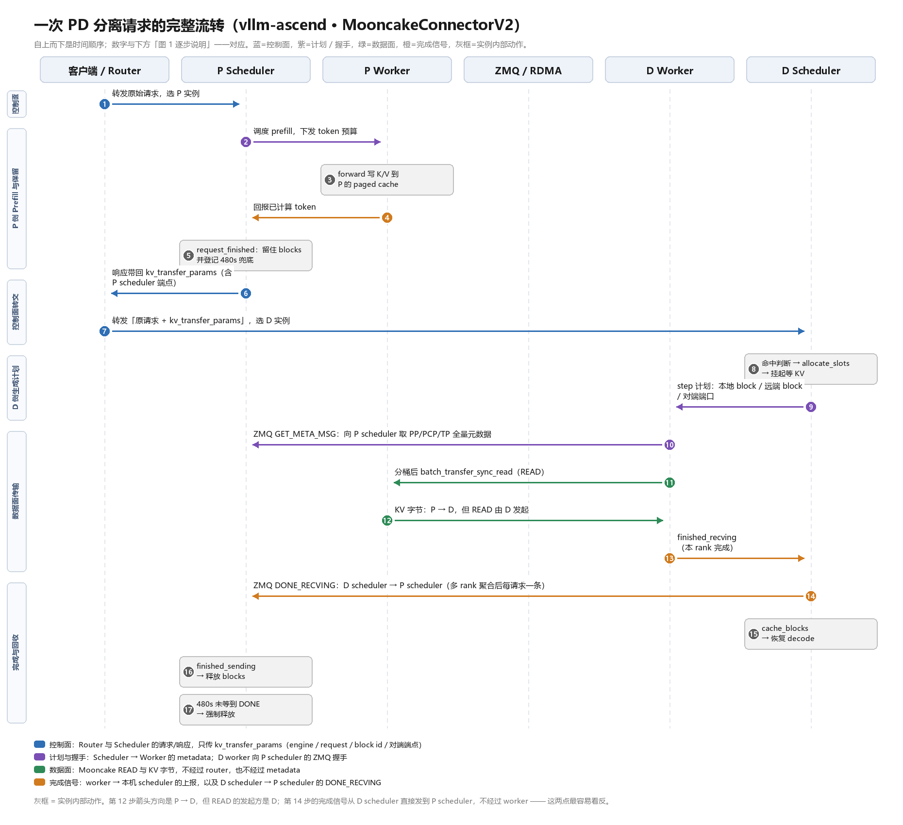
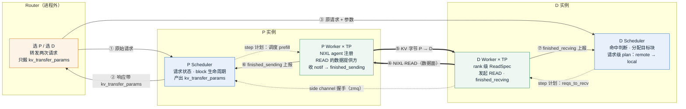
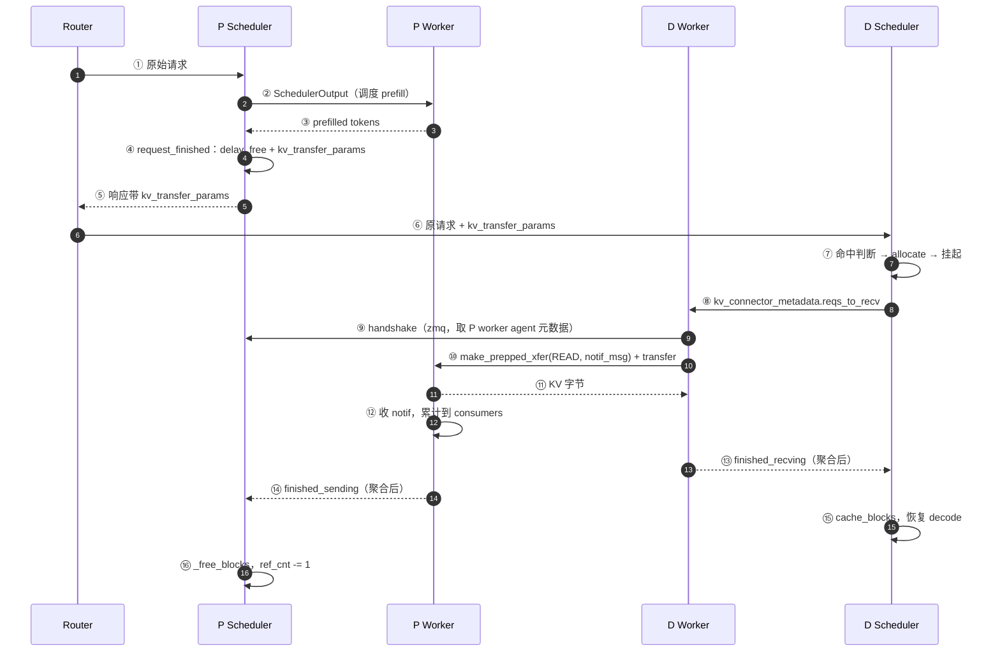
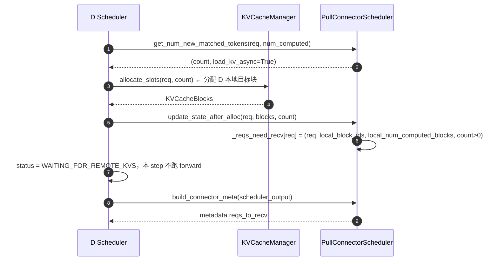
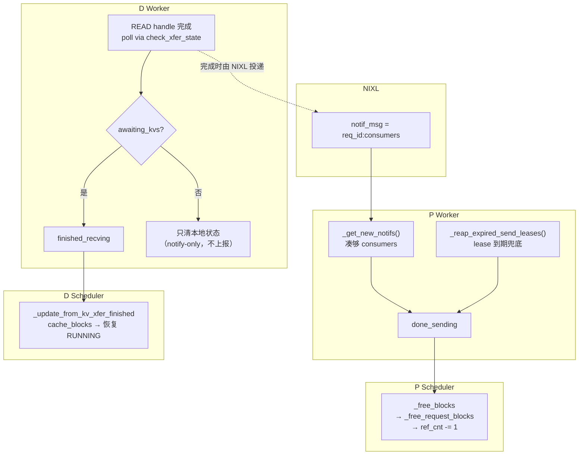
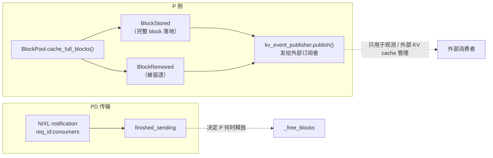

# vLLM PD 分离交互机制详解

> 原文：知乎《vLLM中PD 分离交互机制》（[p/2075600984995320768](https://zhuanlan.zhihu.com/p/2075600984995320768)）
> 代码基准：本机 vLLM main 工作副本 `a7809d0cc5`（2026-11-06）。该版本把 NIXL connector 拆成了 `connector.py` / `pull_scheduler.py` / `pull_worker.py` / `push_scheduler.py` / `push_worker.py` / `base_scheduler.py` / `base_worker.py` / `metadata.py` / `stats.py` / `tp_mapping.py`，原文用的 `scheduler.py` / `worker.py` 只是向后兼容的薄壳。
> 文中所有 `文件:行号` 都在上述基准上实际核对过；原文与代码不一致的地方集中列在第 13 节。
> 图 1 是自绘的六泳道时序图，图 2–6 是 mermaid。本文只讲 pull 模式（`NixlPullConnector`），push 模式与双向模式放在 12 节和 13 节里对照。

---

## 0. 导读

### 0.1 这个题目真正的难点在哪

PD 分离（Prefill/Decode disaggregation）单看谁都能讲：P 算 prompt，D 算 decode，KV 从 P 搬到 D。真正难讲清楚的是三件事同时发生：

1. **请求的所有权跨了两个进程**。请求在 P 上"结束"了，但它占着的 KV blocks 还要服务 D，于是 P 的 Scheduler 必须在请求结束之后继续替一个已经不再调度的请求保管 blocks。
2. **数据搬运不在 Scheduler 手里**。发 READ、算 descriptor、轮询完成，全在 worker（而且是每个 TP rank 各一份）。
3. **"什么时候可以释放"这个信号，是随数据一起走的**。P 等的是 NIXL READ 完成时顺带投递的一条 notification，不是一条 Scheduler 之间的 RPC，也不是 `BlockStored` / `BlockRemoved` 事件。

把这三件事拆开看，整套交互就是自洽的；混在一起看，就会得出"P 结束就该释放 blocks"这种错误结论——而这恰好是线上 hang 住和 blocks 泄漏的主要成因。

### 0.2 三句话版本

1. **Router 只搬参数，不搬 KV**：它把原始请求发给 P，从 P 的响应里取出 `kv_transfer_params`，再把"原请求 + 参数"转发给 D。它传递的是 engine ID、request ID、block ID、side-channel 地址这些控制信息。
2. **P 侧把释放条件"外包"出去了**：`request_finished` 不释放 blocks，而是返回 `delay_free_blocks=True` 和一份 `kv_transfer_params`；blocks 的真正释放要等 D 发起的 NIXL READ 完成，notification 回到 P worker，聚合成 `finished_sending` 之后才发生。
3. **D 侧把"逻辑计划"和"物理计划"分两步做**：Scheduler 只产出 `remote_block_ids → local_block_ids` 的请求级映射并让请求停在 `WAITING_FOR_REMOTE_KVS`；worker 再按 TP/DCP 拓扑展开成 rank 级 `ReadSpec` 和 descriptor，提交 READ，完成后回报 `finished_recving`。

### 0.3 按需阅读

| 你想搞清楚的事 | 看哪节 |
| --- | --- |
| 谁发起读？数据往哪流？谁通知谁？ | 1.3、6.4、8.4 |
| 想给 NIXL / Mooncake 之类的 connector 加一种传输 | 5、6、7 |
| 请求卡在 `WAITING_FOR_REMOTE_KVS` 不动，或 P 侧 blocks 不释放 | 7.3、7.4、8 |
| 想知道为什么 D 命中之后还要重算 | 5.4 |
| 关心 Ascend 上对应哪套实现 | 12 |
| 想核对原文哪些说法不严谨 | 13 |

---

## 1. 一张图看懂一次 PD 请求



### 1.1 六条泳道怎么读

图里横向是六个参与者，纵向是时间（自上而下），箭头上的编号与 1.2 的逐条说明一一对应。

- **客户端 / Router** 合并成一条泳道，因为对外它们是一个"转发者"角色：真正重要的是它**两次**转发都由它发起，且它只碰参数不碰 KV。
- **NIXL / 网络** 单独一条泳道，是为了把"KV 字节怎么走"和"谁在控制"分开。这条泳道只在数据面出现：READ 的完成通知从这里回到 P。
- **P Scheduler 与 P Worker、D Scheduler 与 D Worker** 各自成对出现，因为 P/D 内部都是"Scheduler 决定、Worker 执行"的同构结构。
- 颜色区分四条链路：**蓝 = 控制面**（Router ↔ Scheduler）、**紫 = step 计划与握手**（Scheduler → Worker，以及 D worker ↔ P 的 side channel）、**绿 = 数据面**（READ 与 KV 字节）、**橙 = 完成通知**（worker → scheduler 上报，或 NIXL notif 回 P）。
- **灰框是实例内部动作**，没有跨进程通信，最容易在"时序图"里被画成一条假箭头。

图下方还有一条容易看错的注释，我在这里重复一遍：**第 12 步的箭头方向是 P → D，但 READ 的发起方是 D**。pull 模式的定义就是这个"发起方与数据方向相反"。

### 1.2 逐步说明

**第 1 步 · Router 把原始请求发给 P**
Router 按负载/拓扑选一个 P 实例，把请求原样发过去。此时请求体里**没有** `kv_transfer_params`，因为还不知道 P 会分配哪些 blocks。

**第 2 步 · P Scheduler 调度 prefill**
这一步和普通 prefill 没区别：Scheduler 从 waiting 队列取请求，`KVCacheManager.allocate_slots()` 分配 P 本地 blocks，把本 step 要算的 token 数随 `SchedulerOutput` 下发。connector 在 P 侧的角色此刻只是"记账"：`update_state_after_alloc` 把 `do_remote_decode` 的请求记进 `_reqs_in_batch`（`pull_scheduler.py:122-125`，随后作为 `metadata.reqs_in_batch` 下发），开了 host buffer 时再单独进 `_reqs_need_save`（`:126-129`）。

**第 3 步 · P Worker 前向，K/V 写进 paged KV cache**
worker 执行 forward，K/V 落到 P 的 paged KV cache。同时 NIXL 已经在**启动时**注册过这块显存：`register_kv_caches()` 把整块 KV cache 按 layer/region 描述给 NIXL agent，所以后面 D 才能按 block ID 直接算出远端地址。**注册是一次性的，不在请求路径上**——这点常被忽略。

**第 4 步 · P Worker 回报已计算的 token**
worker 通过 `ModelRunnerOutput` 把本 step 计算的 token 数回报给 Scheduler，Scheduler 更新 `request.num_computed_tokens`。如果开了 KV events，`BlockPool.cache_full_blocks()`（`block_pool.py:203`）会在完整 block 落盘时生成 `BlockStored`。注意：**`BlockStored` 是可选的旁路信息，PD 握手不依赖它**。

**第 5 步 · P Scheduler 的 `request_finished`：不释放，只交出条件**
请求在 P 上跑完（`FINISHED_LENGTH_CAPPED` 或 `FINISHED_STOPPED`）时，Scheduler 调 connector 的 `request_finished`（`pull_scheduler.py:191`）。connector 做三件事：

```python
# pull_scheduler.py:246-293（节选）
delay_free_blocks = any(len(group) > 0 for group in block_ids)
if delay_free_blocks:
    request_kv_blocks_ttl = self._kv_lease_duration      # 默认 30s
    self._reqs_need_send[request.request_id] = (
        time.perf_counter() + request_kv_blocks_ttl
    )
    block_ids = self.get_exchange_clipped_blocks(block_ids)   # 裁掉 SWA/空块
    remote_num_tokens = request.num_computed_tokens
return delay_free_blocks, dict(
    do_remote_prefill=is_p_node,          # 告诉 D：从我这拉
    do_remote_decode=is_d_node,
    remote_block_ids=block_ids,
    remote_request_id=request.request_id,
    remote_host=self.side_channel_host,   # 注意：是 P 的 side channel，不是 worker 地址
    remote_port=self.side_channel_port,
    tp_size=self.transfer_tp_size,
    dcp_size=..., pp_size=...,
    remote_num_tokens=remote_num_tokens,
    remote_registration_generation=self._registration_generation,
)
```

这里的关键不是字段有多少，而是返回值的第一项：`delay_free_blocks=True` 会让 Scheduler **保留请求对象、保留 block 引用**，把"何时释放"的判定权交给 connector 的 worker 侧。P 侧同时登记了一个 lease（`_reqs_need_send`，到期时间 = now + `kv_lease_duration`），这是兜底，不是主路径。

**第 6 步 · P Scheduler 的响应带回 `kv_transfer_params`**
`request_finished` 返回的那份 dict 先变成 `EngineCoreOutput.kv_transfer_params`，`OutputProcessor` 在组装响应时把它取出来（`vllm/v1/engine/output_processor.py:786` 的 `kv_transfer_params = engine_core_output.kv_transfer_params`），最后是 API server 放进响应体。**它是"下一次请求的输入参数"，不是元数据旁路**——D 侧就是靠它判断"我这次 decode 的 KV 在别人那里"。

**第 7 步 · Router 把原请求 + 参数转发给 D**
Router 选一个 D 实例，把**原始请求体**（同一个 prompt）加上 P 返回的 `kv_transfer_params` 一起发过去。这一步是 PD 分离里唯一"请求被发两次"的地方，也是 router 存在的全部理由：它知道全局有哪几个 P、哪几个 D，而 P 和 D 互相不知道。

**第 8 步 · D Scheduler：命中判断 → 分配目标块 → 挂起**
D 侧 Scheduler 拿到请求后，按固定顺序走四步（详见第 5 节）：

```
get_num_new_matched_tokens → allocate_slots → update_state_after_alloc → build_connector_meta
```

`get_num_new_matched_tokens`（`pull_scheduler.py:34`）看到 `do_remote_prefill=True`，算出"还需要从 P 拉多少 token"，返回 `(count, True)`；第二个 `True` 就是"异步加载"标志，Scheduler 因此知道这一轮**只安排 KV load，不跑 forward**，把请求置为 `WAITING_FOR_REMOTE_KVS`（`scheduler.py:1591`）。

**第 9 步 · D Scheduler 下发的 step 计划**
`build_connector_meta`（`base_scheduler.py:485`）把本 step 所有待接收请求打包成 `NixlConnectorMetadata.reqs_to_recv`（每个请求一份 `ReqMeta`），随 `SchedulerOutput.kv_connector_metadata` 交给 worker。**这是 Scheduler 唯一一次"告诉 worker 去搬数据"**，此后这个请求的传输就完全由 worker 自己推进，跨多少个 step 都行。

**第 10 步 · D Worker 与 P 建 handshake**
D worker 发现自己没有 P 的 NIXL agent 信息，就在后台发起 handshake（`_background_nixl_handshake`，`base_worker.py:1518`）。**注意对象**：它连的是 `remote_host:remote_port`，也就是 P 的 **Scheduler 进程**里跑的 side-channel listener（`_nixl_handshake_listener`，`base_scheduler.py:343`），换回来的是 P worker 的 `NixlAgentMetadata`（agent 元数据、各 layer 的 base 地址、block 数、layout、TP/DCP 拓扑、compatibility hash）。P worker 的 agent 信息是更早通过 `set_xfer_handshake_metadata`（`base_scheduler.py:296`）汇总到 Scheduler 的。

握手是**后台异步**的：拿不到就先挂起，成功后把请求放进 `_ready_requests`，由当前或后续 step 的 `start_load_kv()` 继续处理；失败则走 load failure 路径。这样设计的原因很直白——首次握手要走一个 zmq RTT，不能让整个 worker 的 forward 关键路径等它。

**第 11 步 · D Worker 提交 NIXL READ**
拿到远端元数据后，`_read_blocks_for_req`（`pull_worker.py:138`）把请求展开成 rank 级 `ReadSpec`，`_read_blocks`（`pull_worker.py:409`）再把它变成 descriptor 列表并提交：

```python
# pull_worker.py:458-460, 561-566（节选）
notif_id = f"{remote_request_id}:{expected_consumers}".encode()
handle = self.nixl_wrapper.make_prepped_xfer(
    "READ",
    local_xfer_side_handle, local_block_descs_ids,
    remote_xfer_side_handle, remote_block_descs_ids,
    notif_msg=notif_id,        # 读完成时投递给远端 agent
)
self.nixl_wrapper.transfer(handle)
self._recving_transfers[request_id].append(handle)
```

`start_load_kv()` 只**提交**，不等待；handle 存进 `_recving_transfers[request_id]`，由后续 step 的完成轮询去收尾。

**第 12 步 · KV 字节从 P 流回 D**
数据面真正开始搬字节。这一路上没有 router、没有 Scheduler、没有 metadata，只有 RDMA/NIXL 自己在跑。D 的本地目标 blocks 在这段时间里"已分配、未填充"，既不能用于 decode，也不能被别的请求复用。

**第 13 步 · READ 完成，通知回到 P Worker**
READ 完成时，NIXL 把 `notif_msg` 投递给远端 agent（也就是 P worker）。**这条通知是 P 侧释放 blocks 的唯一正常信号**，它既不是 Scheduler RPC，也不是 `BlockStored`。P worker 在 `get_transfer_results()`（`base_worker.py:3226`）里通过 `_get_new_notifs()`（`pull_worker.py:645`）收取，按 `req_id` 累计通知数，凑够 `expected_consumers` 才算这个请求在本 worker 上读完。

**第 14 步 · D Worker 上报 `finished_recving`**
D 侧 worker 同样在 `get_transfer_results()` 里轮询 READ handle（`_pop_done_transfers`，`base_worker.py:3437`），全部 handle 都不再是 `PROC` 才把请求放进 `finished_recving`。**多 worker 还要再聚合一层**：`KVOutputAggregator.aggregate`（`utils.py:82`）要求该请求在所有 worker 上都完成，Scheduler 才能看到请求级的完成。

**第 15 步 · D Scheduler 恢复请求**
`_update_from_kv_xfer_finished`（`scheduler.py:3744`）收到 `finished_recving`，把请求从 `WAITING_FOR_REMOTE_KVS` 放出来；`_update_waiting_for_remote_kv`（`scheduler.py:3654`）里 `cache_blocks()` 把接收到的 blocks 正式注册进 D 的 prefix cache，`num_computed_tokens` 就位。因为 vLLM 的约定是"恢复远程 KV 的请求 `num_computed_tokens = num_tokens - 1`"（`scheduler.py:1652-1658` 的注释直接点名了这个场景），**D 一定会本地重算最后一个 token 来拿 logits**。

**第 16 步 · P Worker 上报 `finished_sending`**
P worker 收齐某个请求的所有 consumer 通知后，把请求加入 `done_sending`；多 worker 时同样经 `KVOutputAggregator` 汇总，Scheduler 才看到请求级的 `finished_sending`。若通知一直不来，`_reap_expired_send_leases`（`base_worker.py:3387`）会在 lease 到期时把请求塞进 `done_sending`，并打一条 `Releasing expired KV blocks ... retrieved by N remote worker(s) before lease expired`。

**第 17 步 · P Scheduler 降低引用**
`_update_from_kv_xfer_finished` 对 `finished_sending` 的请求调 `_free_blocks`（`scheduler.py:3236`）：`KVCacheManager.free` → `BlockPool.free_blocks`（`block_pool.py:791`），`block.ref_cnt` 减一。**引用归零 ≠ 删除**：block 还留在 prefix cache 里可以被后续请求命中，只有真正被驱逐时才由 `_emit_block_removed_events`（`block_pool.py:626`）发出 `BlockRemoved`。

### 1.3 三个最容易搞错的地方

**其一：发起方 ≠ 数据方向。** pull 模式下 D 是操作发起方（`make_prepped_xfer("READ", ...)` 在 D 上执行），P 是数据提供方，数据从 P 流向 D。push 模式反过来：P 发起 WRITE，D 只是把目标地址注册信息告诉 P。两种模式的数据方向都是 P → D，所以"数据方向"不能用来判断模式。

**其二：完成通知是"数据面顺带"的，不是控制面单独发的。** `notif_msg` 绑在 READ 请求上，只有 READ 真正完成时 NIXL 才会把它投递到远端。这意味着：只要 READ 没完成，P 就不该释放；也意味着任何绕过 READ 的"提前释放"都会让 D 读到已被复用的显存。

**其三：handshake 的对象是 P 的 Scheduler，不是 P 的 Worker 进程。** 因为 worker 的 agent 信息要先汇总到 Scheduler（`set_xfer_handshake_metadata`），再由 Scheduler 的 side-channel listener 统一对外提供。这也是为什么 `kv_transfer_params` 里的 `remote_host/remote_port` 是 side channel 地址，而不是 worker 的监听端口。

---

## 2. 为什么要分成三层



**图 2 · 三层分工与三条链路。** 实线是控制面（router ↔ scheduler），点线是 step 计划（scheduler → worker），双线是数据面（worker ↔ worker）。

### 2.1 每一层知道的"最小事实集"

| 角色 | 必须知道 | 不需要知道 |
| --- | --- | --- |
| Router | 有哪些 P/D 实例、谁空闲、`kv_transfer_params` 原样透传 | block 大小、KV layout、任何地址 |
| Scheduler | 请求状态、prefix cache 命中、本地 block ID、远端请求身份 | rank 拓扑、显存地址、descriptor |
| Worker | 本 rank 的 KV cache 地址、远端 agent 元数据、TP/DCP 映射 | 请求排队、prefix cache 命中、lease 语义 |

这三张表是设计的结果，也是判断"某段逻辑该放哪层"的依据：**需要请求语义的放 Scheduler，需要 rank/地址语义的放 Worker，需要全局拓扑的放 Router。**

### 2.2 为什么 Scheduler 不能顺带把 descriptor 也算出来

Scheduler 是单线程的、和 batch 调度同频的。descriptor 的数量是 `num_blocks × layers × regions`：一个 4K prompt、block=16、32 层模型就是 `256 × 32 = 8192` 个 layer 级描述符，K/V 分开注册还要再翻一倍，再加上 TP 切分后每个 rank 只关心自己那片。把这些放进 Scheduler 的 step 里，等于把"搬运细节"塞进调度关键路径，直接抬高每 step 的 CPU 时间。**Scheduler 只产出 O(请求数) 的计划，Worker 展开成 O(block 数 × 层数) 的描述符**，这个分界是有性能含义的，不只是分层美学。

### 2.3 为什么 Worker 不能自己决定读哪些 block

因为 worker 不知道三件事：D 本地 prefix cache 命中了多少（`num_computed_tokens` 与 `local_num_computed_blocks` 只有 Scheduler 有）、这个请求是否还该继续（可能已被 abort）、以及"读多少"的语义（`kv_recompute_threshold` 之类的策略是连接器级配置，在 Scheduler 侧解读）。worker 只该回答一个机械问题：**给定这两个 block ID 列表和这份拓扑，descriptor 长什么样。**

### 2.4 代价：三处状态机、三处超时

三层分工不是免费的：

- 三处状态机——请求状态在 Scheduler（`WAITING_FOR_REMOTE_KVS` → `RUNNING`）、block 引用在 Scheduler 的 `_free_blocks`、传输状态在 worker 的 `_recving_transfers` / `_reqs_need_send`。任意一处提前或延后一步，都会表现为"请求不动了"或"blocks 泄漏"。
- 三处超时——Scheduler 侧的 `WAITING_FOR_REMOTE_KVS` 反而没有独立超时（它只信 worker 上报），真正的三个时钟都在下层：握手的 ZMQ `RCVTIMEO` 5s（`base_worker.py:1232`）、P 侧 lease 30s（`kv_lease_duration`）、D 侧多轮 readback 的 480s（`decoder_kv_blocks_ttl`）。**排障时必须先确认卡在哪一层的时钟上**，否则很容易误判。

我的看法：这套三层结构在"一个请求 = 一次搬运"的场景下是干净的，代价主要在**可观测性**——一次 PD handoff 的关键路径横跨两个进程、两个 Scheduler、两套 worker，`vllm:kv_transfer_*` 指标加 heartbeat 日志是必要的补丁，而不是锦上添花。vLLM 后来加 `get_transfer_results` + `_reap_expired_send_leases` 的显式日志，就是在补这块。

---

## 3. 三条交互链路



**图 3 · 三条链路在一张时序图里的位置。** 注意 ⑨ 的对象是 `PS`（side channel 在 P 的 Scheduler 进程里），⑩ 的对象是 `PW`（数据面直连 worker 的已注册内存）。

三条链路各自解决一个独立问题，混用其中任意两条都会出错：

| 链路 | 载体 | 传什么 | 如果错用 |
| --- | --- | --- | --- |
| 控制面 | HTTP（router）+ 请求体字段 | `kv_transfer_params`：engine/request/block ID、side-channel 地址、TP/DCP/PP、TTL、registration generation | 用 HTTP 去搬 KV → 带宽和延迟都不可接受 |
| step 计划 | `SchedulerOutput.kv_connector_metadata` | 请求级 plan：`ReqMeta`（远端 block ID、本地 block ID、是否真读） | 绕过 Scheduler 直接让 worker 决定读什么 → prefix cache 语义丢失 |
| 数据面 | NIXL（RDMA） | KV 字节 + 绑在 READ 上的 completion notification | 用 `BlockStored` / `BlockRemoved` 当"传完了"的信号 → P 提前释放或永不释放 |

---

## 4. P 侧：Prefill 结束后，blocks 怎么被"借出去"

### 4.1 `request_finished` 的五道判据

`NixlPullConnectorScheduler.request_finished`（`pull_scheduler.py:191`）并不是"对所有请求都延迟释放"。它按**固定顺序**过五道判据，任一道不满足就立刻释放：

```python
# pull_scheduler.py:201-244（节选）
params = request.kv_transfer_params
if not params:                                   # ① 不是 PD 请求
    return False, None

is_p_node = bool(params.get("do_remote_decode"))
is_d_node = not is_p_node
self._stop_heartbeat(request.request_id)         # 顺手停心跳

if params.get("do_remote_prefill"):              # ② 已经被 abort 的 D 侧请求
    # update_state_after_alloc must not have been called ...
    # To avoid stranding the prefill blocks in the prefill instance,
    # we must add empty block_ids to _reqs_need_recv so that our
    # worker side will notify and free blocks in the prefill instance.
    self._reqs_need_recv[request.request_id] = (request, [], (), False)
    params["do_remote_prefill"] = False
    return False, None

if is_d_node and not self.is_bidirectional_kv_xfer_enabled:   # ③ D 侧普通结束
    return False, None

if request.status not in (                       # ④ 只有两种"正常结束"
    RequestStatus.FINISHED_LENGTH_CAPPED,
    RequestStatus.FINISHED_STOPPED,
):
    self._reqs_not_processed.add(request.request_id)
    self._reqs_need_save.pop(request.request_id, None)
    return False, None

delay_free_blocks = any(len(group) > 0 for group in block_ids)   # ⑤ 还得有块可借
```

把这几道判据读成一句话：**只有当"请求是 PD 请求、不是被 abort 的、不是 D 侧的、而且是以长度上限或停止符正常结束、并且真的还握着非空 block"时，才延迟释放。**

四个细节值得记：

- **② 是"反转"的分支**：`do_remote_prefill` 到这时还是 `True`，说明 `update_state_after_alloc` 从没跑过——也就是请求在 D 侧被调度前就被 abort / 被 serving 层拒了。此时要往 `_reqs_need_recv` 塞一条**空 plan** `(request, [], (), False)`，让 worker 走 `send_notif` 去**通知 P 释放**。否则 P 的 blocks 会被永久搁置。这是全文唯一一处"用传输通道发释放信号、而不是发数据"的路径。
- **③ 与 ② 的区别**：② 是"该拉还没拉"，③ 是"根本不需要拉"。前者要发通知，后者什么都不用做。
- **④ 的 `_reqs_not_processed`**：`FINISHED_ABORTED` / `FINISHED_ERROR` 会进这个集合，后续 `build_connector_meta` 把它们当"本 step 不处理的请求"跳过；同时清掉 `_reqs_need_save`（P 侧 host buffer 的待存表）。
- **⑤ 的 `block_ids` 判据**：空块列表（比如请求被截断到 0 个 block）会让它退化成立即释放，`_reqs_need_send` 里也不会留下 TTL 条目。

### 4.2 `kv_transfer_params` 逐字段说明

| 字段 | 谁写 | 含义 / 用途 |
| --- | --- | --- |
| `do_remote_prefill` | P 写 `True` | 告诉 D："KV 在我这，来拉"。D 侧 `get_num_new_matched_tokens` 的第一个分支就看它 |
| `do_remote_decode` | 上一跳结束时回填 | 语义是"**这个请求的 KV 在 decode 实例上**"。首次请求没有它 → 收到方 `is_p_node = bool(params.get("do_remote_decode"))` 为 `False`，把自己当 D；双向模式的第二轮由 D 的 `request_finished` 回填 `True` → 收到方（原来的 P）此时把自己当 P，从 D 读回上一轮的 KV |
| `remote_engine_id` | P | P 的 engine id，用于日志 / 去重 / 区分多 P |
| `remote_request_id` | P | **P 侧的请求 ID**，notification 的 key 就是它 |
| `remote_block_ids` | P | 按 KV cache group 分组的逻辑 block ID（已裁掉 SWA 空块 / 未满块） |
| `remote_host` / `remote_port` | P | **P Scheduler 的 side-channel 地址**，不是 worker 地址 |
| `tp_size` / `dcp_size` / `pp_size` | P | 远端并行度，握手的兼容性检查与 TPMapping 都要用 |
| `remote_num_tokens` | P | 远端实际算了多少 token（= `request.num_computed_tokens`），D 用它算 `min(remote_num_tokens, num_prompt) - num_computed` |
| `remote_blocks_expiry_time` | P（仅双向模式 D 侧） | 双向上 D 侧 blocks 的过期时刻，供第二轮 readback 判断"还能不能读到" |
| `remote_registration_generation` | P | 每次重新注册 KV cache 就自增；D 用它识别"远端 agent 元数据已过期" |
| `transfer_mode` | P | `"pull"` / `"push"`，参与 `compatibility_hash`——两边不一致时握手直接被拒 |

这些字段不是 P 侧手工填的，而是 `request_finished` 在"延迟释放"分支里**一次性构造的返回值**（`pull_scheduler.py:278-293`）——`remote_engine_id` / `remote_request_id` / `remote_host` / `remote_port` / `tp_size` / `dcp_size` / `pp_size` / `remote_num_tokens` / `remote_registration_generation` / `transfer_mode` 都在那一个 `dict(...)` 里。它被塞进 `EngineCoreOutput.kv_transfer_params`，再由 `output_processor.py:786` 回填到 `RequestOutput`，最后是**上层（router / serving 层）把它原样放进下一跳请求的 `kv_transfer_params`**。vLLM 自己只负责"算出并交出去"，不负责"决定发给谁"。

`do_remote_prefill` 在 D 侧 `update_state_after_alloc` 末尾被清成 `False`，并置 `_remote_blocks_processed=True`（`pull_scheduler.py:188-189`），保证**每个请求只触发一次传输**。

### 4.3 `delay_free_blocks` 之后：请求不消失，只是换了主人

`delay_free_blocks=True` 时，Scheduler 不会调用 `_free_blocks`，而是：

1. 把请求继续留在 `self.requests` 里（它已经不是 RUNNING，也不是 WAITING_FOR_REMOTE_KVS，而是"已完成但 blocks 被 connector 借出"）；
2. 保留 block 引用，block 不可复用、不可驱逐；
3. 把释放的**触发条件**交给 worker：只有 `finished_sending` 到达 `_update_from_kv_xfer_finished`，才会 `_free_blocks`。

所以"请求结束"在 PD 场景下有两层含义：**调度意义上的结束**（不再产生 token，`request_finished` 已调用）和**资源意义上的结束**（blocks 引用归零）。两者之间可能隔着几十毫秒到几十秒（取决于 D 什么时候来拉），这就是 lease 存在的理由。

### 4.4 原文没提的一处：prefill backoff

P 不一定把整个 prompt 都算完。`_prefill_backoff()`（`base_scheduler.py:385`）会算出一个"尾部不交给 P 算"的 token 数：

```python
# base_scheduler.py:385-400（节选）
return max(
    1 if self._has_mamba or self._bounded_replay else 0,
    self.vllm_config.num_prefill_lookahead_tokens - 1,
)
```

原因写在同一段注释里：Mamba 需要 `h(N-1)` 让 D 自己推出 `h(N)`；DSV41 的 sliding window 在有界 replay 下不会重放；多模块 MTP 的整段 lookahead 不能被写进 P 的 KV cache（否则未验证的 draft 会污染 MTP 层）。于是：

- P 侧 `_truncate_request_for_prefill`（`base_scheduler.py:411`）会把尾部 backoff 个 token 从 prompt 里删掉，让 P 少算；
- D 侧 `_get_remote_prefill_token_count(num_prompt)`（`base_scheduler.py:402`）也会少报这么多，让 D 知道自己要多算尾部。

对应地，`get_num_new_matched_tokens` 里的 `count` 用的是 `_get_remote_prefill_token_count(len(prompt)) - num_computed_tokens`，**不是**简单的 `prompt 长度 - 已算`。这一点在改造 connector 时很容易踩。

### 4.5 为什么 P 需要一个 lease

主路径是"READ 完成 → notification → `finished_sending`"。但 notification 可能在三种情况下永远不来：D 侧 handshake 一直失败、READ 提交后被取消、D 的 worker 崩了。没有兜底，P 的 blocks 就永久泄漏（`ref_cnt` 永不归零，最终把 P 的 KV cache 撑死）。

lease 就是兜底：`_reqs_need_send[req_id] = now + kv_lease_duration`，`_reap_expired_send_leases`（`base_worker.py:3387`）在每次 `get_transfer_results` 时扫一遍，到期的直接进 `done_sending`。D 侧如果只是**慢**（还在排队、还没握手完），会发 heartbeat 把到期时间往后推（`_handle_heartbeat`，`base_worker.py:3415`），推的幅度是 `_lease_extension = kv_lease_duration * 2 // 3`（`base_worker.py:689`）。细节见第 8 节。

---

## 5. D 侧：从命中判断到逻辑计划

D 侧 Scheduler 处理一个带 `do_remote_prefill` 的请求时，四步顺序是固定的，写在 `NixlPullConnectorScheduler` 的四个方法里：



**图 4 · D Scheduler 的四步。** `allocate_slots` 必须在 `update_state_after_alloc` 之前，因为后者要把"本地目标 block ID"写进 plan；而 `build_connector_meta` 必须在最后，它是把所有请求合成 `SchedulerOutput` 的那一步。

### 5.1 命中判断的两个分支

`get_num_new_matched_tokens`（`pull_scheduler.py:34`）里有两条互斥的路：

**分支 A：`do_remote_prefill=True`（P → D 的第一次交接）**

```python
if params is not None and params.get("do_remote_prefill"):
    token_ids = request.prompt_token_ids or []
    actual = self._get_remote_prefill_token_count(len(token_ids))  # 已扣 backoff
    count = actual - num_computed_tokens
    if count > 0:
        return count, True
```

`count` 是"还要从 P 拉多少 token"，不是"prompt 有多长"。`_get_remote_prefill_token_count` 会扣掉 4.4 说的 backoff，`num_computed_tokens` 是 D 本地 prefix cache 已经命中的部分。**当 D 完整命中时 `count = 0`**，函数不进这个分支的 return，走到最后的 `return 0, False`。

**分支 B：`do_remote_decode=True` + `remote_block_ids`（多轮 / 回读场景）**

```python
# pull_scheduler.py:67-103（节选）
if (
    params is not None
    and params.get("do_remote_decode")
    and params.get("remote_block_ids")
    and all(p in params for p in ("remote_engine_id", "remote_request_id",
                                  "remote_host", "remote_port"))
):
    remote_num_tokens = params.get("remote_num_tokens") or 0
    count = min(remote_num_tokens, request.num_prompt_tokens) - num_computed_tokens
    if count > 0:
        if self.kv_recompute_threshold > 0 and count < self.kv_recompute_threshold:
            return 0, False        # 拉太少不如本地重算
        return count, True
```

注意那个 `all(p in params ...)`：**参数不全就不走传输**。缺键时 `update_state_after_alloc` 会打一条 `Got invalid KVTransferParams` 的 warning 并放弃这条请求——这是"router 漏传字段"最常见、也最容易被忽略的失败模式（请求能跑通，只是完全没走 PD）。

这条分支是本轮新增策略的落点：`kv_recompute_threshold`（默认 64）的意思是**如果只差这么点 token，pull 的握手 + 传输开销比重算还贵，直接本地算**。这是一个很务实的默认值——首次握手要一个 zmq RTT，小批量远距离传输的固定开销远大于几百个 token 的重算。

### 5.2 `update_state_after_alloc` 干了什么

```python
# pull_scheduler.py:122-177（节选）
if params.get("do_remote_decode") or (
    params.get("do_remote_prefill") and self.is_bidirectional_kv_xfer_enabled
):
    self._reqs_in_batch.add(request.request_id)      # 本 step 有它的 forward

if self.use_host_buffer and params.get("do_remote_decode"):
    self._reqs_need_save[request.request_id] = request   # P 侧：先存 host buffer
elif params.get("do_remote_prefill") or (...):
    if params.get("remote_block_ids"):
        unhashed_local_block_ids = (
            blocks.get_unhashed_block_ids_all_groups()
            if num_external_tokens > 0 else ()
        )
        local_block_ids = self.get_exchange_clipped_blocks(unhashed_local_block_ids)
        local_num_computed_blocks = tuple(...)   # 每组已命中的 block 数，定 DCP 切片起点
        self._reqs_need_recv[request.request_id] = (
            request, local_block_ids, local_num_computed_blocks,
            num_external_tokens > 0,             # ← awaiting_kvs
        )
```

两个要点：

- **最后一个布尔值就是 `awaiting_kvs`**。它决定 worker 完成时要不要上报 `finished_recving`——注释写得很直白："Parked in WAITING_FOR_REMOTE_KVS only when there is something to pull; a full local hit stays RUNNING"，以及 metadata 里 "notify-only recvs must not be reported"（`metadata.py:265`）。**全命中时 worker 只发通知、不上报完成**，因为 Scheduler 根本没让请求停下。
- `local_num_computed_blocks` 是"每组已命中的 block 数"，它决定了 DCP 切片从哪里开始对齐远端切片。混合模型（SWA + full attention）不同 group 命中数可能不同，所以它是 tuple 而不是单个整数。

### 5.3 请求被挂起时，Scheduler 的账怎么记

`load_kv_async=True` 时 Scheduler 走的是"只加载、不计算"的路径（`scheduler.py:1582-1611`）：

```python
# scheduler.py:1582-1613（节选）
if load_kv_async:
    # ... `num_new_tokens` was set to 0 above, so the step carries
    # no prefill compute for this request.
    request.status = RequestStatus.WAITING_FOR_REMOTE_KVS
    # Set num_computed_tokens even though KVs are not yet loaded.
    request.num_computed_tokens = num_computed_tokens
    ...
    self._reserve_parked(request)
    self._set_kv_fetch_stage(request, KV_FETCH_IN_PROGRESS)
    skip_request(request_queue)
    continue
```

注意 `num_new_tokens` 在这一轮被置 0，所以**这个 step 对它没有任何 prefill 计算**；`skip_request` + `continue` 让它彻底退出本轮的 batch 组装，注释也解释了为什么不能顺手把 prefill cadence 重置（间隔要从"真的做了 prefill 的 step"起算）。`_reserve_parked` 与 `_set_kv_fetch_stage` 分别记两套账：前者是被挂起请求的资源预留，后者进 `_kv_fetch_counts`，是 `--max-num-inflight-kv-loads` 计数的来源（见第 11 节）。

### 5.4 全命中时为什么还要重算

因为 vLLM 的 logits 来自"本地算出的最后一个 token"。远程 KV 恢复的请求被约定为 `num_computed_tokens = num_tokens - 1`，代码注释直接点名：

```python
# scheduler.py:1652-1658
# Must use the SAME predicate as the deferral gate in the
# waiting loop (`num_computed_tokens < num_tokens - 1`).
# Stamping on `< num_prompt_tokens` instead let a request with
# exactly one token left pass the gate on a held step and still
# restart the interval -- which is every full prefix-cache hit,
# and every remote-KV resume, since those set
# num_computed_tokens = num_tokens - 1.
```

也就是说：**D 拿到的 KV 覆盖 0..N-1，但它仍会本地跑一次 `num_tokens - 1` 起始的 forward**，算出最后一个位置的结果。这不是 PD 特有的，而是 vLLM prefix cache 全命中的统一语义。对 PD 的实际影响是：D 侧的首 token 延迟里包含一次"单 token forward"，不能拿"KV 已就位"直接推导出"零计算"。

真正执行这个约定的代码在 `_update_waiting_for_remote_kv` 的末尾（`scheduler.py:3700-3704`），7.3 节会贴出来：

```python
if num_replay_tokens > 0:
    request.num_computed_tokens -= num_replay_tokens
elif request.num_computed_tokens == request.num_tokens:
    request.num_computed_tokens = request.num_tokens - 1
```

注意第一行：DSV41 的 SWA bounded replay 场景下，回退的是"一整个 replay 窗口"而不是一个 token。**"必须重算最后一个 token"在纯 full-attention 模型上成立，在带滑动窗口/混合模型的仓库里会变成"必须重算一小段"**。

---

## 6. Worker：把逻辑计划展开成 rank 级计划

Scheduler 给出的 plan 是"请求级"的：`remote_block_ids`、`local_block_ids`、`tp_size`、`dcp_size`。worker 要做的是把它变成"我这个 rank 该从远端的哪个 rank、读哪些 block、写到我的哪些 block"。

### 6.1 入口 `start_load_kv`：一个函数六件事

```python
# pull_worker.py:53-77（节选）
for req_id, meta in metadata.reqs_to_recv.items():
    meta.local_physical_block_ids = self._logical_to_kernel_block_ids(
        meta.local_block_ids, self._physical_blocks_per_logical_kv_block
    )
    ...
    # Full local hits and aborted cleanup only notify P; no recv is awaited.
    if meta.awaiting_kvs or any(meta.local_block_ids):
        self._recving_metadata[req_id] = meta
    self._read_blocks_for_req(req_id, meta)

# Start transfers for requests whose handshakes have now finished.
while not self._ready_requests.empty():
    self._read_blocks_for_req(*self._ready_requests.get_nowait())
```

```python
# pull_worker.py:114-125（节选）：P 侧 worker 把 Scheduler 盖的到期时间折算到自己进程的时钟上
now_local = time.perf_counter()
for req_id, expiration_time in metadata.reqs_to_send.items():
    if req_id in self._reqs_to_process:
        if metadata.scheduler_clock:
            expiration_time = now_local + (expiration_time - metadata.scheduler_clock)
        self._reqs_to_send[req_id] = expiration_time

self._send_heartbeats(metadata)
```

这一个函数里其实塞了六件事，按顺序：

1. **逻辑块 → 物理块**（`meta.local_physical_block_ids`）。descriptor 计算要的是物理块号，而 Scheduler 给的是逻辑块号；
2. **登记 `_recving_metadata`**，条件是 `awaiting_kvs or any(local_block_ids)`。注意这个条件——全命中且本 rank 块为空时不登记，因为**没东西要等**；
3. **逐个请求尝试 READ**（`_read_blocks_for_req`），失败/未就绪由它自己处理；
4. **排空 `_ready_requests`**：上一步没握手完的请求在这里被重试，这是"异步握手"的落地点；
5. **P 侧盖 lease 到期时间**，并且**做时钟折算**——`scheduler_clock` 不是装饰，缺了它跨节点场景下 lease 会在到达时就已经过期；
6. **发心跳**（`_send_heartbeats`，8.2 详述）。

也就是说：**"加载"不是一个原子动作，而是每个 step 都会重新推进一遍的过程**。这也是为什么 `_recving_transfers` / `_recving_metadata` 必须是跨 step 存活的状态。

（另一个特殊情况：PCP > 0 的 replicated 模式在登记完之后直接 `return`，走 `_replicated_pcp_done_sending` 那条独立路径（`pull_worker.py:83-89`）。本文不展开。）

### 6.2 `_read_blocks_for_req`：五道检查，然后展开

`_read_blocks_for_req`（`pull_worker.py:138`）在真正展开 READ 之前，先过五道关：

```python
# pull_worker.py:141-172（节选）
if engine_id in self._invalid_remote_engines:            # ① 引擎已判定不可用
    self._handle_failed_transfer(req_id, None, self._recv_failures,
                                 record_failed_transfer=False)
    return

generation = meta.remote.registration_generation
if self._remote_registration_generations.get(engine_id, 0) < generation:
    # The remote registered its KV cache again, eg after a sleep.
    if engine_id in self._remote_agents:
        self._cleanup_remote_engine(engine_id, log_eviction=False)
    self._remote_registration_generations[engine_id] = generation

if engine_id not in self._remote_agents:                 # ② 还没握手
    self._background_nixl_handshake(req_id, engine_id, meta)
    return

self._engine_last_active[engine_id] = time.perf_counter()  # ③ 记活跃

if self._bidirectional_kv_xfer_enabled and self._is_turn2_read_expired(meta):
    logger.warning("Declining expired remote read for %s from engine %s.", ...)
    self.xfer_stats.record_kv_expired_req()               # ④ turn-2 已过期
    self._handle_failed_transfer(...)                     #    只清理，不算传输失败
    return

if any(len(group) > 0 for group in meta.local_block_ids):
    # The scheduler waits for finished_recving from *every* worker.
    # Under DCP a rank's slice can legitimately come out empty ...
    # Seed the entry so this rank still reports completion.
    self._recving_transfers.setdefault(req_id, [])        # ⑤ 占位，保证上报
```

值得单独说的是 **①/② 的区别**：`_invalid_remote_engines` 是"这个远端已经坏了，别试了"，直接失败；`engine_id not in self._remote_agents` 是"还没握过手"，发起异步握手然后**等下一次**。前者终态，后者可恢复。

第 ⑤ 条更隐蔽：DCP 下某个 rank 的分片可能合法地为空（它的交错位置落在序列末尾之外），此时它一条 READ 都不发，但 Scheduler 仍然在等**每个 worker** 的 `finished_recving`。所以在 `_recving_transfers` 里塞一个空列表——`_pop_done_transfers` 看到"没有未完成 handle"就会立刻判定完成。

关都过了，才开始展开。展开有两条分支，取决于两端的 cache-group 布局是否一致：

```python
# pull_worker.py:252-270（region 布局分支，节选）
read_specs = [
    ReadSpec(
        rank,
        *self._apply_prefix_caching_by_region(
            local_by_region, remote_by_region,
            num_computed_blocks=num_computed_blocks,
            num_remote_blocks=num_remote_blocks,
            remote_rank=rank,
            remote_dcp_size=remote_info.remote_dcp_size,
        ),
        block_ids_by_region=True,
    )
    for rank in plan.all_source_ranks
]
meta.region_blocks_to_zero = [
    list(blocks[sum(len(spec.local_block_ids[r]) for spec in read_specs) :])
    for r, blocks in enumerate(local_by_region)
]
```

```python
# pull_worker.py:279-305（同布局分支，节选）：每个 rank 只读它负责的 group
def group_ids(block_ids: BlockIds, rank: int) -> list[list[int]]:
    return [
        list(block_ids[g]) if rank in plan.source_ranks_per_group[g] else []
        for g in range(num_groups)
    ]

for rank in plan.all_source_ranks:
    if dcp_active:
        ...
        local_ids[g], remote_ids[g] = self._apply_dcp_prefix_caching(
            local_ids[g], remote_ids[g],
            remote_rank=rank,
            local_dcp_size=self.dcp_size,
            local_dcp_rank=self.dcp_rank,
            remote_dcp_size=remote_info.remote_dcp_size,
            local_num_computed_blocks=(meta.local_num_computed_blocks[g]),
        )
```

这里有三个信息量很大的点：

- **`source_ranks_per_group[g]` 过滤**：同布局下，一个本地 rank 对每个 group 只从"负责这个 group 的那个远端 rank"读；不是所有 rank 都读所有块。
- **`local_num_computed_blocks` 的真实用途**：在 `_apply_dcp_prefix_caching` 里，它决定"本 rank 的 DCP 切片从远端序列的哪个位置开始对齐"。这是 5.2 里那个 per-group tuple 存在的唯一理由。
- **`region_blocks_to_zero` 在这里算**：region 分支里，本地块比远端块多出来的尾部要清零（SSM 状态的补齐），Scheduler 完全不管这个——它是"块内布局"级别的细节。

### 6.3 `_read_blocks`：真正提交 READ 的地方

`_read_blocks`（`pull_worker.py:409`）是整条链路上唯一碰 NIXL handle 的地方。先看全命中分支：

```python
# pull_worker.py:456-484（节选）
# Number of local workers that will notify this producer worker.
# Propagate on notification so dst worker can wait before freeing.
notif_id = f"{remote_request_id}:{expected_consumers}".encode()

# Full prefix cache hit: do not need to read remote blocks,
# just notify P worker that we have the blocks we need.
if not any(len(group) > 0 for group in local_block_ids):
    agent_name = self._remote_agents[dst_engine_id][(0, remote_rank)]
    try:
        self.nixl_wrapper.send_notif(agent_name, notif_msg=notif_id)
    except Exception as e:
        self._log_failure(failure_type="notification_failed",
                          msg="P worker blocks will be freed after timeout. "
                              "This may indicate network issues.", ...)
        self.xfer_stats.record_failed_notification()
    # Report even on notification failure: the KV is already local, and
    # an unreported parked request would hold its blocks forever.
    # Notify-only recvs must stay unreported (scheduler asserts).
    if awaiting_kvs:
        self._recving_transfers.setdefault(request_id, [])
    return True
```

再看真正的 READ：

```python
# pull_worker.py:511-529, 549-563（节选）
pairs = self._dst_pairs[dst_engine_id]
remote_block_descs_ids = self._compute_desc_ids(
    block_ids=remote_block_ids,
    dst_num_blocks=self.dst_num_blocks[dst_engine_id],
    block_size_ratio=None,
    physical_blocks_per_logical=remote_info.remote_physical_blocks_per_logical,
    pairs=(pairs.remote, pairs.remote if by_region else pairs.group),
    ...
)
local_block_descs_ids = self._compute_desc_ids(
    block_ids=local_block_ids,
    dst_num_blocks=self.dst_num_blocks[self.engine_id],
    block_size_ratio=block_size_ratio,
    physical_blocks_per_logical=self._physical_blocks_per_logical_kv_block,
    pairs=(pairs.local, pairs.local if by_region else pairs.group),
)
assert len(local_block_descs_ids) == len(remote_block_descs_ids)

handle = self.nixl_wrapper.make_prepped_xfer(
    "READ", local_xfer_side_handle, local_block_descs_ids,
    remote_xfer_side_handle, remote_block_descs_ids, notif_msg=notif_id,
)
self.nixl_wrapper.transfer(handle)
self._recving_transfers[request_id].append(handle)
```

四个容易被忽略的细节：

1. **`notif_msg` 是挂在这里的**，但通知不是我们发的——NIXL 在 READ 完成时投递。所以"D 的 READ 完成"和"P 收到通知"之间没有我们自己的代码。
2. **`block_size_ratio` 只在本地侧传**。远端侧传 `None`，因为它已经在握手时用 `remote_info.remote_physical_blocks_per_logical` 展开过了；本地侧还要按两端 block size 的比值做一次映射（`_map_block_ids_for_block_size_ratio`，`pull_worker.py:442`）。
3. **`pairs` 是"region 配对表"**：`pairs.local` / `pairs.remote` 给 region 级读用，`pairs.group` 给 group 级读用。布局不一致时选前者，一致时选后者——这是 6.2 两条分支在 descriptor 层的延续。
4. **`_read_blocks_mixed` 是另一条路径**：本地 KV 同时落在 device 和 DRAM（`self._mixed_mem_types`）时走它，`make_prepped_xfer` 被跳过（`pull_worker.py:536-548`）。它的签名用 `local_device_handle` / `local_dram_handle` 两个 handle 把同一批 descriptor 拆成两段 READ（`pull_worker.py:580-591`），语义不变，只是"本地地址空间"被拆成了两个注册域。

`ReadSpec` 的字段只有四个（`tp_mapping.py:23`）：`remote_rank`、`local_block_ids`、`remote_block_ids`、`block_ids_by_region`。**"读哪些块"和"从谁读"是同一层信息**，而"块在显存的哪个地址"是注册结果（握手拿到），"发什么通知"是字符串拼接。三者拼在一起才是一次 READ。

### 6.4 `expected_consumers` 到底是什么

原文写的是 `notif_id = f"{remote_request_id}:{d_world_size}"`，**这不准确**。当前代码是：

```python
expected_consumers = plan.local_consumers     # TPMapping.local_consumers
notif_id = f"{remote_request_id}:{expected_consumers}".encode()
```

`local_consumers` 的定义在 `tp_mapping.py:60-62`：

```python
# Local ranks (in aggregate) that read from a given source rank. The producer frees
# a request's blocks only once that many notifications have come in.
local_consumers: int = 1
```

它由 transfer topology 的 `dcp_consumer_count(...)` 在握手时算出（`tp_mapping.py:165`），语义是"**有多少个本地 consumer rank 会读我这一个 source rank 的数据**"。在对称 TP 下它恰好等于 TP world size，所以原文的写法"碰巧"对；在异构 TP（D_TP > P_TP）、DCP、PCP 复制的场景下就不等了。这个数写错的后果很直接：P 等不到足够通知会走 lease 超时释放，或者通知多算了导致 P 提前释放。

### 6.5 握手：异步、带版本、带时钟偏移

`_background_nixl_handshake`（`base_worker.py:1518`）只是"给请求挂一个回调"，真正的握在 `_ensure_handshake`（`base_worker.py:1456`）：
1. 若 `engine_id` 已在 `_remote_agents` 里，直接返回 `None`（已完成）；否则把 `_nixl_handshake` 提交到线程池，并把 future 记进 `_handshake_futures[engine_id]`——**同一个远端只握一次，多个请求共享同一个 future**。
2. `_nixl_handshake` 连 `remote_host:remote_port`（P 的 side channel），对每个 `(remote_pp_rank, remote_rank)` 发一条 `(GET_META_MSG, remote_pp_rank, remote_rank)`（`base_worker.py:1228-1229`），收 `NixlAgentMetadata` + 一个远端 `perf_counter` 采样。
3. 于是顺手得到两样东西：`_remote_agents[engine_id]`（agent 名 → 各 rank 的元数据，含 `compatibility_hash`、各 layer base 地址、block 数、layout）和 `_engine_clock_offset[engine_id]`（用最小 RTT 的那次采样算出的时钟偏移，`base_worker.py:1240-1244`、`:1500-1503`）——后者正是 turn-2 过期判断里 `deadline = blocks_expiry_time - self._engine_clock_offset[engine_id]` 的依据。
4. 请求级回调（`base_worker.py:1537-1550`）：成功 `_ready_requests.put((req_id, meta))`，失败 `_log_failure(handshake_failed)` 后 `_failed_recv_reqs.put(req_id)`。

`compatibility_hash` 不匹配就判失败，避免"读到格式不对的内存"。

还有两个容易被忽略的字段：

- **`registration_generation`**：P 每次重新注册 KV cache（比如重新加载权重、resize）会自增。D 缓存的远端元数据带旧 generation 就作废，必须重新握手。它在 `pull_worker.py:146-151` 被消费——发现 generation 更新就清掉该远端的 agent 缓存（`_cleanup_remote_engine`）并记下新值，于是同一请求走到下面第 ② 步的"发起握手"。没有这个字段，P 重注册后 D 会按旧地址读——静默读错数据。
- **`scheduler_clock`**：`reqs_to_send` 的到期时间是**在 Scheduler 进程的 `time.perf_counter()` 上**盖的，而 `perf_counter` 是进程/启动局部的，跨进程不可比。所以 metadata 里带了 scheduler 的时间戳，worker 用它把剩余 TTL 折算到自己时钟上（`metadata.py:278-283` 的注释写得很清楚）。这是个典型的"看起来多余、去掉就出错"的字段。

### 6.6 一次 READ 的粒度

一次 READ 覆盖的是"一个请求、一个 source rank、一批 block"。所以：

- 一个请求在 TP=8 时可能产生 8 条 READ（每个 source rank 一条），它们**并行**提交；
- 每一条 READ 都带同一个 `notif_msg`，P 侧按 `req_id` 累计，凑够 `local_consumers` 才算收齐；
- 同一请求跨多个 step 时，handle 存在 `_recving_transfers[req_id]` 里累积；`_pop_done_transfers` 的判定是"这个 req 已经没有 `PROC` 状态的 handle"（`base_worker.py:3482-3484`），而不是"最后一条 READ 完成"。所以一个 8-rank 请求的完成时刻，等于它最慢的那条 READ。

---

## 7. 完成路径：三个 `finished_*` 的三角关系

PD 交互里最容易记混的就是这三样东西：`finished_recving`（D 上报给 D Scheduler）、`finished_sending`（P 上报给 P Scheduler）、NIXL notification（D 的 READ 发给 P 的 worker）。它们的关系是：



**图 5 · 完成路径的三角关系。** 关键点：`finished_recving` 和 `finished_sending` 是**两条独立的上报链**，唯一的耦合点是"READ 完成"这一件事；notification 只是它的一个副作用。

### 7.1 Worker 侧：`get_transfer_results`

```python
# base_worker.py:3232-3234, 3358（节选）
done_sending = self._get_new_notifs()                 # P 侧：收通知
done_recving, newly_failed = self._pop_done_transfers(
    self._recving_transfers)                          # D 侧：轮询 handle
...
# Handle timeout to avoid stranding blocks on remote.
self._reap_expired_send_leases(done_sending)          # P 侧：lease 兜底
```

注意三件事的**顺序**：先收通知，再轮询本地 handle，最后才做 lease 兜底。`_reap_expired_send_leases` 放在最后是因为它是"没办法的办法"——只有在通知始终没来时才会把请求塞进 `done_sending`。

`_pop_done_transfers`（`base_worker.py:3437`）逐个 handle 调 `check_xfer_state`：

- `DONE` → 关掉 handle（`release_xfer_handle`）、记 telemetry；
- `PROC` → 留在 `in_progress` 里，下个 step 再看；
- 其他 / 异常 → `_handle_failed_transfer`，进 `failed_req_ids`。

一个请求只有在 `in_progress` 为空时才进 `done_req_ids`（`base_worker.py:3482-3484`）。

而"要不要上报"这件事**不是靠报文里的标志位过滤的，而是靠"它有没有被登记进 `_recving_transfers`"**：

- 全命中（`num_external_tokens == 0`）时 `local_block_ids` 为空，`start_load_kv` 不登记（`pull_worker.py:75` 的条件不成立），`_read_blocks` 的全命中分支也不会 seed（`:482` 只在 `awaiting_kvs` 时 seed）——于是它从头到尾不在 `_recving_transfers` 里，`_pop_done_transfers` 自然看不到它，也就不会有 `finished_recving`；
- 反过来，DCP 下"本 rank 切片为空但 Scheduler 在等"的情况必须上报，所以在 `:180` 和 `:482` 显式 `setdefault(req_id, [])` 占位。

**"在字典里"就是"要上报"**——这是 vLLM 里很典型的一种隐式契约：没有布尔标志，靠数据结构的存在性表达意图。

### 7.2 多 worker 的聚合

`KVOutputAggregator`（`utils.py:64`）在 **rank 0 的 Scheduler 侧**做聚合：维护 `_recv_remaining_count[req_id]` 和 `_send_remaining_count[req_id]`，每收到一个 worker 的 `finished_recving` 就减一，减到 0 才算"请求级完成"。

- 期望值来自 `connector.get_finished_count() or world_size`（`utils.py:80`）。NIXL 的 connector 侧返回 `None`，所以用 world size；
- 但 worker 可以在运行时改这个期望值：`kv_output.expected_finished_count > 0 and != 当前值` 时就更新（`utils.py:123-134`）。为什么需要动态值？因为**不是所有 rank 都参与同一个请求的传输**——异构 TP 下有些 rank 只读不写、或者只读一部分，期望值必须由 worker 算出来。
- 聚合还有一层"抢救"逻辑：失败的 worker 已经产生的 `kv_connector_output` 会被 `_salvaged_outputs` 带到下一轮，避免丢进度。

### 7.3 D Scheduler：从"收到完成"到"真的能跑"

`finished_recving` 到达 Scheduler 之后，事情分两段，**不在同一个 step 里完成**：

```python
# scheduler.py:3757-3771（节选）
for req_id in kv_connector_output.finished_recving or ():
    req = self.requests[req_id]
    if req.status == RequestStatus.WAITING_FOR_REMOTE_KVS:
        self.finished_recving_kv_req_ids.add(req_id)
        self._set_kv_fetch_stage(req, KV_FETCH_COMPLETED_WAITING)
    else:
        # 已经结束（比如被 abort）的请求：直接释放，别再占着
        assert RequestStatus.is_finished(req.status)
        self._aborted_kv_loads.discard(req_id)
        self._free_blocks(self.requests[req_id])
for req_id in kv_connector_output.finished_sending or ():
    self._free_blocks(self.requests[req_id])
```

这一段**只是记账**：把 req_id 放进 `finished_recving_kv_req_ids`，并标记 `KV_FETCH_COMPLETED_WAITING`。真正让它恢复执行是在调度循环里，下次轮到它时：

```python
# scheduler.py:3706-3721（节选）
def _handle_blocked_waiting_request(self, request: Request) -> bool:
    if request.status == RequestStatus.WAITING_FOR_REMOTE_KVS:
        request_id = request.request_id
        if request_id not in self.finished_recving_kv_req_ids:
            logger.debug("%s is still in WAITING_FOR_REMOTE_KVS state.", request_id)
            return False
        # Promote request to waiting or preempted.
        self._update_waiting_for_remote_kv(request)
        self._reserve_parked(request)
        if request.num_preemptions:
            request.status = RequestStatus.PREEMPTED
        else:
            request.status = RequestStatus.WAITING
```

`_update_waiting_for_remote_kv`（`scheduler.py:3654`）才是"数据真的到位"的那一刻，它做四件事：

1. `cache_blocks(request, request.num_computed_tokens)` —— 把拉来的块注册进 prefix cache，后续请求可以命中；
2. 失败路径（`failed_recving_kv_req_ids`）里，要么缓存有效前缀、要么整段释放重算；
3. `_mark_prefix_replay(...)` 处理 DSV41 SWA 的 bounded replay：如果这次加载没带回滑动窗口，要把尾部 token 标成"需要 replay"；
4. **`num_computed_tokens` 的收尾**：

```python
# scheduler.py:3690-3704（节选）
# DSV41 SWA bounded replay recomputes the tail ... Otherwise a full prompt hit
# re-computes that token so the next one can be sampled.
num_replay_tokens = self._mark_prefix_replay(...)
if num_replay_tokens > 0:
    request.num_computed_tokens -= num_replay_tokens
elif request.num_computed_tokens == request.num_tokens:
    request.num_computed_tokens = request.num_tokens - 1
self.finished_recving_kv_req_ids.remove(request.request_id)
```

第 4 条就是 5.4 说的"最后一个 token 必须重算"的**代码落点**——它不在 worker 里，而在 Scheduler 恢复请求时。

`KV_FETCH_COMPLETED_WAITING` 这个中间态值得单独注意：**加载完成了，但请求还没被调度**。`_admits_inflight_kv_load` 把它算进在途数（`scheduler.py:2876-2879`），因为它的 blocks 已经占着，还没产生收益。这正是第 11 节那套在途上限的设计前提。

### 7.4 P Scheduler：释放，但未必立刻

```python
# scheduler.py:3236-3239（节选）
def _free_blocks(self, request: Request):
    assert request.is_finished()
    self._free_request_blocks(request)
    del self.requests[request.request_id]

# scheduler.py:3249-3265（节选）
def _request_blocks_can_be_freed(self, request: Request) -> bool:
    # We must defer freeing blocks if an async kv connector may
    # write to them immediately (not ordered with GPU stream).
    return not self.defer_block_free or (
        request.last_sched_seq <= self.processed_step_seq
    )

def _free_request_blocks(self, request: Request):
    if self._request_blocks_can_be_freed(request):
        self.kv_cache_manager.free(request)
        return
    blocks = self.kv_cache_manager.pop_blocks_for_free(request)
    if blocks:
        self.deferred_frees.append((self.sched_step_seq, blocks))
```

`defer_block_free` 是一个很实际的保护：**请求的 blocks 可能还被一个"已经发出、但 GPU 还没执行完"的 step 引用着**。如果立刻还给 block pool，下一个请求可能拿到同样的物理块，而那个 in-flight 的 kernel 还在往上写——这是典型的"看起来不可能、但确实会发生"的竞态。所以这里按 `last_sched_seq <= processed_step_seq` 判断，不满足就进 `deferred_frees` 队列延后释放。

`KVCacheManager.free` 最终调到 `BlockPool.free_blocks`（`block_pool.py:791`）：

```python
for block in ordered_blocks:
    if block.is_null:                       # 从不池化的块，不维护 ref_cnt
        continue
    if block.pool is not None and block.pool is not self._weak_self:
        ...                                 # 属于别的 pool，转交
        continue
    block.ref_cnt -= 1
    if block.ref_cnt == 0:
        if block.block_hash is None or not self.enable_caching or evict_first:
            blocks_to_evict_first.append(block)   # 非缓存块：LIFO 复用，GPU 局部性更好
        else:
            blocks_to_evict_last.append(block)    # 缓存块：FIFO，形成 LRU 行为
self.free_block_queue.prepend_n(blocks_to_evict_first)
self.free_block_queue.append_n(blocks_to_evict_last)
```

三个容易被误读的点：

1. **`free_blocks` 不发 `BlockRemoved`**。它只做引用计数递减 + 把块放回空闲队列。`BlockRemoved` 只来自"缓存哈希被移除"的路径——驱逐（`block_pool.py:764`）或哈希替换（`:271`、`:519`、`:528`）。
2. **非缓存块和缓存块的排队方向相反**：无哈希的块插到队首（下次优先复用，GPU 局部性好），有哈希的插到队尾（先复用更老的，形成 LRU）。
3. **`ref_cnt -= 1` 之后块可能仍然可用**。它还在 prefix cache 里，后续请求可以命中；P 的 KV cache 容量是"租出去 + 缓存命中"两套语义共用的。

所以在 P 上看到某个请求的 blocks 引用降为 0、却还能被后续请求命中，是完全正常的。

---

## 8. lease、心跳与失败模式

### 8.1 lease 的三个参数

| 参数 | 默认值 | 在哪 | 作用 |
| --- | --- | --- | --- |
| `kv_lease_duration` | 30s | `base_worker.py:685` / `base_scheduler.py:82` | P 侧 blocks 的兜底到期时间；也是 `_reqs_need_send` 的 TTL |
| `_lease_extension` | `kv_lease_duration * 2 // 3` = 20s | `base_worker.py:689` | 每次心跳把到期时间往后推这么多 |
| `decoder_kv_blocks_ttl` | 480s | `base_scheduler.py:181` | 双向模式下 D 侧 blocks 的 TTL（第二轮 readback 用），比 lease 长得多 |

心跳间隔是 `kv_lease_duration // 6` = 5s（`base_scheduler.py:88`），拿准了"到期前至少还能推 5 次"的余量：即便连丢 4 个心跳，第 5 个还能救回来。

### 8.2 心跳是怎么走的

心跳**不是一个独立 RPC**，而是"控制信息塞进数据面"的三段接力：

**第一段：D Scheduler 把心跳打包进 step metadata**

```python
# base_scheduler.py:518-523（节选）
# Package heartbeats, throttled by heartbeat_interval.
if self._heartbeat_by_engine:
    now = time.perf_counter()
    if now - self._last_heartbeat_time >= self._heartbeat_interval:
        self._last_heartbeat_time = now
        meta.heartbeat_by_engine = self._heartbeat_by_engine
```

真正的"登记"发生在更早的 `on_new_request`（`base_scheduler.py:202-241`）：只有 `do_remote_prefill` 的请求（也就是 D 侧）会被记进 `_heartbeat_by_engine[remote_engine_id]`（`HeartbeatInfo(req_ids=set(), host, port, tp_size, dcp_size, pp_size)`）和 `_heartbeat_req_engine[req_id]`；`do_remote_decode` 的请求走的是另一条分支——`_truncate_request_for_prefill`（`:205-206`）。`_stop_heartbeat`（`:243-251`）在接收完成时把它们摘掉，engine 空了就整条删除，避免远端挂掉后泄漏 key。

`HeartbeatInfo`（`metadata.py:224`）里除了 `req_ids`，还带 D 自己的连接信息（`host/port/tp_size/dcp_size/pp_size`）——因为 P 侧可能还没握过手，心跳正好兼任"告诉 P 我在哪"。

**第二段：D Worker 把心跳变成 NIXL notification**

```python
# base_worker.py:3552-3585（节选）
def _send_heartbeats(self, metadata: NixlConnectorMetadata) -> None:
    for engine_id, hb_info in metadata.heartbeat_by_engine.items():
        # Proactive handshake (this request may still be in waiting queue) so
        # the **next** heartbeat for this remote can go through.
        if (
            self._ensure_handshake(
                engine_id, hb_info.host, hb_info.port,
                hb_info.tp_size, hb_info.dcp_size, hb_info.pp_size,
                self._hb_handshake_notif_only and hb_info.pp_size > 1,
            )
            is not None
        ):
            continue  # handshake is still pending
        self._engine_last_active[engine_id] = time.perf_counter()
        hb_msg = ("HB:" + ",".join(hb_info.req_ids)).encode()
        for agent_name in self._remote_agents[engine_id].values():
            self.nixl_wrapper.send_notif(agent_name, notif_msg=hb_msg)
```

注意 `_ensure_handshake` 排在最前：**心跳顺便承担了"主动握手"**，所以哪怕请求还停在 waiting 队列，P 侧也能先拿到 D 的 agent 信息（否则下一轮 heartbeat 还是发不出去）。发送失败只打 debug 日志，不影响 step。

调用点在 `pull_worker.start_load_kv:125`——**每个 step 一次**，不是后台线程。这解释了为什么"心跳断了"往往意味着"D 的这个请求连 step 都没进"。

**第三段：P Worker 延长到期时间**

```python
# base_worker.py:3415-3435（节选）
def _handle_heartbeat(self, payload: str) -> None:
    new_expiry = time.perf_counter() + self._lease_extension
    for req_id in payload.split(","):
        if req_id in self._reqs_to_send:
            old = self._reqs_to_send[req_id]
            self._reqs_to_send[req_id] = max(old, new_expiry)
```

两个细节值得记住：

- **`max(old, new_expiry)`**：心跳只会延长，不会缩短。跨节点时钟偏移再大也不会因为一次旧心跳把 lease 提前砍掉。
- **不在 `_reqs_to_send` 里的 req_id 被静默忽略**：D 可能在 P 已经释放之后还发一两次心跳，这不是错误。

为什么搭 metadata 而不是独立 RPC？因为 **D 只有在"还有请求在等 P 的 KV"时才会关心 P**，而这段时间 D 本来每个 step 都有一份 metadata 要发给 worker；顺手附上一个 `dict[engine_id, HeartbeatInfo]` 就行，省一条 RPC 通道。代价是**心跳的可见性差**：它不在 HTTP/gRPC 层，只能从日志和 `_reqs_to_send` 的到期时间里看出来。

### 8.3 "迟到的通知"意味着什么

如果 P 已经按 lease 释放了 blocks，D 的 READ 完成通知随后才到，P 会在 `_get_new_notifs` 里发现这个 req_id 已经不认识了：

```python
# pull_worker.py:664-676（节选）
req_id, expected_consumers = msg.rsplit(":", 1)
if (req_id not in self._reqs_to_send
        and req_id not in self._reqs_to_process):
    self.xfer_stats.record_notification_after_expiry()
    logger.error(
        "Potentially invalid KV blocks for "
        "unrecognized request %s were retrieved by "
        "a decode worker. They may have expired.",
        req_id,
    )
    continue
```

注意这里的措辞——**"Potentially invalid KV blocks ... may have expired"**，是 error 而不是 warning。这不是 D 的 bug，而是容量/时序问题：

- 常见原因：D 侧排队太久（`async_kv_waiting` 里等 slot）超过 30s，或握手一直没完成；
- 也可能是 D 的 `_send_heartbeats` 没生效（比如 D 的这个请求一直没被调度进 step）；
- 后果：P 的 blocks 已被别的请求复用，而 D 那边 READ 已经"成功"并写进了自己的缓存 → **数据错误但进程不崩**，所以这条日志必须当告警看。

对应的正确方向是**加长 lease、或者限制在途请求数**，而不是缩短 lease——缩短只会让这个窗口更容易被撞上。

同一个函数还给出了"凑够 consumers 才释放"的实现：

```python
# pull_worker.py:681-695（节选）
self.expected_consumer_notifications_by_req[req_id] = int(expected_consumers)
self.consumer_notification_counts_by_req[req_id] += 1
if (self.consumer_notification_counts_by_req[req_id]
        == self.expected_consumer_notifications_by_req[req_id]):
    notified_req_ids.add(req_id)
    del self.consumer_notification_counts_by_req[req_id]
    del self.expected_consumer_notifications_by_req[req_id]
    self._reqs_to_process.remove(req_id)
    self._reqs_to_send.pop(req_id, None)
```

两个隐含约定：**每一次通知都带着同一个期望值**（注释说明它来自聚合拓扑而不是具体 rank，所以重复通知不会互相矛盾）；**`_reqs_to_process` 与 `_reqs_to_send` 是两张表**——前者记"参与过 batch、可能还会被读"，后者记"带 lease 的到期时间"，通知只要命中任意一张就算合法。

### 8.4 其他失败模式

| 现象 | 位置 | 根因 |
| --- | --- | --- |
| 请求永远在 `WAITING_FOR_REMOTE_KVS` | D Scheduler | worker 没上报 `finished_recving`：握手一直失败（`_failed_recv_reqs` 里有它）、或 READ 卡住（handle 未 DONE） |
| P 侧 blocks 不释放、内存缓慢上涨 | P Scheduler | notification 没到且 lease 没生效（比如 `_reap_expired_send_leases` 没被调用，说明 `get_transfer_results` 没跑到） |
| `failed_recving` 触发重算 | D Scheduler | READ 失败或 block 校验失败，`kv_load_failure_policy`（默认 `recompute`）让请求回到本地重算 |
| 读到的内容不对但没报错 | 数据面 | `registration_generation` 没跟着更新，D 用了旧元数据；或 `compatibility_hash` 校验被绕过 |
| 请求被 preempt 后拿不回 KV | D Scheduler | preempt 会释放 blocks，但不撤销远端 lease；重新调度时需要重新拉（`_reqs_need_recv` 重新建） |

---

## 9. KV events 不是传输信号

### 9.1 两者语义完全不同



**图 6 · KV events 与 PD 完成信号是两条完全独立的路径。**

- `BlockStored`：一个 block 被完整写入并注册进 prefix cache 时产生（`block_pool.py:203` 的 `cache_full_blocks`）；如果是从 prefix cache 复用，则由 `emit_cached_block_events` 产生同样形状的事件——两者共用 `_build_block_stored_event`（`block_pool.py:357`）。
- `BlockRemoved`：只在 block 的缓存哈希被移除时产生——partial→full 升级（`block_pool.py:271`）、哈希替换（`:519`、`:528`）、驱逐（`:764` 的 `_maybe_evict_cached_block`）。`_emit_block_removed_events` 本身定义在 `:626`。
- 二者都进 `kv_event_publisher.publish(batch)`（`scheduler.py:2734`），发给外部订阅者（KV cache 管理服务、观测系统）。
- **PD 的完成判定用 `finished_sending` / `finished_recving`，与事件流无关。**

### 9.2 为什么不能用事件替代 notification

三个理由，都很实际：

1. **P 的 `BlockRemoved` 是在释放之后才发的**——拿它当"我不用了，你来读"，D 根本没机会读。
2. **`BlockStored` 是"我写完了"，不是"你读走了"**。它不携带"哪个 D 读了几次"，无法支撑"通知数 = consumers 数"的计数语义。
3. **事件是可选的**：`KVEventsConfig.enable_kv_cache_events` 默认 `False`（`vllm/config/kv_events.py:14`），此时 publisher 直接是 `"null"`（`:54`），事件一条都发不出去。任何依赖事件的传输协议都会在默认配置下不工作。

原文 2.1 说"`BlockStored` / `BlockRemoved` 只是对外事件，不做完成信号"是对的，这一节把"为什么"补全。

### 9.3 事件真正的用途：缓存感知路由

事件流的真实用途在**KV cache 感知路由**这一类外部组件上：订阅 P 的 `BlockStored`，router 就能在请求发出去之前预判"哪个 P 上已经有我的前缀"，从而把请求路由到命中率最高的 P。但它只是启发式信息：真正的"能不能读"仍然要由 `kv_transfer_params` 里的 block ID + 握手 + READ 来确认。把事件当权威信息会导致"以为命中、实际拉不到"。

---

## 10. 时间账：一次 PD handoff 的延迟花在哪

把图 1 的 17 步按"能不能并行"排一下，TTFT 的增量大致是：

```
TTFT_PD ≈ P 排队 + P prefill + 参数往返（P→router→D）
        + D 排队/命中判断 + max(握手, READ 提交延迟)
        + KV 传输时间 + D 首 token 重算与 decode
```

其中只有**"KV 传输时间"**和**"参数往返"**是 PD 分离新增的，其余是本来就要付的。粗算量级（仅示意，不是实测）：

| 项 | 估算 | 说明 |
| --- | --- | --- |
| 参数往返 | 0.5–2 ms | 同机房两次 HTTP 转发；router 可以复用连接 |
| 首次握手 | 2–5 ms | 一个 zmq RTT + 元数据反序列化；后续请求命中缓存 |
| KV 传输 | 10 ms 量级 | 4K prompt、32 层、hidden 4096、bf16、TP=8：每 rank 约 64 KiB/token × 4096 ≈ 256 MiB，25 GB/s 下约 10 ms |
| D 首 token forward | 1 次单 token forward | 5.4 与 7.3 说的 `num_tokens - 1` 语义 |

结论：**PD 分离把 TTFT 从"P 的 prefill 时间"变成"P 的 prefill 时间 + 10~20 ms 固定开销 + 传输时间"**。prompt 越长、KV 越大，传输项越占主导；prompt 很短时（比如 512 token），固定开销（握手 + 参数往返）比传输还贵——这就是 5.1 里 `kv_recompute_threshold` 存在的经济理由。

另一个常被忽略的成本在 P 侧：**blocks 被借出的这段时间，P 的 KV cache 有效容量下降**。`delay_free_blocks` 保留的是真实显存，D 来得越慢，P 越像在"用显存换 D 的 TTFT"。这就是为什么需要"在途上限"——下一节。

---

## 11. 与「在途加载上限」的关系

### 11.1 问题：异步 load 会持有 blocks

第 5.3 节说过，`load_kv_async=True` 的请求会立刻 `allocate_slots` 拿到目标块，然后停在 `WAITING_FOR_REMOTE_KVS`。在这段时间里：

- 它占着 D 的 KV cache（目标块已分配，但不能用于计算）；
- 它让 P 的 blocks 保持着 lease；
- 它不产生任何 token。

如果一个 D 实例同时有几百个这样的请求，KV cache 会被"预分配"占满，而 decode 批次是空的——**吞吐塌陷**，且现象很像"死锁"。反过来，如果严格串行（一次只允许一个在途加载），D 的传输带宽又完全用不上。

### 11.2 `--max-num-inflight-kv-loads` 的作用点

vLLM 的解法是给"在途加载"一个**准入上限**（`vllm/config/scheduler.py:79`，`max_num_inflight_kv_loads`），并在 Scheduler 侧引入一条独立的等待队列：

```python
# scheduler.py:2806-2818（节选）
def _enqueue_waiting_request(self, request):
    if self._is_blocked_waiting_status(request.status):
        self.deferred_waiting.add(request)
    if self._holds_kv_blocks(request):
        self.kv_holding_waiting.add_request(request)
    elif (
        self.connector is not None
        and self.scheduler_config.max_num_inflight_kv_loads
        and self.connector.may_load_async(request)
    ):
        self.async_kv_waiting.add_request(request)
    else:
        self.waiting.add_request(request)
```

```python
# scheduler.py:2872-2880
def _admits_inflight_kv_load(self) -> bool:
    """Whether a new async KV load stays within --max-num-inflight-kv-loads."""
    limit = self.scheduler_config.max_num_inflight_kv_loads
    return limit is None or (
        self._kv_fetch_counts[KV_FETCH_IN_PROGRESS]
        + self._kv_fetch_counts[KV_FETCH_COMPLETED_WAITING]
        + len(self._aborted_kv_loads)
        < limit
    )
```

三个细节：

1. **计数包含 `COMPLETED_WAITING`**（加载完但还没被调度），因为它们的 blocks 已经占着；
2. **`async_kv_waiting` 与 `waiting` 是两条队列**，`_next_waiting_queue` 按到达时间/优先级合并（`scheduler.py:2860`），所以异步加载请求不会插队到普通请求前面；
3. **准入逻辑依赖 `connector.may_load_async(request)`**。这是 connector 侧唯一需要回答的问题："这个请求能不能在 batch 满的时候就开始加载？"

### 11.3 默认实现与 NIXL 的"白拿"

`KVConnectorBase_V1.may_load_async` 的默认实现非常保守：

```python
def may_load_async(self, request: "Request") -> bool:
    """Whether ``get_num_new_matched_tokens`` may return
    ``load_kv_async=True`` for this request. With --max-num-inflight-kv-loads,
    such requests can start loading while the running batch is full.
    ...
    Defaults to the P/D ``do_remote_prefill`` flag.
    """
    params = request.kv_transfer_params
    return bool(params and params.get("do_remote_prefill"))
```

**NIXL pull 天然命中**：PD 请求的 `kv_transfer_params` 里就有 `do_remote_prefill=True`，所以 NixlPullConnector 不需要覆写这个方法。这也解释了为什么 PD 是最早受益于这个上限的场景——它本来就是"KV 在别人那里"的模式。

另一个相关开关是 `SchedulerOutput.has_sync_kv_loads`：同步加载在 forward **之前**执行，异步加载在 forward **之后**提交（`vllm/v1/worker/gpu/kv_connector.py:92-96`），目的都是把提交动作挪出关键路径。

### 11.4 AscendStore 的问题与修复（PR #21109）

vllm-ascend 的 KV pool 路径（`kv_pool/ascend_store/`）是另一套 connector：它从远端 pool 拉前缀，`load_async` 由 `KVPoolScheduler` 的配置控制。问题在于：

- 它没有覆写 `may_load_async`，于是继承上面的默认实现；
- pool 请求的 `kv_transfer_params` 里没有 `do_remote_prefill`，默认实现返回 `False`；
- 结果：**即便打开了 `--max-num-inflight-kv-loads`，pool 的异步加载也不会进入 `async_kv_waiting` 队列，上限对它完全无效**——请求还是会在 batch 满的时候卡在等待队列里，pool 的传输并发也上不去。

我提的 [PR #21109](https://github.com/vllm-project/vllm-ascend/pull/21109)（对应 issue [#21108](https://github.com/vllm-project/vllm-ascend/issues/21108)，5 个文件 +68 行）做的是最小闭环：

1. `AscendStoreConnector.may_load_async` 转发给 `connector_scheduler.may_load_async`；
2. `KVPoolScheduler.may_load_async` 返回"`load_async` 配置开启，且当前角色不是纯 consumer（除非 `consumer_is_to_load`）"，并明确注释了"这里不能做 pool 查询，必须是廉价的"，以及"多报无害：真命中不了会走同步路径"；
3. UT 覆盖"跟随 `load_async` 开关"和"只读 consumer 不上报"两个行为。

这段改动本身很小，但它暴露了一个模式：**上游新增的 connector 协议钩子，默认实现往往是按 PD 语义写的；其他 connector 迁移过来时必须显式认领，否则会静默地拿不到新能力。**

---

## 12. Ascend 侧的对应实现

vllm-ascend 里有两套 PD/池化 connector，理解它们与本文的映射关系，比记 API 更有用。下表右侧两列分别指向 `vllm_ascend/distributed/kv_transfer/kv_p2p/mooncake/` 和 `.../kv_pool/ascend_store/`：

| 维度 | vLLM `nixl/`（本文主线） | vllm-ascend `kv_p2p/mooncake/` | vllm-ascend `kv_pool/ascend_store/` |
| --- | --- | --- | --- |
| 定位 | 上游参考实现，NIXL 传输 | Mooncake 端口的 pull 实现（push 仅占位） | 池化 KV 的 connector |
| 分层 | `base_scheduler` / `pull_scheduler` / `pull_worker` / `connector` | 同构：`MooncakeBaseConnectorScheduler`（`mooncake/base_scheduler.py:37`）、`MooncakePullConnectorScheduler`（`mooncake/pull_scheduler.py:516`）、`MooncakePullConnectorWorker`（`mooncake/pull_worker.py:1554`） | `KVPoolScheduler` + `AscendStoreConnector` |
| 传输 | NIXL agent + READ/WRITE（pull/push 两个 connector 都已实现） | Mooncake TransferEngine，但**只有 pull**：`MooncakePushConnector` 是 `NotImplementedError` 占位（`mooncake/connector.py:258-267`） | 池化读写 |
| 释放信号 | NIXL notification（`req_id:consumers`） | 生产者释放通知（日志 `producer release notification queued`，`mooncake/pull_scheduler.py:761`） | pool 的 load spec 完成语义 |
| 兜底 | lease + heartbeat（30s / 5s / 20s） | **没有 lease/heartbeat**，用超时回收（`_retrieve_expired_requests_locked`，`mooncake/pull_scheduler.py:392`，配 `VLLM_MOONCAKE_ABORT_REQUEST_TIMEOUT`） | 由 pool 侧超时决定 |
| 推进方式 | 每个 step 的 `get_transfer_results()` 轮询 | 后台线程（`MooncakePullRecvingThread`，`mooncake/pull_worker.py:52`） | step 内轮询 |
| 在途上限 | 原生支持（`may_load_async` 默认实现即命中） | 未覆写 | PR #21109 补上 |

三条值得注意的差异：

1. **Mooncake 端口用后台线程推进传输，而不是在 step 里轮询。** 好处是传输不被 Scheduler 的 step 节奏限制，坏处是"完成"与"step"解耦之后，`finished_recving` 的时序更难推断——这也是它需要 `MooncakeSchedulerRecvingThread`（`mooncake/pull_scheduler.py:408`）这类线程的原因。

2. **它没有 lease/heartbeat，而是超时回收。** 因为没有 heartbeat，就没有"我还活着、别释放"的能力；只能靠一个足够长的超时（`VLLM_MOONCAKE_ABORT_REQUEST_TIMEOUT`）等，超时之后直接 abort 请求。相比 NIXL 的"lease + 心跳续期"，这套方案更简单，但对"慢但没死"的请求不友好：慢请求会被当成死请求处理。

3. **池化与 PD 是两种不同的"远端"语义。** PD 的远端是另一个推理实例的 KV cache（有请求身份、有 lease、有完成通知）；池化的远端是一个外部存储（有 key、有命中/未命中、没有 lease）。所以 `kv_pool` 的 connector 天然不适合照搬 lease 机制，但**适合复用"在途上限"**——这正是 11.4 那 68 行改动的意义。

Ascend 上跑 PD 的部署文档在 `docs/source/tutorials/features/` 下：`pd_disaggregation_mooncake_single_node.md`、`pd_disaggregation_mooncake_multi_node.md`、`pd_colocated_mooncake_multi_instance.md`。前两篇讲标准 PD（P/D 分离部署），第三篇讲"共卡多实例"，把 P/D 放在同一台机器的不同实例上，靠 Mooncake 走共享内存/本机 RDMA。

---

## 13. 与原文的差异与勘误

原文整体结构是对的（三层划分、pull 语义、`BlockStored` 不是完成信号都讲对了），但有几处细节与当前代码不一致，或者不够精确。我按"影响从大到小"排列：

| # | 原文说法 | 代码事实 | 依据 |
| --- | --- | --- | --- |
| 1 | 握手是"D worker 与 P worker 建立连接" | 连的是 **P Scheduler** 的 side-channel listener，换回来的是 P **worker** 的 agent 元数据；worker 元数据先经 `set_xfer_handshake_metadata` 汇总到 Scheduler | `base_scheduler.py:343`、`:296`、`base_worker.py:1518` |
| 2 | `notif_id = f"{remote_request_id}:{d_world_size}"` | 实际是 `f"{remote_request_id}:{expected_consumers}"`，`expected_consumers = TPMapping.local_consumers`（"有多少本地 consumer 读同一个 source rank"），异构 TP/DCP 下不等于 d_world_size | `pull_worker.py:458`、`tp_mapping.py:60-62`、`:165` |
| 3 | "P 侧 request_finished 后请求结束、blocks 等 D 来读" | 请求**对象**被保留、block **引用**被保留，调度意义上的结束与资源意义上的结束是两回事；释放由 `finished_sending` 触发 | `pull_scheduler.py:246-293`、`scheduler.py:3236` |
| 4 | "所有结束状态都延迟释放" | 只有 `FINISHED_LENGTH_CAPPED` / `FINISHED_STOPPED` 延迟；abort 走"空 plan + 通知 P 释放"的独立分支 | `pull_scheduler.py:235-244`、`:228` |
| 5 | "可提供 token 数 = P 算的 token − D 已算" | 还要扣 prefill backoff：`_get_remote_prefill_token_count(num_prompt)` 才是 P 实际交给 D 的数量（Mamba 的 `h(N-1)`、MTP lookahead、DSV41 有界 replay） | `base_scheduler.py:385`、`:402`、`:411` |
| 6 | 全命中时"D 会发通知" | 对，但除此以外：全命中**不 park**（`awaiting_kvs=False`）、worker **不登记**进 `_recving_transfers`（于是不产生 `finished_recving`；若强行上报，`_update_from_kv_xfer_finished` 里非等待状态会走 `assert RequestStatus.is_finished(...)` 而断言失败），请求保持 RUNNING | `pull_scheduler.py:174-177`、`pull_worker.py:482`、`scheduler.py:3764-3767` |
| 7 | "lease 到期后 P worker 把请求加入 done_sending" | 更准确：`_reap_expired_send_leases` 在 `get_transfer_results` 末尾扫描 `_reqs_to_send` 里 `now >= expires` 的项，塞进 `done_sending`，并打 `Releasing expired KV blocks for request %s which were retrieved by %d remote worker(s) before lease expired.`；D 的 heartbeat 推的是**到期时间**（+`lease*2//3`），不是"续租一个 lease 对象" | `base_worker.py:3358`、`:3387-3413`、`:3423-3427` |
| 8 | 未提及 | 三条当前代码里的关键机制：`kv_recompute_threshold`（默认 64，拉太少不如重算）、`has_sync_kv_loads`（同步/异步加载的提交时机）、`registration_generation` + `scheduler_clock`（元数据失效与跨进程时钟） | `base_scheduler.py:168-170`、`pull_scheduler.py:92-102`、`vllm/v1/worker/gpu/kv_connector.py:92-96`、`metadata.py:244-245`、`:278-283` |
| 9 | "`BlockStored` 在 D 完成接收并注册 prefix cache 时产生" | `BlockStored` 有两个来源（`cache_full_blocks` 新块、`emit_cached_block_events` 复用块），且事件通道可关闭；它与传输完成无关 | `block_pool.py:203`、`:357`、`scheduler.py:2734` |
| 10 | 把 `push` 描述成"P 主动写、D 只给地址" | 方向对，但 push 模式下 D 侧仍要在 `request_finished` 里为可能的 turn-2 readback 保留 blocks（`decoder_kv_blocks_ttl`，默认 480s），双向模式的语义比单向 push 复杂得多 | `pull_scheduler.py:253-257`、`base_scheduler.py:181` |

关于第 2 条我再强调一次：这不是"吹毛求疵"。`local_consumers` 与 `d_world_size` 在对称 TP 下相等，所以原文的自测环境里不会出错；但一旦上异构 TP（P 的 TP 与 D 的 TP 不同）、DCP 或多实例共享，`expected_consumers` 算错就会直接表现为"P 等不到通知、lease 超时后释放"或"P 提前释放"——两种都是数据正确性问题。

---

## 14. 代码索引

下表是本文引用过的关键位置（基准 `a7809d0cc5`）：

| 文件 | 行 | 内容 |
| --- | --- | --- |
| `vllm/distributed/kv_transfer/kv_connector/v1/nixl/pull_scheduler.py` | 34 | `get_num_new_matched_tokens`：命中判断、异步标志、backoff、`kv_recompute_threshold` |
| 同上 | 108 | `update_state_after_alloc`：建 `_reqs_need_recv`、`awaiting_kvs`、host buffer 分支 |
| 同上 | 191 | `request_finished`：三判据、`delay_free_blocks`、`kv_transfer_params` |
| `.../nixl/base_scheduler.py` | 202 | `on_new_request`：prefill 侧截断、D 侧登记心跳跟踪（`_heartbeat_by_engine`） |
| 同上 | 296 | `set_xfer_handshake_metadata`：worker agent 元数据汇总到 Scheduler |
| 同上 | 343 | `_nixl_handshake_listener`：zmq ROUTER side channel |
| 同上 | 385 / 402 / 411 | `_prefill_backoff` / `_get_remote_prefill_token_count` / `_truncate_request_for_prefill` |
| 同上 | 485 | `build_connector_meta`：生成 `reqs_to_recv` / `reqs_to_send` / 心跳 |
| `.../nixl/pull_worker.py` | 49 | `start_load_kv`：跳过握手未完成/failed，进入 `_read_blocks_for_req` |
| 同上 | 138 | `_read_blocks_for_req`：过期检查、零填充、展开 |
| 同上 | 409 | `_read_blocks`：`ReadSpec` → descriptor → `make_prepped_xfer(READ)` → `transfer` |
| 同上 | 645 | `_get_new_notifs`：解析 `req_id:consumers` 与 `HB:` |
| `.../nixl/base_worker.py` | 1518 | `_background_nixl_handshake`：异步握手 |
| 同上 | 3226 / 3387 / 3437 | `get_transfer_results` / `_reap_expired_send_leases` / `_pop_done_transfers` |
| 同上 | 3415 / 3552 | `_handle_heartbeat` / `_send_heartbeats` |
| `.../nixl/connector.py` | 390 / 424 | `NixlPullConnector.start_load_kv` / `NixlPushConnector.start_load_kv` |
| `.../nixl/tp_mapping.py` | 23 / 41 / 62 | `ReadSpec` / `TPMapping` / `local_consumers` |
| `.../nixl/metadata.py` | 249 / 267 / 283 | `ReqMeta` / `awaiting_kvs` / `scheduler_clock` |
| `vllm/distributed/kv_transfer/kv_connector/utils.py` | 64 / 82 | `KVOutputAggregator` / `aggregate`（请求级完成聚合） |
| `vllm/v1/core/sched/scheduler.py` | 1591 | `WAITING_FOR_REMOTE_KVS` 置位 + `_set_kv_fetch_stage` |
| 同上 | 1652-1658 | "remote-KV resume 的 `num_computed_tokens = num_tokens - 1`" 注释 |
| 同上 | 2806 / 2872 | `_enqueue_waiting_request` / `_admits_inflight_kv_load` |
| 同上 | 3236 / 3654 / 3744 | `_free_blocks` / `_update_waiting_for_remote_kv` / `_update_from_kv_xfer_finished` |
| `vllm/v1/core/block_pool.py` | 203 / 357 / 626 / 791 | `cache_full_blocks` / `_build_block_stored_event` / `_emit_block_removed_events` / `free_blocks` |
| `vllm/v1/worker/gpu/kv_connector.py` | 75 / 118 / 136 / 162 | `pre_forward` / `_start_load_kv` / `post_forward` / `finalize_step` |
| `vllm/v1/request.py` | 109 / 124 | `kv_transfer_params` 字段与来源（`extra_args`） |
| `vllm/v1/engine/output_processor.py` | 786 | 从 `EngineCoreOutput.kv_transfer_params` 回填到响应 |
| `vllm/config/scheduler.py` | 79 | `max_num_inflight_kv_loads` |
| `vllm/distributed/kv_transfer/kv_connector/v1/base.py` | 628 | `may_load_async` 默认实现：看 `do_remote_prefill` |
| `vllm_ascend/distributed/kv_transfer/kv_p2p/mooncake/` | 全目录 | Mooncake 端口（base/pull/push/threads/timeout） |

---

## 15. 一句话调用链

**主链路（pull 模式）：**

```
Router.POST(P) [{prompt}]
  → P EngineCore → Scheduler.add_request
  → schedule: allocate_slots → Worker forward → cache K/V
  → request_finished: delay_free_blocks=True + kv_transfer_params
  → Router.POST(D) [{prompt}, kv_transfer_params]
  → D Scheduler: get_num_new_matched_tokens → allocate_slots
                → update_state_after_alloc(_reqs_need_recv)
                → status=WAITING_FOR_REMOTE_KVS（本 step 不 forward）
                → build_connector_meta(reqs_to_recv)
  → D Worker: _background_nixl_handshake → _read_blocks_for_req
            → _read_blocks → make_prepped_xfer(READ, notif) → transfer
  → NIXL: KV bytes P→D；完成时投递 notif 给 P
  → D Worker: poll handle → finished_recving（awaiting_kvs 时才上报）
  → 聚合 → D Scheduler: cache_blocks → 回 waiting → 下一个 step decode
  → P Worker: _get_new_notifs 凑够 consumers → done_sending
  → 聚合 → P Scheduler: _free_blocks（ref_cnt -= 1，驱逐才发 BlockRemoved）
```

三条独立的事实可以单独记：

- **谁发起读**：D worker（`make_prepped_xfer("READ")`）；**数据方向**：P → D。
- **P 什么时候能释放**：收到 `local_consumers` 条 notification，或 lease 到期被 `_reap_expired_send_leases` 强制回收。
- **D 什么时候能 decode**：`finished_recving` 被 `KVOutputAggregator` 聚合成请求级完成后，Scheduler 把请求从 `WAITING_FOR_REMOTE_KVS` 放回 waiting。

---

## 附录 A · 术语表

| 术语 | 含义 |
| --- | --- |
| P / D | Prefill 实例 / Decode 实例 |
| pull / push | 由 D 发起 READ（pull）或由 P 发起 WRITE（push）；两者数据方向都是 P → D |
| `kv_transfer_params` | 请求级控制参数，从 P 的响应流回 router，再作为 D 请求的输入 |
| `delay_free_blocks` | `request_finished` 的返回值，表示"blocks 现在不能释放，等通知" |
| `WAITING_FOR_REMOTE_KVS` | D 侧请求状态：已分配目标块、等待 KV 到达、本 step 不计算 |
| `reqs_to_recv` / `reqs_to_send` | step 级计划：本 step 要接收/要等待发送确认的请求 |
| `ReadSpec` | rank 级读计划：从哪个远端 rank 读哪些远端块到哪些本地块 |
| `local_consumers` | 有多少本地 rank 会读同一个远端 source rank 的数据 = 通知数的期望值 |
| lease / heartbeat | P 侧 blocks 的兜底到期时间 / D 侧延长该时间的周期消息 |
| `registration_generation` | P 的 KV cache 注册版本号，D 用它判断缓存的远端元数据是否过期 |
| `scheduler_clock` | metadata 里 Scheduler 的 `perf_counter()` 基准，供 worker 折算跨进程 TTL |
| KV events | `BlockStored` / `BlockRemoved`，经 `kv_event_publisher` 发给外部消费者，与传输完成无关 |

## 附录 B · 复现与自检

想验证本文的任意一条结论，用下面几条命令即可（在 vLLM 仓库根目录执行）：

```bash
# 1. 确认 notif_id 的真实构成（不是 d_world_size）
grep -n "notif_id" vllm/distributed/kv_transfer/kv_connector/v1/nixl/pull_worker.py
grep -n "local_consumers" vllm/distributed/kv_transfer/kv_connector/v1/nixl/tp_mapping.py

# 2. 确认 handshake 的监听者在 Scheduler 侧
grep -n "_nixl_handshake_listener\|_background_nixl_handshake" -r vllm/distributed/kv_transfer/kv_connector/v1/nixl/

# 3. 确认延迟释放的判据与 kv_transfer_params 字段
sed -n '191,293p' vllm/distributed/kv_transfer/kv_connector/v1/nixl/pull_scheduler.py

# 4. 确认在途上限的计数口径
grep -n "_admits_inflight_kv_load\|async_kv_waiting" vllm/v1/core/sched/scheduler.py

# 5. 确认 remote-KV resume 的 last-token 重算语义
grep -n "remote-KV resume" vllm/v1/core/sched/scheduler.py

# 6. 确认事件发布与传输无关
grep -n "kv_event_publisher.publish" vllm/v1/core/sched/scheduler.py
```

---

*本文所有关于代码行为的断言都基于 `a7809d0cc5` 的实际代码；若你手上的版本已经把这些文件重新合并回 `scheduler.py` / `worker.py`（老版本布局），行号会不同，但符号名不变，仍可用上面的 grep 定位。*

