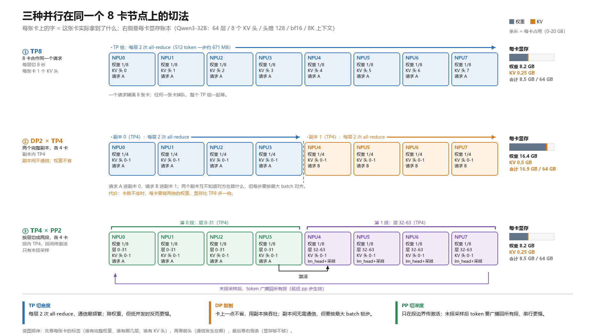
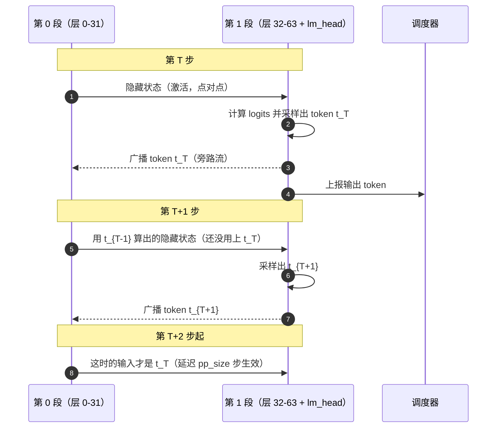

# vLLM-Ascend 并行策略详解：DP / TP / PP

> **这篇文档回答三个问题**：DP、TP、PP 各自到底切开了什么？一台机器上该选哪个、选多大？为什么同一个模型换一种切法，延迟和吞吐会差几倍？
>
> **写给谁**：已经理解 KV cache、prefill/decode、PD 分离，准备把模型真正部署到多卡上的人。读完应该能对着 `--tensor-parallel-size 8 --pipeline-parallel-size 2 --data-parallel-size 2` 这样的命令行，说出每张卡上放了什么、通信发生在哪、瓶颈会在哪。
>
> **怎么读**：第 1 章是唯一的概念地基，必须按顺序读（后面所有判断都从这里推出来）；第 2、3、4 章分别讲 TP、DP、PP，每章结构一样（概念 → 机制 → 部署怎么调）；第 5 章把三者放进同一个 16 卡例子做推演；第 6 章之后是查阅用的。
>
> **代码依据**：上游 `vllm` 的 `ParallelConfig` / 模型切分逻辑，以及 `vllm-ascend` 的并行组创建与本仓部署文档。所有行号都能直接翻代码核对；昇腾侧的行为以 `vllm-ascend/docs/source/user_guide/feature_guide/` 下的官方说明为准，本文只做转述和串联。

## 1. 先建立一张"切法地图"

这一章只做一件事：让你在脑子里能画出"一张卡上到底放了什么"。画不出来，后面所有参数都是玄学。

### 1.1 一张卡上放着四样东西

推理时，NPU 的显存被四类数据瓜分，注意它们的**增长方式完全不同**：

| 东西 | 大小由什么决定 | 随什么增长 | 能不能切 |
| --- | --- | --- | --- |
| 模型权重 | 参数量 × 精度字节数 | 固定（启动后不变） | 能，按层或按张量切 |
| KV cache | 层数 × token 数 × KV 头 × 头维 | **随并发请求和上下文长度线性增长** | 能，按层或按 KV 头切 |
| 激活 / 临时缓冲 | 每步处理的 token 数 × 隐藏维 | 随 `max_num_batched_tokens` 增长 | 不能切，只能调小 batch |
| 通信缓冲（HCCL 等） | 通信域大小、消息大小 | 固定 | 不能切 |

三个并行维度，本质就是**对前两样东西的三种不同切法**：

```
TP：把"每一层内部的张量"切开   → 每层的权重和 KV 头都切成 N 份
PP：把"层"切开                → 一部分层放这台机器，另一部分放那台
DP：什么都不切，整份复制        → 每张卡/每个实例都是一份完整模型
```

这张图就是本文的全部内容，后面每一章只是把它展开：



*图：同一个 8 卡节点按 TP8、DP2×TP4、TP4×PP2 三种方式排布，格子里的字是"这张卡上到底有什么"，箭头是"通信发生在哪"；右侧是按 Qwen3-32B（64 层、8 个 KV 头、bf16）算出来的每卡显存账本。*

> 如果预览不支持内嵌本地图片，可以直接打开：[images/parallel-schemes.png](./images/parallel-schemes.png)。

### 1.2 三句话定义，三个必须分清的差别

**TP（Tensor Parallel，张量并行）**：把每一层里的矩阵乘切开，多张卡合起来算同一层。每张卡拿到的不是"不同的层"，而是"同一层的不同列/不同头"。

**DP（Data Parallel，数据并行）**：把整个模型复制 N 份，每份独立处理不同的请求。副本之间在推理时几乎不通信。

**PP（Pipeline Parallel，流水并行）**：把模型的层按顺序切成若干段（stage），每段放在不同的卡上；一个请求像流水线一样依次经过各段。

三个最容易混的差别，先记死：

| 对比 | 关键差别 |
| --- | --- |
| TP vs DP | TP 是"多个卡算**同一个**请求"，DP 是"每个卡算**不同**请求"。所以 TP 一定要通信，DP 基本不用。 |
| TP vs PP | 都省显存，但 TP 省的是"层内宽度"，PP 省的是"层数"。TP 每层都要通信，PP 只在段边界通信。 |
| PP vs PD 分离 | PP 是"同一次前向拆给多段流水"，PD 是"prefill 和 decode 拆给两台机器"。两者可以叠加，但解决的是不同问题。 |

> 一句话记住：**TP 切宽度、PP 切深度、DP 复制。只有前两个真的减少了每卡显存；DP 用显存换吞吐。**

### 1.3 rank 布局：四个维度怎么排在世界里

部署时最容易踩的一个坑，是"我知道要 TP8，但不知道这 8 个进程里谁是 0 号、相邻的 rank 是不是同一台机器"。

vLLM 的进程编号规则是**嵌套**的，从外到内依次是 DP、PP、PCP、TP：

```python
# vllm/config/parallel.py:1057-1061
self.world_size = (
    self.pipeline_parallel_size
    * self.tensor_parallel_size
    * self.prefill_context_parallel_size
)
```

```python
# vllm-ascend/vllm_ascend/distributed/parallel_state.py:76-85
# The layout of all ranks: ExternalDP * EP
# ExternalDP is the data parallel group that is not part of the model,
# every dp rank can generate independently (in verl integration).
all_ranks = torch.arange(world_size).reshape(
    -1,
    global_dp_size,
    global_pp_size,
    global_pcp_size,
    global_tp_size,
)
```

把这两段合起来读：`world_size = pp × tp × pcp`（DP 不增加单实例进程数，它增加的是**实例份数**），而 `reshape(-1, dp, pp, pcp, tp)` 意味着末维（TP）变化最快。最前面那个 `-1` 是"模型之外的 DP"：外部 LB / verl 集成时，每个副本各自独立生成、彼此不共享模型参数，所以它在 rank 网格里还要再套一层。**去掉它之后**，模型内部任意一个 rank 的编号是：

```
rank = ((dp_rank × pp_size + pp_rank) × pcp_size + pcp_rank) × tp_size + tp_rank
```

反推也成立——代码里就是这么算 pp_rank 的：

```python
# vllm/config/model.py:1729-1736
# the layout order is: DP x PP x PCP x TP
pp_rank = (
    parallel_config.rank
    // (parallel_config.tensor_parallel_size * parallel_config.prefill_context_parallel_size)
) % parallel_config.pipeline_parallel_size
```

**这个规则有两个直接的部署推论**：

1. **TP 组是连续的 rank**，所以它是最容易放进同一台机器的维度。跨机放 TP，等于把最频繁的集合通信压到跨机网络上，通常是最差的选择。
2. **PP 组是“同一位置跨段”的 rank**：同一组里各 rank 的 dp/pcp/tp 坐标完全相同、只有 pp rank 不同，rank 间距是 `tp × pcp`，所以"机内 TP、跨机 PP"是标准的双机切法——这正是官方 PP 指南推荐的拓扑（`docs/source/user_guide/feature_guide/pipeline_parallel.md:139-144`）。

> 一句话记住：**rank 从外到内是 DP→PP→PCP→TP，TP 在末位、编号连续；所以 TP 尽量别跨机，PP 天然适合跨机。**

### 1.4 显存账本：选型的第一性原理

选并行策略，本质上是在解一个不等式：**每张卡的权重 + KV + 激活 + 缓冲 ≤ 单卡可用显存**。四项里前两项可以靠并行压下去，后两项只能靠调参。

**第一项：权重**

```
每卡权重 ≈ 参数量 × 精度字节 / (tp × pp)
```

举例：Qwen3-32B 是 328 亿参数，bf16 每参数 2 字节，总计约 **65.6 GB**。TP8 后每卡约 8.2 GB；TP4×PP2 后也是 8.2 GB；DP 则完全不减（每个副本都要 65.6 GB）。

注意这只是近似：`embedding` 与 `lm_head` 按词表切（也是按 TP 切），最后一层还有 norm；PP 的第一段多背一个 embedding、最后一段多背 `lm_head` 与采样，所以"段"之间的显存并不是严格均分的（`vllm/distributed/utils.py` 的 `get_pp_indices` 注释解释了为什么余数不给最后一段）。

**第二项：KV cache**

```
每卡 KV = 层数/pp × token 总数 × 2(K,V) × (KV头数/tp) × 头维 × 精度字节
```

注意这里出现了**两个除数**：`pp` 除层数，`tp` 除 KV 头数。这是全文最值得记住的一条公式，因为它解释了：

- 为什么 TP 和 PP 都能缓解显存压力，但缓解的"位置"不同；
- 为什么当 `KV头数 < tp` 时，KV 就不再变小了——代码里明确写了，此时会**复制** KV 头，保证每张卡至少有一个：

```python
# vllm/config/model.py:1693-1697
# If tensor parallelism is used, we divide the number of KV heads by
# the tensor parallel size. We will replicate the KV heads in the
# case where the number of KV heads is smaller than the tensor
# parallel size so each GPU has at least one KV head.
return max(1, total_num_kv_heads // parallel_config.tensor_parallel_size)
```

一个具体的账本（Qwen3-32B，64 层 / 8 个 KV 头 / 头维 128 / bf16，上下文 8K）：

| 方案 | 每卡权重 | 每卡 KV（8K 上下文） | 每卡合计 | 谁受益 |
| --- | --- | --- | --- | --- |
| TP8 | 8.2 GB | 0.25 GB | 约 8.5 GB | 权重和 KV 都切 8 份 |
| TP4 × PP2 | 8.2 GB | 0.25 GB | 约 8.5 GB | 权重切 4 份再切 2 段 |
| DP2 × TP4 | 16.4 GB | 0.5 GB | 约 17 GB | 只有 TP 在省，DP 是复制 |

同样的 8 张卡，最后一行每卡要多背一倍——这就是"DP 不省显存"的定量版本。

**第三、四项：激活与通信缓冲**

这两项没法用公式精确算，只能靠参数控制：`--max-num-batched-tokens` 决定一步最多处理多少 token（激活随之线性涨），`--max-model-len` 决定单请求最长上下文（决定 KV 的峰值），`--gpu-memory-utilization` 决定总显存预算，`--kv-cache-memory-bytes` 可以绕过 profiling 直接指定 KV 字节数（`vllm/v1/worker/gpu_worker.py` 的 `determine_available_memory`）。

vLLM 的启动流程是：先加载权重 → 用假输入跑一次前向测峰值激活 → 用剩余显存按"利用率"划给 KV → 反推能装多少个 block、能支持多长的 `max_model_len`。所以**"显存不够"的报错几乎总能通过调这四个参数之一缓解**，但每一个都有代价（见 §5.4）。

> 一句话记住：**权重 ÷(tp×pp)，KV ÷pp 再 ÷tp；DP 两项都不除。选型就是拿这两个除数去凑一个能装下的组合。**

## 2. TP：切宽度，为的是"塞得下 + 单请求快"

### 2.1 精确概念：一层里到底切了什么

一个 Transformer 层里有两类矩阵乘，TP 对它们的切法不同，这是理解 TP 通信量的关键。

**第一类：列并行（Column Parallel）**——把输出维切开。典型是注意力的 `qkv_proj` 和 MLP 的 `gate_up_proj`。每张卡算出一部分输出特征，**不需要通信**，因为它手上正好是完整输入。

**第二类：行并行（Row Parallel）**——把输入维切开。典型是注意力的 `o_proj` 和 MLP 的 `down_proj`。每张卡算的是"部分和"，必须把所有卡的部分和加起来才是正确结果，所以**输出时要一次 all-reduce**：

```python
# vllm/model_executor/layers/linear.py:1851
output = tensor_model_parallel_all_reduce(output_parallel)
```

于是得到一条很实用的规律：**每个 Transformer 层恰好有两次 all-reduce**（注意力输出一次、MLP 输出一次），这个数字和 TP 大小无关，只和层数有关。

注意力本身是"按头切"的：每张卡分到 `总头数/tp` 个 Q 头，以及 `KV头数/tp` 个 KV 头，各自算自己那部分注意力。所以 TP 的合法性有一条硬约束：

```python
# vllm/config/model.py:1571-1578
total_num_attention_heads = self.model_arch_config.total_num_attention_heads
tensor_parallel_size = parallel_config.tensor_parallel_size
if total_num_attention_heads % tensor_parallel_size != 0:
    raise ValueError(
        f"Total number of attention heads ({total_num_attention_heads})"
        " must be divisible by tensor parallel size "
        f"({tensor_parallel_size})."
    )
```

而 KV 头是另一条规则：`KV头数/tp`，**不够分就复制**（上一节的 `model.py:1693-1697`）。这两条规则解释了部署时最常见的两个困惑：

- "为什么 `--tensor-parallel-size 6` 起不来？"——Q 头数不能被 6 整除（比如 64 头只能 1/2/4/8/16/32/64）。
- "为什么 TP 从 8 加到 16，KV 显存没降？"——KV 头只有 8 个，`8/16 = 0`，被 `max(1, ...)` 兜成 1，等于每张卡都存了一份完整的 KV 头。

第三类切分是**词表并行**：`embedding` 和 `lm_head` 按词表维切，每张卡只负责一段词表。这一维对“能不能整除”并不敏感：代码会先把词表 pad 到对齐的整数倍（`vllm/model_executor/layers/vocab_parallel_embedding.py:100-102` 的 `pad_vocab_size`），再平分给各卡（`:309-310`）；pad 出来的行永远不会产生有效 logits，只是每卡多占几百行权重，可以忽略。昇腾还提供了"细粒度 TP"，允许 `lm_head`/`embedding`/MLP/`o_proj` 用**不同**的 TP 大小（`vllm_ascend/distributed/parallel_state.py:220-223` 读取 `finegrained_tp_config`），用于词表特别大、按 tp 切不划算的模型。

### 2.2 代价：每层两次 all-reduce 到底多贵

单个 all-reduce 搬运的数据量是 `token 数 × 隐藏维 × 字节数`，每层两次，乘以层数就是一次前向的 TP 通信总量：

```
每步 TP 通信量 ≈ 2 × 层数 × token 数 × 隐藏维 × 字节数
```

以 Qwen3-32B（64 层、隐藏维 5120、bf16）为例，一步处理 512 个 token：

```
2 × 64 × 512 × 5120 × 2 B ≈ 671 MB
```

如果有效带宽是 100 GB/s，光 TP 通信就要 6～7 ms；而一步 decode 的可用时间预算常常只有十几毫秒。**这就是 TP 的根本矛盾：它让单层算得更快，但同时给每一步加了一份固定通信税。** batch 越小，这份税摊得越薄不了，所以低并发场景 TP 往往反而更慢。

据此可以推出 TP 的三条调优直觉：

1. **TP 优先放在机内**（rank 连续，见 §1.3），机内互联带宽远高于跨机；
2. **TP 增大 → 单请求延迟下降（到某点为止）→ 但吞吐可能下降**，因为每卡 GEMM 变小、通信占比变高；
3. **高并发时 TP 更划算**（通信被更大的 batch 摊薄），低并发时 TP 更亏。

### 2.3 部署怎么调

**先看能不能整除，再看能不能放下，最后看通信占比。**

启动前的三步检查：

```text
1. 注意力头数 % tp == 0 ？（model.py:1571-1578 会直接报错）
2. KV 头数 / tp 是否 >= 1 ？（否则 KV 被复制，显存不再下降，见 model.py:1693-1697）
3. 权重 / (tp × pp) + KV 是否小于单卡可用显存？
```

一个常见的取舍：**单机 8 卡、模型 65 GB、单卡 64 GB**。此时 TP8 能把权重压到 8 GB/卡，KV 也很宽裕，是最自然的起点。如果模型小到 TP2 就够，就没有理由上 TP8——多出来的通信税纯亏。

**什么时候 TP 不是最优解**（该考虑 PP 或 DP）：

| 症状 | 说明 | 换什么 |
| --- | --- | --- |
| TP 加到 8 之后，延迟不再降、吞吐还掉了 | 单卡矩阵太小，通信占比过高 | 降 TP、加 DP |
| `tp` 再大就除不尽头数了 | 结构上限 | 换 PP 继续摊权重 |
| 跨机 TP 后延迟明显变差 | 集合通信走了跨机网络 | 机内 TP + 跨机 PP |
| KV 头不够分，TP 再大也不省 KV | KV 被复制 | 别再靠 TP 省 KV |

> 一句话记住：**TP 是"每层都收税"的省显存方式：机内优先、整除优先、高并发才划算。**

## 3. DP：复制，为的是"同时服务更多请求"

### 3.1 精确概念：什么都不切，整份复制

DP 是三个维度里唯一**不减少每卡显存**的：模型被完整复制 N 份，每份叫一个副本（replica），每个副本有自己的 KV cache、自己的 block 表、自己的调度器状态。请求被分给不同副本，副本之间互不知道对方在算什么。

既然互不知道，为什么还需要通信？因为 GPU/NPU 的集合通信要求"同一个通信域里所有 rank 同时进入同一次调用"。如果两个副本在同一时刻处理的 token 数不同、或者一个在跑一个在等，集合通信就会挂住。所以 DP 的副本必须**锁步**，vLLM 的做法是每步先 all-reduce 一次"各 rank 的 token 数"，再把所有人对齐到最大值：

```python
# vllm/v1/worker/dp_utils.py:69-76
tensor_cpu = torch.zeros(4, dp_size, dtype=torch.int32, pin_memory=pin_memory)
tensor_cpu[0][dp_rank] = orig_num_tokens_per_ubatch
tensor_cpu[1][dp_rank] = padded_num_tokens_per_ubatch
...
tensor = tensor_cpu.to(device, non_blocking=True)
dist.all_reduce(tensor, group=group)
return tensor
```

```python
# vllm/v1/worker/dp_utils.py:99-111
def _post_process_dp_padding(tensor: torch.Tensor, should_dp_pad: bool) -> torch.Tensor:
    num_tokens_across_dp = tensor[1, :]
    if should_dp_pad:
        # If DP padding is enabled, ensure that each rank is processing the same number
        # of tokens
        max_num_tokens = int(num_tokens_across_dp.max().item())
        return torch.tensor(
            [max_num_tokens] * len(num_tokens_across_dp),
            device="cpu",
            dtype=torch.int32,
        )
    else:
        return num_tokens_across_dp.cpu()
```

这段代码藏着 DP 最重要的性能事实：**负载越不均，padding 越多，浪费越大**。两个副本一个处理 100 个 token、一个处理 1000 个，前者也要按 1000 来跑——吞吐直接掉一半。所以 DP 的效率几乎完全取决于**请求分得均不均匀**，这也是为什么在线服务里 DP 前面总需要一个负载均衡的 Router。

多副本之间谁来分请求？vLLM 内部有一个 DP 协调器，负责收集各副本的负载并让它们成"波"地推进：

```python
# vllm/v1/engine/coordinator.py:23-53（节选注释）
class DPCoordinator:
    """Coordinator process used for data-parallel deployments (DP>1).
    ...
    * Collects stats from each DP engine (currently just waiting and running
      queue lengths), and publishes these to all front-ends for use in
      load-balancing decisions.
    ...
    * Broadcasts the START_DP_WAVE message to engines to move them from paused
      to running state when an idle engine receives a new request ...
    ...
    Note that when deployed in External LB mode, no stats will be published by
    the engines ...
```

注意两个细节：一是副本会成组地在"运行/暂停"之间切换，暂停的副本收到新请求才会把整组唤醒——这就是为什么 DP 的响应延迟和"副本数"不是简单反比；二是外部 LB 模式下协调器拿不到副本的负载统计，负载均衡的责任就完全落到外部 Router 身上了。

> 一句话记住：**DP = 多个互不相干的完整副本；它们必须锁步，而且按最大 batch 对齐，所以"均不均匀"比"加几个副本"更重要。**

### 3.2 DP 的三种形态，别混着说

| 形态 | 怎么起 | 谁分请求 | 典型用途 |
| --- | --- | --- | --- |
| 内部 DP | `--data-parallel-size N`（配 `--data-parallel-size-local`） | vLLM 的 DP 协调器 | 单实例内的多副本，MoE/EP 场景最常见 |
| 外部 LB | 起 N 个独立实例，前面放 Router/网关 | 外部 Router | 通用做法，dense 模型首选 |
| 混合 / 外部 LB 模式 | `--data-parallel-hybrid-lb` / `--data-parallel-external-lb` | 混合：一部分协调、一部分外部 | 大规模 EP、Kubernetes 一个 Pod 一个 rank |

几个必须知道的边界条件，都在 `ParallelConfig` 的校验里：

- `data_parallel_size_local` 不能大于 `data_parallel_size`（`vllm/config/parallel.py:583-587`）；
- 外部 LB 模式要求 `data_parallel_size > 1`（`:589-592`），并且**只对 MoE 部署有意义**，dense 模型建议直接起独立实例（`:177-186` 的字段说明）；
- 离线（offline）模式下用环境变量配 DP 时，dense 模型会被直接拒绝：`"Offline data parallel mode is not supported/useful for dense models."`（`:1123-1127`）。

为什么 DP 和 MoE 绑得这么紧？因为 `--enable-expert-parallel` 之后，**EP 的通信域就是 TP × PCP × DP 的乘积**：

```python
# vllm/config/parallel.py:667-672
# The EP group spans the TP x PCP x DP ranks.
ep_size = (
    self.tensor_parallel_size
    * self.prefill_context_parallel_size
    * self.data_parallel_size
)
```

而昇腾侧需要注意：NPU 上并没有注册真正的 all-to-all 管理器，MoE 通信走的是 mc2 / all-gather，所以那个类只是个占位实现：

```python
# vllm-ascend/vllm_ascend/distributed/device_communicators/npu_communicator.py:23-27
class _NpuAll2AllManager:
    """No-op all2all_manager for NPU. Used by vLLM main's fault-tolerance
    check (data_parallel_size > 1 and is_moe); NPU does not register a real
    one because it uses mc2 / all_gather for MoE communication.
    """
```

所以"DP+EP"在昇腾上的行为要按 EP 的实际实现去看（专家怎么分、all-gather 还是 mc2），不能直接照搬 CUDA 上 all-to-all 的经验。

但有一条不依赖实现方式的结论仍然成立：对 MoE 模型来说，"加 DP"同时意味着"把专家摊到更多卡上"（因为 EP 域里包含 DP）。这两个动机经常混在一起，调优时要分清自己在优化哪个：多副本服务看吞吐和负载均衡，宽 EP 看专家并行的通信和显存。

### 3.3 部署怎么调

**什么时候该加 DP：**

1. 单卡（或单个 TP/PP 组）已经装得下模型，但吞吐/并发不够；
2. 请求之间彼此独立、没有共享前缀压力——副本越多，能同时处理的请求越多；
3. MoE 模型要把专家摊开（配合 `--enable-expert-parallel`）。

**什么时候不该加 DP：**

| 症状 | 原因 | 应该做什么 |
| --- | --- | --- |
| 单请求延迟是核心指标 | DP 不改变单个请求的耗时，只加并发 | 先优化 TP / batch，别指望 DP 降延迟 |
| 请求长短差异极大 | pad 到最大值，短请求被拖慢，长请求拉低整体 | 加 Router 做长短分流，或改用 PD 分离 |
| 显存本来就紧张 | DP 不省任何显存，反而多一份完整副本 | 用 TP/PP 压权重，或做量化 |
| 只有几路并发 | 副本空转 | 减副本，或改大 batch |

一个很实用的判断：**DP 的收益上限是"线性加吞吐"，代价是"显存乘以副本数 + 负载不均时的浪费"**。如果你是单机 8 卡、模型 30 GB、并发很高，那么 TP2 × DP4 通常比 TP8 吞吐更好；如果模型 65 GB 且只有 8 卡，TP8 是唯一选择，DP 根本没地方放。

> 一句话记住：**DP 是拿显存和负载均衡换吞吐的维度；它永远不降单请求延迟。**

## 4. PP：切深度，为的是"放得下 + 保住机内带宽"

### 4.1 精确概念：层被切成几段，一段是一个 TP 组

PP 把模型的隐藏层按**连续区间**切成若干段，每段叫一个 stage：

```text
PP rank i: [start_layer_i, end_layer_i)
```

每一段由一个 TP 组执行（TP=1 时就是一个 worker）。数据流是：

```text
输入 token → stage 0（前几层 + embedding）→ 中间激活 → stage 1 → … → 最后一段（后几层 + norm + lm_head + 采样）→ 输出 token
```

官方文档把术语定义得很清楚（`docs/source/user_guide/feature_guide/pipeline_parallel.md:13-20`）：stage 是逻辑分区，PP rank 是段内编号，"同 stage 索引、不同 TP rank 的 worker 共同执行同一个 stage"。

由此得到 PP 的两条硬性前提：

1. **模型必须支持 PP**。不是所有模型实现都能只跑一部分层，必须实现 `SupportsPP` 接口，否则启动就被拒：

```python
# vllm/config/model.py:1583-1590
if pipeline_parallel_size > 1 and not self.registry.is_pp_supported_model(...):
    raise NotImplementedError(
        "Pipeline parallelism is not supported for this model. "
        "Supported models implement the `SupportsPP` interface."
    )
```

2. **只有最后一段有输出头**。`lm_head`、logits、采样都在最后一段，其他段只产出隐藏状态。昇腾侧的模型支持清单见官方矩阵里的 "Pipeline Parallel" 列。

### 4.2 关键机制：采样在最后一段，但每个段都需要那个 token

这是新手读 PP 代码时最容易漏的一环，也是 PP 延迟特征的根本原因。

decode 每一步的输入是**上一步采样出来的 token**。可是采样发生在最后一段——第一段怎么知道该拿哪个 token 做下一步？

答案是：**最后一段采样完，把 token 广播回所有段**。vLLM 的实现是在旁路流上做这次广播，并且刻意延迟 `pp_size` 步才消费，让广播不与段间的激活传输抢同一条链路：

```python
# vllm/v1/worker/gpu/pp_utils.py:55-63（类注释）
class PPHandler:
    """Runs the PP sampled-token broadcast/recv on a side stream so the
    default stream isn't gated by the matching peer call. Step T's recv is
    consumed at step T+pp_size via `get_prev_sampled_outputs`.
    ...
```

延迟消费的原因很简单：第 T 步启动的那次前向，要等所有段都推进完才会在最后一段产生 token；下一轮能用上它，得再等 `pp_size` 个流水级。代码里用一个深度为 `pp_size` 的环形缓冲来对齐这个时间差（`pp_utils.py:76-81`），广播本身是以最后一段为源的：

```python
# vllm/v1/worker/gpu/pp_utils.py:256-263
torch.distributed.broadcast(
    sampled_token_ids.contiguous(),
    src=self.last_rank,
    group=self.broadcast_group,
)
```

把这几步画成时序就是下面这样（这也是 PP 唯一真正"顺序"的部分）：



**这段机制解释了一个反直觉的事实**：PP 并不会让单个请求变快，它反而变慢——请求要依次穿过所有段，段间还要传激活、还要等广播。PP 买到的是"模型能放下"和"TP 通信留在机内"，不是延迟。

### 4.3 流水气泡：PP 的效率全部体现在这里

因为请求要一段一段走，任何时刻都只有一段在算这个请求，其它段在等——这段等待时间就是"流水气泡"（pipeline bubble）。缓解办法是**让不同请求错开**：请求 A 在 stage 1 时，请求 B 正在 stage 0。并发越高，气泡占比越低：

| 场景 | PP 的表现 |
| --- | --- |
| 单请求 / 低并发 decode | 几乎没有独立工作来填段，延迟比单机 TP 更差 |
| 高并发 + continuous batching | 各段都有活干，气泡占比下降，吞吐接近线性 |
| 长上下文 prefill | 每段计算量大，能摊薄段间通信 |
| 各段层数不均 | 最慢的段决定整体节奏，其它段空转 |

官方文档的结论和这四条一致（`pipeline_parallel.md:414-427`）：PP 相对大 TP 组的主要优势是**通信局部性**，而不是单层算得更快；并且"模型能放进一台机器时，TP 才是基线"。

昇腾还提供了一个专门对付长上下文 prefill 气泡的优化：**动态分块流水并行（CPP）**。它的思路是把长序列切成不等长的 chunk，让每个 chunk 的耗时相等，从而让各段始终同步：

```text
固定分块（chunk 等长、耗时不等）：
  Stage 0  |■■■■|■■■■■■|■■■■■■■■|■■■■■■■■■■|
  Stage 1  |    |■■■■  |■■■■■■  |■■■■■■■■  |■■■■■■■■■■|
                ↑ 气泡   ↑ 气泡    ↑ 气泡

动态分块（chunk 不等长、耗时相等）：
  Stage 0  |■■■■■■|■■■■■■|■■■■■■|■■■■■■|
  Stage 1  |      |■■■■■■|■■■■■■|■■■■■■|■■■■■■|
                  ↑ 无气泡——各段保持同步
```

（上图来自 `docs/source/developer_guide/Design_Documents/dynamic_chunked_pipeline_parallel.md:25-36`。）CPP 只建议开在 **PD 分离里的 P 节点**，配置方式是 `--additional-config '{"scheduler_config": {"profiling_chunk_config": {"enabled": true}}}'`，详见 `docs/source/user_guide/feature_guide/dynamic_chunk_pipeline_parallel.md:36-68`。

### 4.4 层怎么分：自动分、以及什么时候手工分

**默认自动分**：层数不能被段数整除时，余数从倒数第二段开始往前分，**最后一段永远不加**——因为它还要跑 norm、`lm_head`、logits 和采样，本来就最重；中间段不够用时才会落到第一段。官方给的例子（61 层）：

```text
PP2: [31, 30]      PP rank 0: [0, 31)   PP rank 1: [31, 61)
PP4: [15, 15, 16, 15]
PP rank 0: [0, 15)  rank 1: [15, 30)  rank 2: [30, 46)  rank 3: [46, 61)
```

**手工分**：设环境变量 `VLLM_PP_LAYER_PARTITION`，按 PP rank 顺序列出每段的层数：

```bash
export VLLM_PP_LAYER_PARTITION="32,29"
```

几条硬规则（`pipeline_parallel.md:241-251`）：条目数必须等于 PP 大小、总和必须等于隐藏层数、只数隐藏层（不含 embedding/norm/lm_head/draft 层）、同一个服务的所有 worker 用同一个值。

**调优循环**（`pipeline_parallel.md:259-270`）：先自动分 → 测量每段的峰值显存和步延迟 → 如果最后一段是瓶颈，就一次挪一层到前一段（例如 `[31,30]` → `[32,29]`）→ 每次改动后重测。注意不要"只按显存大小"来分层，否则瓶颈只是从一段转移到另一段。

### 4.5 部署怎么调

**PP 值得上的三种情况**（`pipeline_parallel.md:127-137`）：

1. 模型在一个 TP 组里放不下，必须继续按层摊；
2. 多机部署，想让高频的 TP 集合通信留在机内，跨机只传激活；
3. PD 分离的 P 节点需要更多设备来扛长上下文 prefill。

**PP 不值得上的情况**：模型放得进一台机器、且你追求低延迟——此时 TP 是基线，PP 只会加延迟。

**PP 与 PD 分离的组合规则**（这是生产里最常踩的一组坑，全部来自 `pipeline_parallel.md:332-379`）：

| 规则 | 说明 |
| --- | --- |
| P 节点可以 PP>1，D 节点必须 PP=1 | 用 `MooncakeConnectorV1` 时明确要求 decode 侧 PP 为 1 |
| 两边的 `kv_connector_extra_config` 都要写**P 的真实拓扑** | `prefill.pp_size`、`prefill.pp_layer_partition` 要对齐，否则握手超时 |
| P 的 TP 必须 ≥ D 的 TP，且是整数倍 | 当前 Mooncake connector 的限制 |
| 自定义分层时，`VLLM_PP_LAYER_PARTITION` 只设在 P 节点 | 不要抄到 PP1 的 D 进程上 |

多机启动时用 MP 后端需要 `--nnodes / --node-rank / --master-addr / --master-port`，worker 节点还要加 `--headless`：只有 head 节点起 API server，两边参数必须完全一致（`pipeline_parallel.md:66-106`）。

还有一条容易被忽略的互斥：**跨机 RoCE 的 MoE 部署，PP 和 DP 目前不能同时开**，因为 `MoeDistributeDispatch` 的通信路径不支持这个组合（`pipeline_parallel.md:438-440`）。遇到"开了 PP 又开 DP 就挂"的现象，先查这一条。

> 一句话记住：**PP 用"串行穿过各段"换显存和机内带宽；它降吞吐不降延迟，只有高并发或长 prefill 才能把气泡填掉。**

## 5. 组合：把三者放进同一个 16 卡例子

### 5.1 同一个模型、三种切法

设定：**两台机器，每台 8 卡**，跑 Qwen3-32B（bf16 权重约 65.6 GB），目标是在线服务、高并发、能接受单请求几十毫秒的延迟。三种可行方案：

| | 方案 A：TP16 | 方案 B：TP8 × PP2 | 方案 C：TP8 × DP2 |
| --- | --- | --- | --- |
| 每卡权重 | 约 4.1 GB | 约 4.1 GB | 约 8.2 GB |
| 每卡 KV（8K） | 约 0.25 GB（KV 头已被复制，不再变小） | 约 0.13 GB（层数减半） | 约 0.25 GB |
| 跨机通信 | **每层两次 all-reduce**，全走跨机 | 每步一次激活传输（约几 MB） | **没有跨机通信**（两个独立副本） |
| 单请求延迟 | 最差（跨机集合通信） | 中等（串行过两段） | 最好（机内 TP8） |
| 吞吐 | 一般 | 高（流水填满时） | 最高（两副本并行） |
| 复杂度 | 最低（一条命令） | 中（要管两段内存均衡） | 中（要管请求分配） |
| 什么时候选它 | 只想先跑起来、验证功能 | 模型一台机器放不下 | 模型一台放得下、要吞吐 |

这张表的结论很直接：**方案 C 只在"单机能装下"时成立**——`65.6/8 ≈ 8.2 GB` 权重加上 KV 和激活后，8 卡 × 64 GB 的机器很宽裕；而方案 A 之所以通常是坏选择，是因为它把最频繁的通信（每层两次）压到了跨机网络上。

如果模型更大（比如 671B 的 MoE），一台机器装不下，方案 C 就不存在了，此时顺序是：先 TP（机内切到 8）→ 再 PP（跨机切层）→ 最后才是 DP（若还需要更多并发）。

### 5.2 选型顺序：一条可以照着走的决策链

```text
1. 单卡能装下？
   ├─ 是 → 直接单卡，或 TP1 + DP 多副本（最省心）
   └─ 否 ↓
2. 单机能装下（TP ≤ 8）？
   ├─ 是 → TP 到能装下为止；还要吞吐就加 DP（新副本放在新机器上）
   └─ 否 ↓
3. 需要跨机 → 机内 TP8 + 跨机 PP；PP 的段数 = 机器数
   └─ 还要更高并发 → 在"实例"层加 DP（多套 P/PP 实例 + Router）
4. 长上下文 prefill 是瓶颈 → 在 P 侧考虑 CPP / PCP
5. MoE 且要摊专家 → 加 --enable-expert-parallel，DP 变 EP 的一部分
```

每一步都对应一个可以量化的检查：第 2 步看 §1.4 的账本；第 3 步看 PP 的段是否均衡（§4.4）；第 5 步看专家是否放得下、all-to-all 是否成为瓶颈。

### 5.3 PD 分离场景：P 和 D 不必对称

PD 分离把"prefill 机器"和"decode 机器"分开之后，两者的最优并行配置本来就不同：

| 角色 | 瓶颈 | 倾向的并行 |
| --- | --- | --- |
| P（prefill） | 算力、长 prompt 的 TTFT | TP 偏大（同机尽量 TP8），必要时 PP 跨机、PCP 切长上下文 |
| D（decode） | 显存带宽、并发数 | TP 适中（够放权重即可），多出来的卡用 DP 加并发 |

但两边并不是随便配都能通，有几条约束（来自 `pipeline_parallel.md:332-379` 与 PD 部署文档）：

1. **`MooncakeConnectorV1` 要求 D 侧 PP=1**，P 侧可以 PP>1；
2. **P 的 TP ≥ D 的 TP，且是整数倍**——因为 KV 要按块号对齐地搬过去；
3. 连接器的 `kv_connector_extra_config` 里要写 **P 的真实拓扑**（`prefill.pp_size` / `pp_layer_partition`），两边一致。

`MooncakeConnectorV2` 之后支持按 cache spec 配对，两侧 TP 比例可以不相等；昇腾侧为此提供了 `pd_tp_ratio` 机制，把 P 侧的 KV 通过 all-to-all 重排到 D 侧的 TP 布局（`vllm_ascend/distributed/kv_transfer/utils/utils.py:50-67` 的 `kv_alltoall_and_rearrange`，并行组在 `vllm_ascend/distributed/parallel_state.py:145-153` 创建）。这属于进阶用法，概念上只要记住一句：**TP 布局不同，KV 的"哪块在哪张卡上"就不同，所以要重排。**

### 5.4 参数联动清单

并行策略不是孤立的开关，下面这些参数和它强耦合，调一个通常要连带调另一个：

| 参数 | 和谁联动 | 调大的代价 |
| --- | --- | --- |
| `--tensor-parallel-size` | 头数整除、KV 头数、每卡权重 | 通信税上升，低并发时延迟变差 |
| `--pipeline-parallel-size` | 层数、段均衡、PD 的 D 侧限制 | 延迟变差，需要高并发填气泡 |
| `--data-parallel-size` | 负载均衡、显存总量、MoE 的 EP 域 | 显存翻倍，不均时 padding 浪费 |
| `--max-model-len` | KV 峰值、块数 | 单请求能更长，但挤占并发 |
| `--max-num-seqs` | 并发请求数、KV 占用 | 并发高但每请求 KV 变小，可能 OOM |
| `--max-num-batched-tokens` | 激活峰值、prefill 吞吐 | 激活变大，挤占 KV |
| `--gpu-memory-utilization` | KV 总预算 | 调太高容易 OOM，太低浪费 |
| `--kv-cache-memory-bytes` | 直接指定 KV 字节数（跳过 profiling） | 手动控制，估错就 OOM |

一个常见的死循环：`max_model_len` 调大 → KV 峰值变大 → 可用块数变少 → `max_num_seqs` 实际达不到 → 吞吐不升反降。遇到长期跑不满的情况，先看启动日志里"KV cache blocks"的数量，再决定是加卡还是降 `max_model_len`。

> 一句话记住：**先算账本定并行，再用 batch 参数榨性能；顺序反了就会在 OOM 和低吞吐之间来回跳。**

## 6. 排障速查

| 症状 | 先查什么 |
| --- | --- |
| 启动报 "Total number of attention heads ... must be divisible by tensor parallel size" | tp 不整除头数（`model.py:1571-1578`），换成能整除的值 |
| 启动报 "Pipeline parallelism is not supported for this model" | 模型没实现 `SupportsPP`（`model.py:1583-1590`），查支持矩阵 |
| `VLLM_PP_LAYER_PARTITION` 被拒 | 条目数 ≠ PP 大小，或总和 ≠ 隐藏层数 |
| 某个 PP rank OOM | 大概率是最后一段（带 lm_head/采样/draft），按 §4.4 挪一层出来 |
| 首个请求长时间不返回 | 先用 `--enforce-eager` 排除图捕获，再查 rank 间通信是否通 |
| MP 多机 worker 加不进 head | 两机 `--nnodes/--master-addr/--master-port` 必须一致，worker 要带 `--headless` |
| 跨机 RoCE MoE 开了 PP+DP 就挂 | 该组合不支持，保持 PP 或 DP 之一为 1（`pipeline_parallel.md:438-440`） |
| PD 握手超时 | 两边 `kv_connector_extra_config` 的 P 拓扑声明不一致 |
| DP 副本加了一倍但吞吐没涨 | 负载不均导致 padding（`dp_utils.py:99-111`），查 Router 分流 |
| TP 增大后延迟反而变差 | 单卡矩阵太小、通信占比过高，降 TP 加 DP |
| TP 增大后 KV 显存没降 | KV 头数 < tp，被复制（`model.py:1693-1697`） |

## 7. 六个容易混的概念

| 误解 | 事实 | 依据 |
| --- | --- | --- |
| DP 能降低每卡显存 | 不能。DP 复制整个模型，每卡显存不变，总量翻倍 | `parallel.py:1057-1061` 只把 pp×tp×pcp 算进 world_size |
| TP 越大越快 | 每层两次 all-reduce 是固定税，低并发时 TP 越大越慢 | `linear.py:1851`，量级见 §2.2 |
| PP 能降单请求延迟 | 不能。请求要串行穿过各段，还要等采样广播 | `pp_utils.py:55-63` |
| KV 一定按 tp 切分 | KV 头不足时会被复制，每卡至少保留 1 个 KV 头 | `model.py:1693-1697` |
| TP8 和 PP8 差不多 | TP 每层通信，PP 只在段边界通信，量级差很多 | §2.2 vs §4.2 |
| DP 和 PD 分离是一回事 | DP 复制副本、分请求；PD 拆阶段、串行接力 | §1.2，PD 文档 |

## 8. 代码索引

| 想确认什么 | 看哪里 |
| --- | --- |
| world_size 与 rank 布局 | `vllm/config/parallel.py:412-413,1057-1061`；`vllm-ascend/vllm_ascend/distributed/parallel_state.py:79-84` |
| pp_rank 的计算 | `vllm/config/model.py:1722-1739` |
| TP 头数约束 | `vllm/config/model.py:1571-1578` |
| KV 头切分与复制 | `vllm/config/model.py:1693-1697` |
| 层并行（PP）的层分配 | `vllm/distributed/utils.py` 的 `get_pp_indices` |
| 行并行的 all-reduce | `vllm/model_executor/layers/linear.py:1832-1851` |
| PP 采样广播与环形缓冲 | `vllm/v1/worker/gpu/pp_utils.py:55-63,76-81,252-263` |
| DP 锁步与 padding | `vllm/v1/worker/dp_utils.py:57-76,99-111` |
| DP 协调器与波次 | `vllm/v1/engine/coordinator.py:23-53` |
| EP 通信域大小 | `vllm/config/parallel.py:667-672` |
| 昇腾 all2all 管理器为何是空实现 | `vllm_ascend/distributed/device_communicators/npu_communicator.py:23-37` |
| 昇腾细粒度 TP | `vllm_ascend/distributed/parallel_state.py:220-223` |
| 昇腾 P/D 不同 TP 的 KV 重排 | `vllm_ascend/distributed/kv_transfer/utils/utils.py:50-67`；`parallel_state.py:145-153` |
| PP 官方部署指南 | `docs/source/user_guide/feature_guide/pipeline_parallel.md` |
| CPP（动态分块流水） | `docs/source/user_guide/feature_guide/dynamic_chunk_pipeline_parallel.md` |

## 附录 A：术语表

| 术语 | 含义 |
| --- | --- |
| 副本（replica） | 一份完整的模型 + 它自己的 KV/调度状态；DP 的单位 |
| 段（stage） | PP 里一段连续的层，由一个 TP 组执行 |
| TP 组 | 在同一个 stage 内做张量并行的那些 rank |
| world_size | 单个实例的进程数，等于 pp × tp × pcp（不含 DP） |
| 通信域（group） | 一组可以互相做集合通信的 rank；TP/PP/DP 各有自己的域 |
| 气泡（bubble） | 流水线中某段没有活干、空等的时间 |
| 激活（activation） | 层与层之间传递的中间张量；PP 段间传的就是它 |
| 分片（shard） | 被切开后某张卡上那一份数据 |
| EP | 专家并行，MoE 的专家分布到多卡；域大小 = tp×pcp×dp |
| PCP / DCP | 上下文并行，把序列维切开（P 侧 prefill / D 侧 decode），本文不展开 |
| HCCL | 昇腾的集合通信库，对应 CUDA 世界的 NCCL |

## 附录 B：自检命令

```bash
# 1. 确认卡数够不够（昇腾）
npu-smi info | grep -E "NPU|HBM" | head

# 2. 确认这几个参数是否被接受、默认值是什么
vllm serve --help | grep -E "tensor-parallel-size|pipeline-parallel-size|data-parallel"

# 3. 确认模型是否支持 PP（看类是否继承 SupportsPP）
grep -rn "SupportsPP" vllm/model_executor/models/ | grep -i "<你的模型>"

# 4. 确认启动后实际的并行配置（看日志里的 world_size / rank 布局）
vllm serve <model> --tensor-parallel-size 8 2>&1 | grep -iE "world_size|tensor_parallel|pipeline_parallel"

# 5. 交叉验证本文引用的行号（示例：KV 头复制规则）
sed -n '1690,1700p' vllm/config/model.py
```

## 附录 C：相关文档

- PP 部署与兼容性：`docs/source/user_guide/feature_guide/pipeline_parallel.md`
- 动态分块流水（CPP）：`docs/source/user_guide/feature_guide/dynamic_chunk_pipeline_parallel.md`
- 序列并行（SP，MoE 路径）：`docs/source/user_guide/feature_guide/sequence_parallelism.md`
- 上下文并行（PCP/DCP）：`docs/source/user_guide/feature_guide/context_parallel.md`
- PD 分离多机部署：`docs/source/tutorials/features/pd_disaggregation_mooncake_multi_node.md`
- 本文的姊妹篇（PD 分离交互机制）：`推理优化/PD分离/vLLM PD 分离交互机制详解.md`

如果下一步要深入，最自然的两条线是：**MoE 的 EP + EPLB**（专家怎么分、负载怎么均），以及 **CP/SP**（长上下文与序列维切分）。它们都建立在这一篇的三维度基础之上。
