# vLLM Ascend KV Pool（AscendStore）设计方案详解

> **一句话**：AscendStore 把"本卡 HBM 里的 prefix KV"外置成"按内容寻址、可跨实例共享的 KV 池"，用一次 `lookup` 换掉一段重复的 prefill 计算。
>
> - 原文：[vLLM Ascend KV Pool（AscendStore）设计方案](https://zhuanlan.zhihu.com/p/2076369077552132779)
> - 本文：在原文基础上重写主线、补齐框架图与时序图，并对 `vllm-ascend` 当前检出（2026-11-05）做了交叉核对。
> - 范围：`vllm_ascend/distributed/kv_transfer/kv_pool/ascend_store/`，以及相邻的 `kv_p2p/`（用于对比）。
> - 状态：源码 + 官方文档 + 原文，**未在 NPU 真机实测**；涉及硬件与版本约束的结论以官方文档为准。
> - 与同目录 `00 KV Cache池化 · 架构总览.md` 的关系：那份偏"学习地图 + 参数速查"，本文偏"设计动机 + 调用链 + 取舍分析"，可对照读。

---

## 0. 怎么读这份文档

| 你的目标 | 直接读 |
|---|---|
| 3 分钟建立印象 | §1 定位 + §3.2 时序图 + §12.1 三个漂亮设计 |
| 15 分钟搞懂全链路 | §2 模块地图 → §3 控制面/数据面 → §4 数据结构 → §5 四类请求 |
| 排障：命中为 0 / load 失败 / 结果不一致 | §10 失败与恢复 + §9 场景推演 + §14 代码索引 |
| 要做架构选型：池化 vs P2P | §8 对比 + §8.5 决策树 + §12.4 不该用的场景 |
| 要改代码 / 接第四个后端 | §2.3 模块地图 + §4.3 Key + §11 Bulk/Layerwise |

---

## 1. 先定位：这里的"池化"到底是什么

### 1.1 先排除三个同名概念

"pooling"在推理栈里至少有四种含义，混用会导致看错代码入口：

| 名词 | 是什么 | 与本文关系 |
|---|---|---|
| **KV Cache 池化**（本文） | 把 KV Cache 写到外部共享存储，跨请求/跨实例复用 | ✅ 主题 |
| Pooling 模型 / 序列池化 | `--runner pooling`，把 hidden states 压成向量做 embedding | ❌ 入口完全不同 |
| PagedAttention 的 block pool | 单卡内的空闲显存块分配器 | ❌ 只是本卡内存管理 |
| 算法层的"KV 压缩/池化" | 对 token 维做 mean/max 等有损压缩 | ❌ 有损，和共享无关 |

> 记忆点：**本文的池化是"无损的资源共享"，不是"有损的特征压缩"。**

### 1.2 它站在 Prefix Cache 与 PD 分离之间

三层职责要分清，否则会误以为池化能替代 Prefix Caching：

- **vLLM 原生 Prefix Cache（APC）**：回答"这段前缀在本实例、本卡上算过吗？"，命中就去复用本卡 block；
- **AscendStore**：回答"这段前缀在**别的实例/别的节点**上算过吗？KV 存在哪、能不能取回来？"；
- **PD 分离**：回答"这次请求由哪个 Prefill 算、哪个 Decode 接？"。

三者是叠加关系：

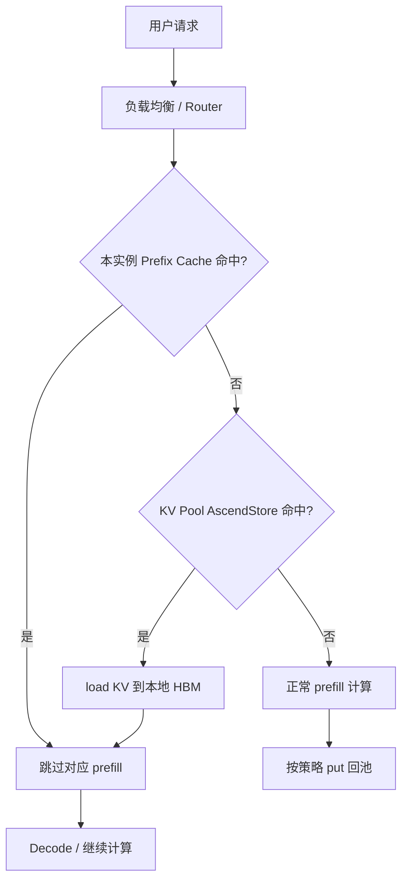
<p align="center">图 1 · 池化在推理栈中的位置：查找策略（APC）与存储底座（Pool）是两层</p>

| 维度 | 原生 Prefix Caching | KV 池化 |
|---|---|---|
| 作用域 | 单实例、单 worker、本卡 HBM | 跨实例、跨节点、DRAM/SSD |
| 容量上限 | 本卡分给 KV 的显存 | 集群聚合容量 |
| 远程访问 | 不支持 | 支持（RDMA / HCCS / UB） |
| 冷热分级 | 无 | 有（后端决定） |
| 定位 | **查找策略** | **存储底座** |

> **点评**：很多人把池化理解成"更大号的 prefix cache"，这只对了一半。池化真正改变的是**生命周期**——KV 不再绑定在某个进程的显存里，而是变成了一个有独立名字（key）、可以被别人按名字取用的对象。一旦接受这个视角，后面所有的 key 设计、TP/PP 映射、失败恢复，都是"对象存储语义"在推理场景下的具体化。

### 1.3 收益公式与边界

池化不是免费加速，它本质上是**拿带宽换 FLOPs**：

```text
收益 ≈ Σ(命中前缀 token 数 × 每 token prefill 成本 × 被复用次数)
     − Σ(put 流量 + get 流量 + lookup 时延 + 带宽竞争 + 运维成本)
```

| 项目 | 是否受益 | 说明 |
|---|---|---|
| 重复前缀的 prefill FLOPs | ✅ 直接省 | 命中 n 个 token 就少算 n 个 |
| TTFT | ✅ 直接降 | 少算 = 首 token 更早 |
| P 节点吞吐 | ✅ 提升 | 同算力服务更多请求 |
| P/D 生命周期耦合 | ✅ 解耦 | P 写完即可释放 device KV |
| **Decode 的显存** | ❌ **不省** | Decode 每步要读整条序列，KV 必须驻留 device；池里那份只是副本 |
| 总流量 | ❌ 反而多一次 | device → 池 → device |
| 无重复前缀的负载 | ❌ 净亏 | lookup 开销 + put 带宽全是成本 |

这也解释了官方为什么把 `kv_load_failure_policy=recompute` 作为主推配置：**池子是"可失败的加速器"，不是正确性依赖**。这句话是整套设计的底色，后面 §10 的所有失败路径都建立在它之上。

---

## 2. 一个开关背后的模块地图

### 2.1 配置入口：`--kv-transfer-config`

vLLM 的 KV 传输统一从 `--kv-transfer-config` 进入，AscendStore 只是其中的一种 connector：

```json
{
  "kv_connector": "AscendStoreConnector",
  "kv_role": "kv_both",
  "kv_load_failure_policy": "recompute",
  "kv_connector_extra_config": {
    "backend": "mooncake",
    "lookup_rpc_port": 0,
    "load_async": false,
    "use_layerwise": false
  }
}
```

`kv_role` 的三种取值决定了"读/写"哪一侧生效：

| 角色 | 典型节点 | 行为 |
|---|---|---|
| `kv_producer` | Prefill | 以写池（`put`）为主，同时参与命中查询与加载，可在 Prefill 侧直接复用池内前缀 |
| `kv_consumer` | Decode | 默认既不读也不写；需要 Decode 侧参与时显式打开 `consumer_is_to_load` / `consumer_is_to_put` |
| `kv_both` | PD 混布 / 单实例 | 既查命中、也写池，是最常见的"单实例 + 池"形态 |

几个容易踩的默认值（以当前代码为准）：

| 配置项 | 默认值 | 说明 |
|---|---|---|
| `backend` | `mooncake` | 可选 `mooncake` / `memcache` / `yuanrong` |
| `load_async` | `false` | 是否把 `get` 放到后台线程，与计算重叠 |
| `use_layerwise` | `false` | 逐层保存/加载，开启后需要 piecewise graph |
| `lookup_rpc_port` | `0` | 只用于隔离本地 IPC 路径，不解决跨组件的 TCP 端口冲突 |
| `consumer_is_to_put` | `false` | Decode 是否写池（MLA 场景常用） |
| `save_decode_cache` | `false` | 是否保存 Decode 阶段的完整 block |

> ⚠️ 官方文档特别提醒：`use_layerwise` 目前只支持 Mooncake/Memcache 后端，且只在 Prefill 节点开启。不要把它当成"越多越好"的开关。

### 2.2 Connector 注册与兼容别名

注册发生在 `vllm_ascend/distributed/kv_transfer/__init__.py`：

- `AscendStoreConnector` → `kv_pool/ascend_store/ascend_store_connector.py`
- 旧名 `MooncakeConnectorStoreV1` 被兼容映射到同一个类；
- `MultiConnector` 被替换成 `AscendMultiConnector`，用于同时挂 P2P 连接器和池化连接器。

这意味着：**"池化"和"PD 传输"在配置层可以共存，但在代码层是两条独立路径**（见 §8）。

### 2.3 模块地图（当前主干）

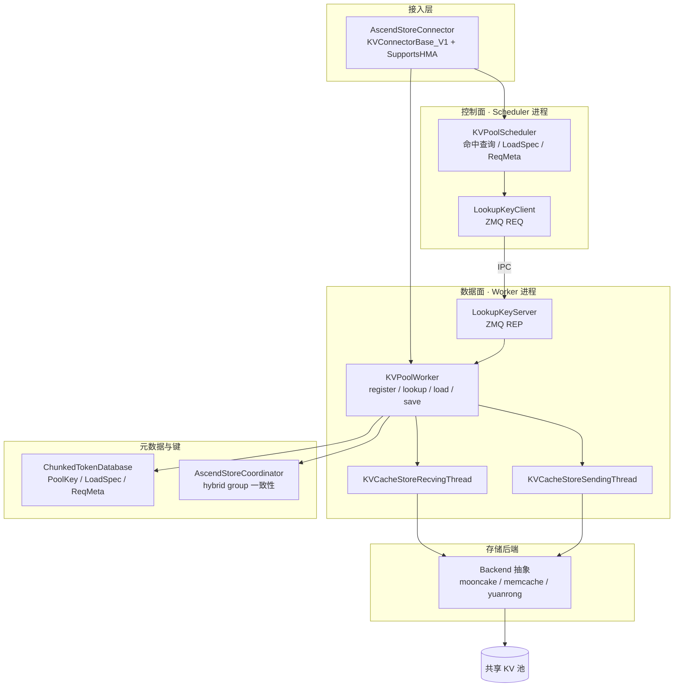
<p align="center">图 2 · AscendStore 的分层模块图：Scheduler 只有"决策"，Worker 才有"存储客户端"</p>

| 文件 | 职责 | 关键符号 |
|---|---|---|
| `ascend_store_connector.py` | vLLM Connector V1 适配层 | `build_connector_meta`、`start_load_kv`、`LookupKeyServer` |
| `pool_scheduler.py` | 控制面：命中查询、LoadSpec、请求分类 | `get_num_new_matched_tokens`、`_process_*` |
| `pool_worker.py` | 数据面：注册 cache、lookup、load/save、TP mismatch | `lookup_scheduler`、`start_load_kv`、`_build_strided_addrs` |
| `metadata.py` | 键与元数据 | `PoolKey`、`LoadSpec`、`ReqMeta`、`RequestTracker` |
| `lookup_key.py` | 命中查询的 ZMQ 代理 | `LookupKeyClient` / `LookupKeyServer` |
| `kv_transfer.py` | 后台收发线程与 `get/put` 编排 | `KVCacheStoreRecvingThread` / `SendingThread` |
| `coordinator.py` | hybrid KV group 的公共命中与 mask | `AscendStoreCoordinator` |
| `layerwise/` | 逐层模式（调度、worker、传输、布局） | `LayerwiseKVPoolWorker`、`LayerwiseCacheLayout` |
| `backend/` | 存储后端抽象与实现 | `Backend`、`MooncakeBackend`、`MemcacheBackend`、`YuanrongBackend` |
| `attention_fence.py` | layerwise 下 attention 计算与传输的时序门控 | `attention_transfer_window` |
| `metrics.py` | 连接器侧指标 | `AscendStoreKVConnectorStats` |

### 2.4 三个后端，和"两个 Mooncake"

| 后端 | 底座 | 适用场景 | 数据面特点 |
|---|---|---|---|
| `mooncake` | Mooncake Distributed Store | 默认；需要 SSD offload、多租户配额 | 批量 `batch_put/get_from_multi_buffers` |
| `memcache` | MemFabric | A3 HCCS 低时延；逐层传输 | 支持 GVA（全局虚拟地址） |
| `yuanrong` | openyuanrong-datasystem | 多节点、Remote H2D、openEuler 生态 | 独立接口 |

> ⚠️ **最容易混淆的一点**：目录里有两个 "Mooncake"。
> - `kv_p2p/mooncake_connector.py`：Mooncake 作为**远端内存传输引擎**，核心是 rank + 地址 + 传输计划；
> - `kv_pool/ascend_store/backend/mooncake_backend.py`：Mooncake 作为**对象存储后端**，核心是 key + exists + get/put。
>
> 名字一样，语义完全相反：一个是"把数据搬到指定地址"，一个是"把数据放进共享池里按名字取"。排障时先确认自己看的是哪一层。

---

## 3. 架构主线：控制面与数据面分离

### 3.1 为什么必须切开

这不是"设计品味"，而是被 vLLM 的进程模型逼出来的：

1. **Scheduler 进程没有 device 指针**。它做的是 block 分配与调度，只知道 block id，不知道 KV tensor 的地址；
2. **存储客户端只存在于 Worker**。`register_kv_caches()` 之后，`m_store` 才拿到可读写的缓冲区；
3. **调度决策是同步的**。`get_num_new_matched_tokens()` 必须在当前 step 返回"能复用多少 token"，否则没法决定分配多少 block、本 step 算多少 token。

于是形成一个很自然的分工：

- **控制面**：Scheduler 通过 ZMQ 问 Worker "这段前缀池里有吗？"，只传元数据、只回一个整数；
- **数据面**：Worker 按 `ReqMeta` 算出 key/地址/长度，调用 backend 的 `get/put`，真正搬运 tensor。

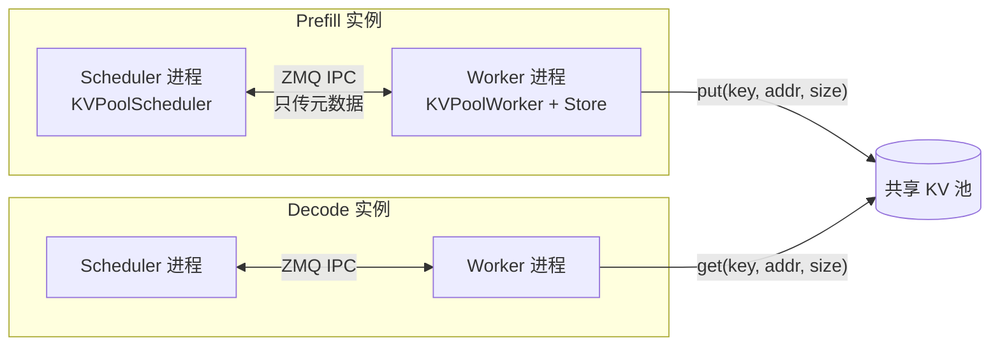
<p align="center">图 3 · 进程边界：控制面在 Scheduler，数据面在 Worker，池在两者之外</p>

### 3.2 一次命中的完整时序

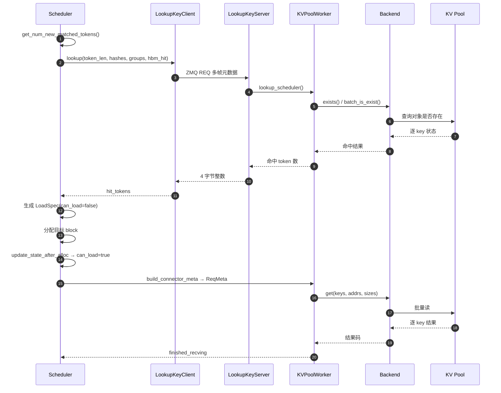
<p align="center">图 4 · 一次 prefix hit 的控制面与数据面时序</p>

这里有两个刻意的"只传元数据"：

- `LookupKeyClient.lookup()` 只发 `token_len`、`hbm_hit_tokens`、group id 和 block hash 字符串，**不发 tensor**；
- `LookupKeyServer` 只回一个 big-endian 的 4 字节整数，**不回结果列表**。

### 3.3 lookup RPC 的三个细节

**(1) 通道是本地 IPC，不是网络 RPC。** 路径形如 `ipc://{VLLM_RPC_BASE_PATH}/lookup_rpc_port_{port}_dp_rank{dp_index}`，`REQ/REP` 模型，请求方是 Scheduler，服务方是 Worker 里起的 `LookupKeyServer`。`lookup_rpc_port` 只用于隔离 IPC 路径，官方文档明确说它**不解决**与其他组件的 TCP 端口冲突。

**(2) 超时 1 秒，失败即"降级为 0 命中"。** 客户端设置了 `RCVTIMEO=1000`；一旦 ZMQ 出错，就记日志、关闭 client、返回 0。调度器于是认为"池里什么都没有"，走正常 prefill——**正确性不受影响，只是退化成没开池化**。

**(3) `RESET_MSG` 走同一条通道。** 除了 `LOOKUP_MSG`，还支持 `RESET_MSG` 让 rank 0 排空队列后 `remove_all(force=True)`，用于测试与重置。

> **点评 · 一个值得讨论的取舍**
> 当前实现里，`lookup` 一旦异常会 `close()` 客户端，而 `lookup()` 开头有 `if self._closed: return 0`。也就是说，**一次 1 秒超时之后，这个 Scheduler 进程后续所有请求都会直接返回 0 命中，直到进程重启**。从"宁可退化不可出错"的角度看这是安全的，但从可用性看，池的一次抖动会让整个实例永久失去池化收益。更温和的做法是：失败后进入带退避的重连状态，并暴露一个熔断指标；连续失败 N 次再彻底短路。

### 3.4 数据面：两个线程与一个错峰技巧

数据面常驻两个后台线程（layerwise 模式另有自己的变体）：

- `KVCacheStoreSendingThread`：消费 `ReqMeta`，算 key/地址，调 `backend.put()`；
- `KVCacheStoreRecvingThread`：消费 `ReqMeta`，调 `backend.get()`，把数据写进本地 KV cache。

有一个很实用的小设计：在真正调用 `get()` 之前，Worker 会按 `tp_rank` 对 key/addr/size 列表做**循环移位**：

```python
# 代码里是内联写法，没有独立的 helper
shift = self.tp_rank % len(key_list)
key_list_c = key_list[shift:] + key_list[:shift]
```

目的是让不同 TP rank 的请求从不同的 key 开始，避免所有 rank 在同一时刻对同一批对象发起访问，形成"同频抖动"。这类细节不会出现在架构图里，但往往是池化能否跑出线性的关键。

### 3.5 两阶段 LoadSpec：为什么 `can_load` 不能当场置真

`get_num_new_matched_tokens()` 只回答"能复用多少"，此时**目标 block 还没分配**。所以命中结果先落成一个 `LoadSpec(can_load=False)`；等 `update_state_after_alloc()` 确认 block 分配完成，并断言

```text
num_external_tokens == kvpool_cached_tokens - vllm_cached_tokens
```

之后，才把 `can_load` 置为 `True`。Worker 侧 `start_load_kv()` 的第一件事就是检查这个标志，不满足就跳过。

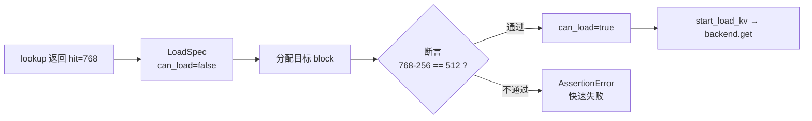
<p align="center">图 5 · 两阶段提交式的加载计划：先记录意图，分配完成后再放行</p>

> **点评**：这个"先占位、后放行"的两段式，是整套设计里最像数据库事务的地方。它防的是同一类 bug：**调度器以为命中了，但 block 没准备好，Worker 却已经开始往一块不属于自己的显存里写**。用一句断言把这种不一致变成"启动即失败"，比事后查数据错乱便宜得多。

---

## 4. 三个核心数据结构

### 4.1 LoadSpec：一次加载的"意图"

| 字段 | 含义 | 为什么需要 |
|---|---|---|
| `vllm_cached_tokens` | 本地 vLLM 已命中的 token 数 | 计算"还差多少"的基线 |
| `kvpool_cached_tokens` | 池中命中的 prefix token 数 | 决定能省多少 prefill |
| `can_load` | 是否允许 Worker 执行 load | 两阶段提交的闸门 |
| `kvpool_store_skip_tokens` | 保存时要跳过的前缀长度 | 避免把刚读出来的 KV 又写回去 |
| `token_len` | Worker 侧实际使用的加载长度 | 与 chunk/granularity 对齐 |
| `layerwise_*` | 逐层模式的快照身份 | 区分"上一步"与"外部命中" |

实际从池里读的区间是：

```text
外部加载区间 = [vllm_cached_tokens, kvpool_cached_tokens)
```

同一个请求在 `get_num_new_matched_tokens` 里会先 `pop` 掉旧的 `load_specs[req_id]`。注释写得很直白：等待中的请求可能在准入前被再次查询，**不能把上一次的命中计划带到这一次**。

几个边界处理也值得注意：

- 如果命中长度等于请求总长，会强制减 1——必须留至少一个 token 重新计算，否则没有可用的 logits；
- 开启 EAGLE/MTP 时，如果命中伸进了最后一个粒度块，会裁掉一块，保证 draft/verify 的隐状态是新鲜算出来的；
- 当 group 之间存在私有压缩状态时，会把命中长度下取整到传输粒度，避免"从压缩块中间恢复"。

### 4.2 ReqMeta 与 RequestTracker

`RequestTracker` 是 Scheduler 侧的"请求账本"，`ReqMeta` 是每个 step 发给 Worker 的"工单"。

| 结构 | 关键字段 | 用途 |
|---|---|---|
| `RequestTracker` | `req_id`、`token_len`、`allocated_block_ids_by_group`、`num_saved_tokens`、`block_hashes` | 跨 step 记住这个请求分配过哪些 block、存到哪了 |
| `ReqMeta` | `save_start_token`、`target_token_len`、`block_ids_by_group`、`block_hashes`、`can_save`、`load_spec` | 告诉 Worker 本 step 读什么、写什么、写多少 |

注意 `allocated_block_ids_by_group` 是**按 group 分开**的，因为 hybrid 模型里不同 group 的 block size 可以不同；`num_saved_tokens` 是"已经写进池的高水位"，决定下一次从哪继续写。

### 4.3 PoolKey：把坐标系写进名字

池里的对象没有中心化索引，靠 key 自描述。`PoolKey.to_string()` 的拼接顺序是固定的：

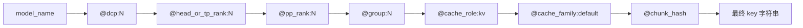
<p align="center">图 6 · PoolKey 的组成：模型 + 并行坐标 + cache 语义 + 内容 hash</p>

一个真实的 key 长这样：

```text
Qwen3-32B@dcp:0@head_or_tp_rank:3@pp_rank:0@group:1@cache_role:kv@cache_family:default@9f2c...e1
```

| 字段 | 作用 | 不加会怎样 |
|---|---|---|
| `model_name` | 隔离模型 | 不同模型可能撞 hash |
| `head_or_tp_rank` | 区分 TP 分片 | 读到别的 rank 的 head |
| `dcp_rank` | 区分 decode context parallel | CP 下分片错位 |
| `pp_rank` | 区分流水段 | PP 下读到别的层的 KV |
| `kv_cache_group_id` | 区分 hybrid group | Full/Sliding/MLA 混读 |
| `cache_role` | 区分 `kv` 与 `state`（Mamba） | conv_state 与 KV 撞名 |
| `cache_family` | 区分压缩布局（`c1`/`cN`） | 压缩比不同却共享对象 |
| `chunk_hash` | 内容寻址 | 无法按内容复用 |

> **点评 · "拓扑绑定"是特性还是缺陷？**
> 把 TP/PP/group 写进 key，好处是**去中心化**：不需要一个全局元数据服务来记录"这个对象属于哪个 rank、什么布局"，对象存储天然按 key 分片，读侧也不需要额外解析。
>
> 代价是**弹性差**：TP 从 8 扩到 16、PP 从 2 改成 4 之后，旧 key 一个都命中不了——不是数据坏了，而是"坐标系"变了。对"稳定拓扑、长期跑同一模型"的集群，这是合理取舍；对"频繁扩缩容"的云上场景，命中率会在扩容后归零，需要靠预热重建。这个张力在 §7 的 TP/PP mismatch 里还会再出现一次：那套机制解决的是"读写两侧 TP 不同"，但解决不了"池里对象随拓扑失效"。

---

## 5. 调度器的四个 process

### 5.1 请求状态机

`build_connector_meta()` 每个 step 都会把请求分成四类。它们不是四种协议，而是**同一个请求的四种状态**：

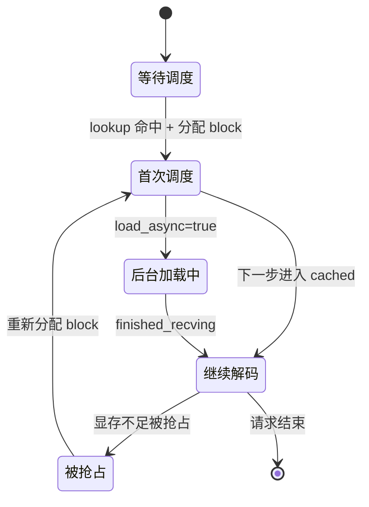
<p align="center">图 7 · 请求在调度器视角下的状态迁移</p>

### 5.2 四类处理

| 处理函数 | 触发条件 | 关键动作 | 要防的问题 |
|---|---|---|---|
| `_process_new_request` | 本 step 新调度 | 建 `RequestTracker`、记录 block、生成初始 `ReqMeta` | 旧 tracker 残留 |
| `_process_preempted_cached_request` | 被抢占后重新调度 | **重建** tracker 与 block 绑定 | 旧 block 已释放，地址失效 |
| `_process_running_cached_request` | 已在跑、只增 decode token | 复用 tracker、增量处理新增 token | 普通 decode 无需重复保存 |
| `_process_async_load_request` | 本轮没被调度，但后台 load 未完成 | 生成只用于完成传输的 `ReqMeta` | 异步加载被"遗忘" |

几个容易忽略的分支：

- 被抢占的请求，`ReqMeta` 里的 `block_ids` 必须重建，因为调度器可能已经把这些 block 回收再分配给别人；
- 普通 decode 默认不保存（`is_decoding and not save_decode_cache and not layerwise_offload` 直接返回 `None`），否则每个 step 都往池里写，流量会爆炸；
- 异步加载的请求如果本轮没被调度，仍然要生成 `ReqMeta`，否则 `get()` 永远等不到消费方。

### 5.3 `build_connector_meta` 的执行顺序

```text
build_connector_meta(scheduler_output):
  1. 清理 finished / preempted 的 tracker、load_spec、unfinished 记录
  2. force_skip_save = (kv_role == kv_consumer and not consumer_is_to_put)
  3. 遍历 scheduled_new_reqs        → _process_new_request
  4. 遍历 scheduled_cached_reqs     → preempted ? preempted : running
  5. 找出"未调度但仍有未完成异步加载"的请求 → _process_async_load_request
  6. 每个 ReqMeta 先 retain_blocks_for_save()，再 add_request()
  7. 返回 AscendConnectorMetadata
```

第 6 步的 `retain_blocks_for_save` 很重要：**block 在被复用之前，必须先确认它的 save 已经完成**，否则会出现"刚写一半的 block 被下一个请求覆盖"的经典竞态。当前实现用 `in_flight_save_blocks.py` 追踪在途保存，并在 block 释放时 fence 掉排队的 save。

> **点评**：这四类 process 的名字很像"四个业务分支"，其实是"一个请求的四个阶段"。读代码时如果按状态机去理解，`_process_preempted_cached_request` 里那些"重建而不是复用"的注释就都顺了——它不是健忘，而是**旧地址已经不属于你了**。

---

## 6. Hybrid KV cache：多 group 的一致性

### 6.1 什么是 hybrid group

Hybrid 不是"HBM + CPU 两级缓存"，而是**模型本身有多套 KV cache**：

| group 类型 | 例子 | 特点 |
|---|---|---|
| Full Attention | 普通 dense 层 | 保存完整历史 |
| Sliding Window | SWA 层 | 只保留窗口范围 |
| MLA | DeepSeek 系列 | latent / nope / rope 不同布局 |
| Mamba / 线性注意力 | `conv_state`、`ssm_state` | 用 `align` 模式管理状态块 |
| 压缩布局 | 部分压缩注意力模型 | 不同层有不同 `compress_ratio` |

它们在代码里通过 `KVCacheGroupSpec`、`kv_cache_group_id`、`grouped_block_size` 区分，**每个 group 可以有不同的 block size、key 前缀、命中 mask 和传输大小**。

### 6.2 公共命中：取 min，而不是取并

假设：

```text
group 0（Full Attention，block=16）：命中 128 token
group 1（Sliding Window，block=32）：只命中 96 token
```

`AscendStoreCoordinator` 不会用 128，而是取各 group 可安全共享的公共前缀：

```text
common_hit = min(128, 96) = 96
```

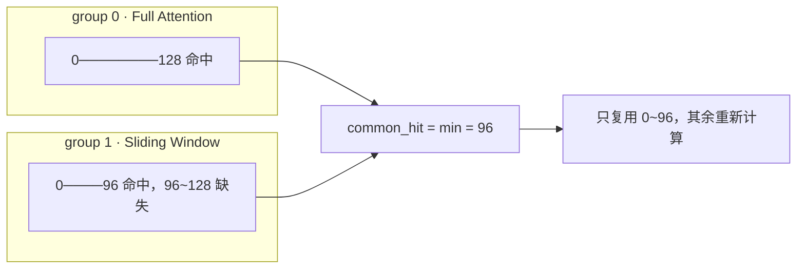
<p align="center">图 8 · hybrid 的公共命中：一致性优先于命中长度</p>

### 6.3 mask 与"可达性"

除了长度，coordinator 还负责生成每个 group 的 `load_mask` / `store_mask` / `lookup_mask`，核心概念是**可达性（reachable）**：

- 某个 group 的 KV 可能因为滑动窗口而被淘汰，导致"块存在但不可达"；
- 压缩布局下，父块的 hash 链必须完整，否则子块也不能用；
- Mamba 状态块还有"align"语义，空 block 不能直接跳过。

`find_reachable_hit_tokens()` 和 `reachable_block_mask()` 就是在算"从请求开头出发，哪些块是真正可以连续复用的"。

> **点评**：hybrid 是这套设计里最容易出正确性问题的地方。把"命中长度"从"单 group 的最长前缀"改成"多 group 的公共可达前缀"，是一个**保守但正确**的选择。代价是：只要有一个短窗口 group 命中得少，整体收益就被拉低。对 SWA 占比高的模型，池化收益可能没有想象中高，上线前应该按 group 分别打点，而不是只看一个总的 hit rate。

---

## 7. TP / PP 对齐：两套"编译期地址映射"

### 7.1 问题本质

写池的人和读池的人，并行拓扑可能不同：

- Prefill TP=8，Decode TP=2：一个 Decode rank 需要读 4 个 Prefill rank 的 KV；
- Prefill PP=2，Decode PP=1：Decode 产生 61 层 KV，Prefill 只负责其中一段。

AscendStore 的解法不是"读的时候拼 tensor"，而是**在 key 和地址层面做映射**。

### 7.2 TP mismatch：以最大 TP 为 canonical shard

`infer_tp_mismatch_info()` 的判定条件（当前代码）：

```text
enabled = (peer_tp_size > local_tp_size)
          and not use_mla
          and not use_hybrid
          and num_kv_heads >= effective_tp_size
          and num_kv_heads % effective_tp_size == 0
```

其中 `effective_tp_size = max(peer_tp, local_tp)`，作为"规范分片数"。以 KV heads=32、P TP=8、D TP=2 为例：

```text
canonical shards = 8 份，每份 4 heads
D rank 0 需要 P rank 0~3 → 读 4 个 sub-key，写入本地 heads 0~15
D rank 1 需要 P rank 4~7 → 读 4 个 sub-key，写入本地 heads 16~31
```

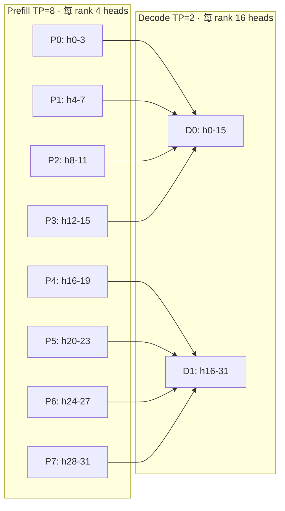
<p align="center">图 9 · TP mismatch：Decode 一个 rank 聚合多个 Prefill 分片</p>

关键实现是 `_build_strided_addrs()`：它为每个目标 head slice 单独计算地址与字节数，因此**不需要先把 4 个远端对象拼成一个完整 tensor**。代价是地址计算更复杂，且这套路径要求非 MLA、非 hybrid、head 数可整除——限制条件很多，属于"能用但不通用"的优化。

### 7.3 PP mismatch：用 `@pp_rank` 和 layer partition 表达

Prefill PP=2、Decode PP=1、模型 61 层、partition `30,31` 时：

- Decode 侧产生完整 61 层 KV；
- 发送线程调用 `decode_adaptor_prefill_pp()`，把一个逻辑 key 展开成两类物理 key：
  - layer 0~29 → `@pp_rank:0`
  - layer 30~60 → `@pp_rank:1`
- Prefill 的 PP rank 0/1 后续各查各的 key。

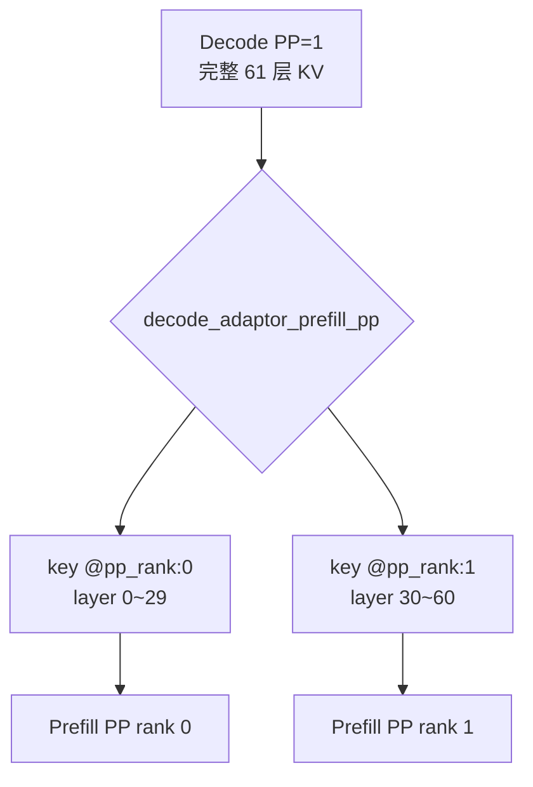
<p align="center">图 10 · PP mismatch：按 layer 区间切 key，而不是按 head 切片</p>

注意这里切分单位是**连续的 layer 地址区间**，所以不需要 TP mismatch 那套 strided head 计算。配置上需要 `prefill_pp_size` 或 `prefill_pp_layer_partition`，否则读侧无法知道怎么重建。

### 7.4 取舍

| 方案 | 好处 | 代价 |
|---|---|---|
| TP mismatch：canonical shard + strided addr | 读侧聚合，不搬整 tensor | 地址计算复杂；只支持非 MLA/hybrid |
| PP mismatch：layer 区间切 key | 语义简单、连续地址 | 需要 prefill 侧 PP 配置信息 |
| 都不做（要求拓扑一致） | 实现最简单 | 扩缩容后池内对象不可用 |

> **点评**：这两套机制解决的是"**读写两侧拓扑不同**"，但没有解决"**池内对象随拓扑变化而失效**"。前者是运行时映射，后者是生命周期问题。真正要做弹性池化，最终需要一个"逻辑对象 + 物理布局视图"的分离——key 只描述内容，布局作为对象内的元数据，读侧按需解释。这是我认为 AscendStore 下一步最值得投入的方向（见 §12.3）。

---

## 8. AscendStore 与 kv_p2p：两种传输哲学

### 8.1 一张图看懂差别

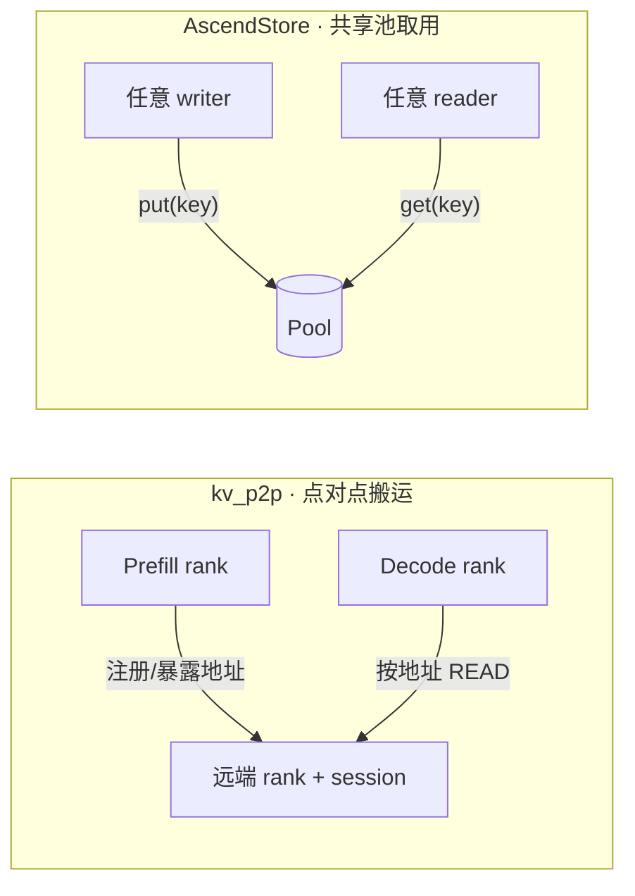
<p align="center">图 11 · 两种哲学：一个是"把这次请求的 KV 搬到指定地方"，一个是"按内容去池里取"</p>

### 8.2 关键区别

| 维度 | kv_p2p | AscendStore |
|---|---|---|
| 定位 | 指定 P 实例的远端地址 | 共享 Pool 中的内容 key |
| 关系 | P/D 之间点对点 | 多实例共享对象存储 |
| 读取 | D 根据远端地址 READ | 读方按 key `get` |
| 写入 | P 暴露/注册本地 KV 地址 | 写方 `put(key, addr, size)` |
| 生命周期 | 通常绑定请求或 P/D 会话 | 可跨请求、跨实例复用 |
| 拓扑信息 | rank、端口、远端地址是核心 | rank 主要参与 key 命名与 shard 映射 |
| PP 表达 | `GroupPull.prefill_pp_rank` | `@pp_rank:N` + layer partition |
| TP 表达 | remote TP mapping / `GroupPull` | canonical shard、sub-key、strided address |
| 事件 | 传输完成/发送完成/接收完成 | Pool hit、`BlockStored`、`BlockRemoved` |

### 8.3 `GroupPull` vs `PoolKey`

P2P 的 `GroupPull`（`kv_p2p/mooncake_connector.py`）描述的是一次**远端拉取计划**：

```python
@dataclass
class GroupPull:
    group_id: int
    remote_tp_offset: int
    num_group_pulls: int
    prefill_pp_rank: int
    is_group_transfer_end: bool
```

AscendStore 没有同名结构，它用另一组对象表达同样的信息：

| P2P 概念 | AscendStore 对应 |
|---|---|
| `group_id` | `KVCacheGroupSpec` / `kv_cache_group_id` |
| `remote_tp_offset` | `head_or_tp_rank` + sub-key + `_build_strided_addrs` |
| `prefill_pp_rank` | `@pp_rank:N` + `decode_adaptor_prefill_pp` |
| 传输计划 | `ReqMeta.block_ids_by_group` + backend `get/put` |

一句话：**`GroupPull` 是"远端 rank → 本地 rank 的传输计划"，`PoolKey` 是"共享池对象的命名与一致性协议"**。

### 8.4 Mooncake 的双重身份

同一个 Mooncake，在两个目录里扮演不同角色：

```text
kv_p2p/mooncake_connector.py            = 远端内存传输引擎（engine + session + 地址）
kv_pool/ascend_store/backend/mooncake.py = KV Pool 的对象存储后端（store + key + object）
```

P2P 关心的是"远端 rank + 地址映射 + 传输计划"；AscendStore 关心的是"key + 对象是否存在 + get/put + 生命周期"。排障时如果看到 `batch_transfer_sync_read`，你在 P2P；看到 `batch_put_from_multi_buffers`，你在池化。

### 8.5 选型决策树

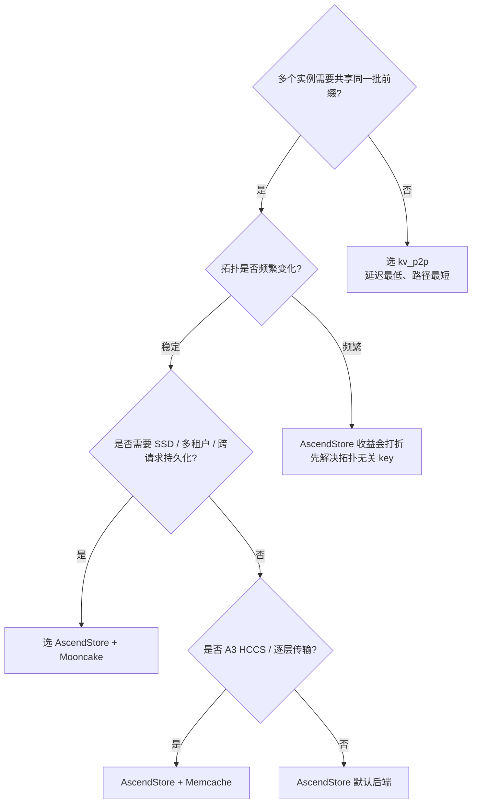
<p align="center">图 12 · 选型决策树：先问共享需求，再问拓扑稳定性，最后问后端能力</p>

---

## 9. 四个场景推演

以下数字均为简化示例，只用于说明模块如何协作，不代表生产配置。

### 9.1 普通 prefix hit

```text
请求长度：1024 token
本地 HBM 已命中：256 token
KV Pool 命中：768 token
```

调用链：

```text
get_num_new_matched_tokens()
  → LookupKeyClient.lookup(token_len=1024, hbm_hit_tokens=256)
  → LookupKeyServer → KVPoolWorker.lookup_scheduler()
  → 返回 768
```

调度器构造：

```text
vllm_cached_tokens   = 256
kvpool_cached_tokens = 768
需要外部 load 的区间  = [256, 768)   → 512 token
继续计算的区间        = [768, 1024)  → 256 token
```

`lookup` 只返回 768 这个整数；真正的 512 token KV 由 Worker 在 `start_load_kv()` 里调用 `backend.get()` 读取。

### 9.2 抢占后恢复

```text
第一次调度：_process_new_request()
  → 建 tracker
  → 分配 block [10, 11]
  → 生成 LoadSpec

被抢占后恢复：_process_preempted_cached_request()
  → 旧 block 可能已释放
  → 重新绑定 block [25, 26]
  → 重新生成目标地址

继续 decode：_process_running_cached_request()
  → 复用 tracker
  → 只处理新增 token/block

后台 load 未完成：_process_async_load_request()
  → 本轮没有重新调度该请求
  → 仅生成异步 load 所需的 ReqMeta
```

### 9.3 hybrid 不一致

```text
group 0（Full，block=16）：命中 128
group 1（SWA，block=32） ：命中  96
→ 公共命中 96，剩余 32 token 重新计算
```

### 9.4 TP mismatch

```text
P TP=8（每 rank 4 heads），D TP=2（每 rank 16 heads）
D rank 0 读 P rank 0~3 的 sub-key，写入本地 heads 0~15
D rank 1 读 P rank 4~7 的 sub-key，写入本地 heads 16~31
```

### 9.5 PP mismatch

```text
P PP=2（partition 30,31），D PP=1（61 层）
D 写：layer 0~29 → @pp_rank:0；layer 30~60 → @pp_rank:1
P0 查 @pp_rank:0，P1 查 @pp_rank:1
```

---

## 10. 失败、恢复与可观测性

### 10.1 load 失败：可回退，不致命

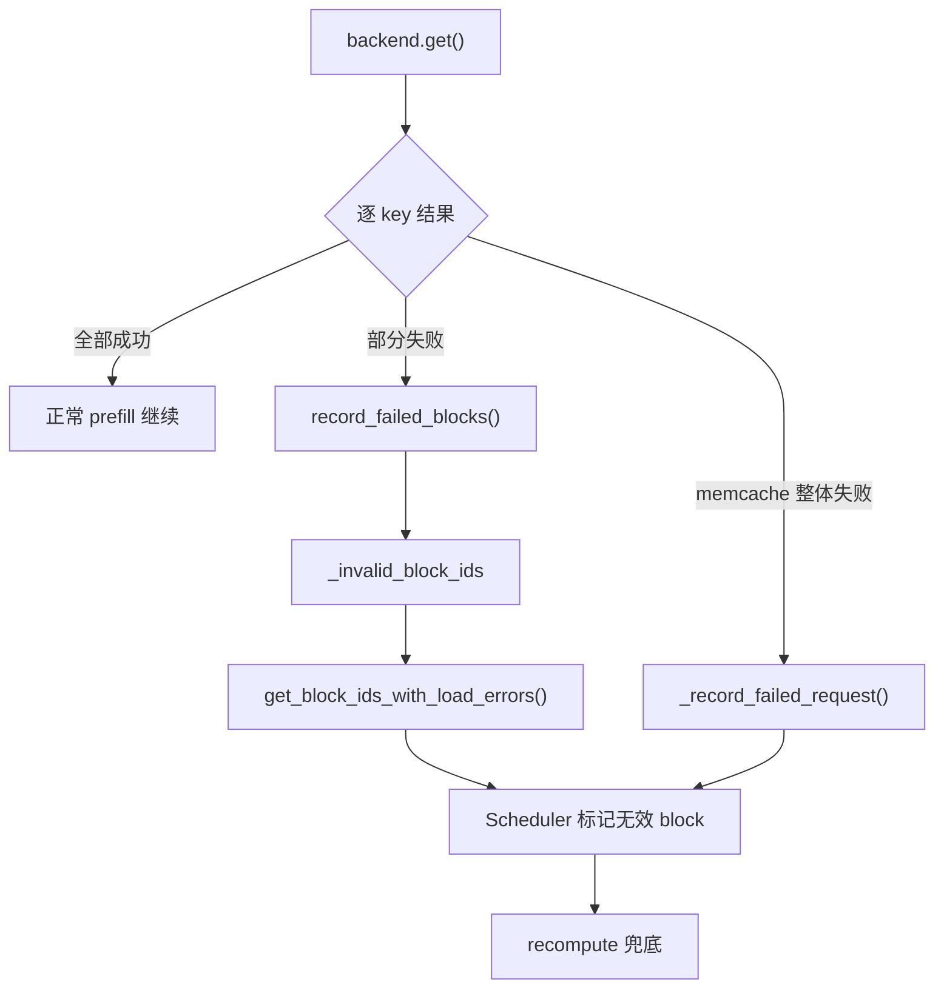
<p align="center">图 13 · load 失败路径：错误向上暴露，由调度器决定重算</p>

这条路径成立的前提是 `kv_load_failure_policy=recompute`：池子读失败只是"少省一点算力"，请求本身继续跑。

### 10.2 save 失败：只影响后续复用

保存路径先做两件"去重"：

1. 跳过 `load_spec.kvpool_store_skip_tokens` 覆盖的前缀（刚读出来的不写回去）；
2. 按需 `exists()` 检查，只写缺失的 key。

写入失败时：

- 后端记录错误码与日志；
- 如果后端返回逐 key 结果（当前 `Backend.put` 已支持 `list[bool]`），发送线程会**只为成功的 key 生成 `BlockStored` 事件**；
- 请求本身继续使用刚算出来的本地 KV，失败只影响"下次能不能命中"。

原文写作时还没有逐 key 返回，所以当时是"事件偏乐观、靠后续 `exists()` 发现缺失"；当前主干已经补上了这条路径，并保留了失败后的 token 后缀用于事件重放（`_retry_token_ids`）。这属于**延迟恢复**，不是当前请求内的立即重试。

### 10.3 `BlockStored` 的语义边界

KV event 是给外部（如 prefix cache 路由器、KV-aware LB）消费的。它必须满足两个条件才可信：

1. 对象真的写成功了；
2. 对象的父块 hash 链完整（否则消费方会以为可以接着用）。

当前实现用"逐 key 成功状态 + 父块 hash"来过滤事件，比"无条件上报"安全得多，但仍有一个边界：**事件是"写成功"的语义，不是"可读"的语义**。如果后端有租约/提交（lease/commit）模型，`commit` 之前对象可能不可读，事件与可读性之间还存在窗口。

### 10.4 lookup 失败：fail-open，但可能"永久"

如 §3.3 所述，超时会关闭 client，后续直接 0 命中。建议在生产上把这一点当成**已知行为**写进排障手册：如果某实例突然"池化完全不生效"，先查 Scheduler 日志里有没有 `KV pool lookup failed`。

### 10.5 指标

`metrics.py` + `get_stats()` 提供了连接器侧的基础指标（load/save 次数、时延、key 数等）。真正排障时建议至少看四类：

| 指标 | 回答的问题 |
|---|---|
| lookup 命中 token 数 / 请求数 | 池化到底有没有生效 |
| lookup 时延 P50/P99 | RPC 是否成为调度瓶颈 |
| put/get 字节数与失败率 | 后端是否健康、带宽是否打满 |
| 每 group 命中率 | hybrid 下是哪个 group 拖后腿 |

---

## 11. 补充：Bulk 与 Layerwise 两条数据通路

原文主要讲 bulk（整块）路径，这里补一条对照，因为实际部署里 `use_layerwise` 很常见。

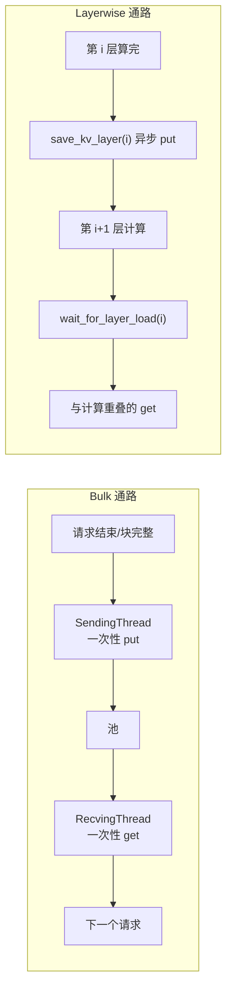
<p align="center">图 14 · 整块搬运 vs 逐层流水：后者用更多同步点换更低的端到端等待</p>

| 维度 | Bulk | Layerwise |
|---|---|---|
| 传输单位 | 整个 block / chunk | 单层 |
| 与计算重叠 | 基本不重叠 | 层间流水 |
| 实现复杂度 | 低 | 高（8 个钩子、fence、GVA/block-key 两套数据面） |
| 图模式 | 常规 | 需要 piecewise graph |
| 适用 | 通用、默认 | Prefill 节点、Mooncake/Memcache |

layerwise 的收益来自"把等待藏进计算里"，代价是同步点变多、对后端和图模式的要求更高。官方文档把 `use_layerwise` 限定在 Prefill 节点，也是这个原因：Decode 每步只算一个 token，没有足够的计算量去掩盖传输。

---

## 12. 我的看法

### 12.1 三个漂亮的设计

**第一，两阶段 LoadSpec 把"意图"和"执行"分开了。** `lookup` 只产生"能复用多少"，`can_load` 由分配结果决定。这让调度器的判断始终基于"已分配的事实"，而不是"查到的愿望"。很多缓存系统出问题，恰恰是因为把"查到了"当成"用得上"。

**第二，key 自描述，池子不需要中心化元数据。** 模型、并行坐标、group、角色、布局全部编码进 key，对象存储天然分片，读侧不需要先查一张全局表。这让系统在"多实例、无共享元数据服务"的前提下也能工作，扩展性很好。

**第三，池子是"可失败加速器"。** load 失败回退重算，save 失败只损失后续命中，lookup 失败退化成 0 命中。正确性从不依赖池子——这是它能被放心打开的前提。相比之下，很多"缓存即正确性"的设计在池抖动时会直接雪崩。

### 12.2 六个隐忧

1. **lookup 在调度热路径上同步执行。** 每个请求一次 IPC 往返，1 秒超时；QPS 高时这是 O(requests) 的串行开销。没有批量 lookup，也没有本地预过滤。
2. **一次超时可能永久关闭该实例的池化。** `close()` 后 `_closed=True`，后续 lookup 直接 0。可用性上是"安全"，体验上是"静默退化"。
3. **key 与拓扑强绑定。** TP/PP 一变，池内对象全部失效。扩容后命中率归零，需要重新预热；这与"弹性伸缩"的诉求天然冲突。
4. **写路径不是原子的。** 一个逻辑块可能对应多个物理 key（PP 分片、TP sub-key），部分失败会留下"半条命"对象。虽然有 `exists()` 兜底，但读侧要处理"部分命中"，逻辑复杂度上升。
5. **hybrid 取 min 会压低收益。** 只要有一个 group 命中少，整体命中就短。对 SWA/Mamba 混布模型，收益需要按 group 实测，不能只看总 hit rate。
6. **两个 Mooncake 的认知负担。** 传输引擎与存储后端同名不同物，新人排障时极易看错层。

### 12.3 如果我来改

| 方向 | 具体想法 | 预期收益 |
|---|---|---|
| 批量/异步 lookup | 按 step 聚合请求做一次批量 RPC；或先过一层本地 Bloom filter | 降低调度热路径开销 |
| 拓扑无关 key | key 只描述内容；TP/PP 布局作为对象内元数据，读侧解释 | 扩容后不丢命中 |
| 写事务化 | `put` 后统一 `commit`，未提交对象不可见；读侧只认已提交 | 消灭"半条命"对象 |
| 熔断与重连 | lookup 失败进入退避重连，连续 N 次才短路，并暴露指标 | 池抖动不再永久降级 |
| 命中口径标准化 | 分别暴露 token 命中率、block 命中率、请求命中率 | 压测与容量规划更准 |
| 事件与可读解耦 | `BlockStored` 只在 commit 之后发 | 外部消费者不会读到"看似存在但不可读"的对象 |

### 12.4 什么时候不该用

- **请求之间几乎没有重复前缀**：lookup + put 全是净成本；
- **拓扑频繁变化**：扩容后池内对象不可用，预热成本可能超过收益；
- **带宽已经打满**：池化会再增加一次 device → pool → device 的流量；
- **对 TTFT 抖动极敏感、且后端不在同机房**：远程 get 的 P99 会直接反映在 TTFT 上；
- **只想省 Decode 显存**：池化不省 Decode 的常驻 KV，应该看 KVPP、量化或 offload。

---

## 13. 与原文的差异（版本演进）

原文基于较早的实现，当前主干已经演进。以下是**我实际核对到的差异**，读原文时请以本节为准：

| 原文所述（早期实现） | 当前检出 |
|---|---|
| `LookupKeyClient` 写在 `pool_scheduler.py` | 独立成 `lookup_key.py`，含 `LookupKeyServer` 与 `RESET_MSG` |
| `layerwise_cache_layout.py` 在 `ascend_store/` 下 | 移入 `layerwise/` 子包，并新增 `layerwise/{pool_scheduler,pool_worker,kv_transfer,metadata}.py` |
| 后端为 `mooncake/memcache/yuanrong` | 另有 `mooncake_layerwise.py`、`layerwise_keys.py`、`session_tracker.py` |
| `put()` 不返回逐 key 状态 | `Backend.put()` 已返回逐 key 的 `list[bool]`（或 `bool` / `None`），发送线程据此过滤 `BlockStored` |
| save 失败靠日志与后续 `exists()` 发现 | 仍有失败后的 token 后缀保留（`_retry_token_ids`）用于事件重放；`put` 本身仍不自动重试 |
| 未提及指标 | 新增 `metrics.py`、`AscendStoreKVConnectorStats`、`_record_kv_connector_operation` |
| 未提及在途保存追踪 | 新增 `in_flight_save_blocks.py`，block 释放前先 fence 排队 save |
| 未提及 DSpark | 新增 `dspark_prefix_cache.py`，支持 SFA/DSpark 场景的前缀复用 |
| 未提及 lease/commit 语义 | `Backend` 出现 `batch_alloc` / `batch_add_lease` / `batch_commit` 等接口（layerwise 后端使用） |

这些差异不影响原文的架构结论，但影响排障时"该去哪个文件找"。

---

## 14. 代码索引

路径均相对仓库根 `vllm-ascend`，行号以当前检出处为准，仅作导航。

| 主题 | 文件 | 关键符号 |
|---|---|---|
| 连接器注册 | `vllm_ascend/distributed/kv_transfer/__init__.py` | `AscendStoreConnector`、`MultiConnector` |
| Connector 适配 | `.../kv_pool/ascend_store/ascend_store_connector.py` | `build_connector_meta`、`start_load_kv`、`LookupKeyServer` |
| 命中查询 | `.../lookup_key.py` | `LookupKeyClient.lookup`、`LookupKeyServer` |
| 调度控制面 | `.../pool_scheduler.py` | `get_num_new_matched_tokens`、`update_state_after_alloc`、`_process_*` |
| 请求元数据 | `.../metadata.py` | `PoolKey`、`LoadSpec`、`RequestTracker`、`ReqMeta` |
| Worker 数据面 | `.../pool_worker.py` | `lookup_scheduler`、`start_load_kv`、`_load_kv_tp_mismatch`、`_build_strided_addrs` |
| 收发线程 | `.../kv_transfer.py` | `KVCacheStoreRecvingThread`、`KVCacheStoreSendingThread` |
| hybrid 一致性 | `.../coordinator.py` | `AscendStoreCoordinator.find_reachable_hit_tokens` |
| 逐层布局 | `.../layerwise/layerwise_cache_layout.py` | `LayerwiseCacheLayout`、`build_layerwise_reuse_layout` |
| attention 门控 | `.../attention_fence.py` | `attention_transfer_window` |
| 后端契约 | `.../backend/base.py` | `Backend.put/get/exists`、`batch_*` |
| Mooncake 后端 | `.../backend/mooncake_backend.py` | `batch_put_from_multi_buffers`、`put` |
| 在途保存 | `.../in_flight_save_blocks.py` | `InFlightSaveBlockTracker` |
| P2P 对照 | `.../kv_p2p/mooncake_connector.py` | `GroupPull`、`batch_transfer_sync_read` |

---

## 15. 术语表

| 术语 | 含义 |
|---|---|
| APC | Automatic Prefix Caching，vLLM 原生前缀缓存 |
| Pool / KV Pool | 跨实例共享的 KV 存储池 |
| Connector | vLLM 的 KV 传输插件接口，AscendStore 是其实现 |
| LoadSpec | 调度器下发的"本次加载计划" |
| ReqMeta | 每个 step 下发给 Worker 的读写工单 |
| PoolKey | 池内对象的自描述 key |
| hybrid group | 模型内多套不同布局/窗口的 KV cache |
| TP/PP mismatch | 读写两侧张量并行/流水并行配置不一致 |
| canonical shard | TP mismatch 下以最大 TP 为基准的规范分片 |
| Bulk / Layerwise | 整块传输 / 逐层传输 |
| Lease / Commit | 对象写入的租约与提交语义（部分后端） |

---

## 附录 A：最小配置模板

**PD 混布（单实例 + 池）**

```bash
vllm serve /path/to/model \
  --kv-transfer-config '{
    "kv_connector": "AscendStoreConnector",
    "kv_role": "kv_both",
    "kv_load_failure_policy": "recompute",
    "kv_connector_extra_config": {
      "backend": "mooncake",
      "lookup_rpc_port": 0
    }
  }'
```

**PD 分离：Prefill 侧**

```bash
vllm serve /path/to/model \
  --kv-transfer-config '{
    "kv_connector": "AscendStoreConnector",
    "kv_role": "kv_producer",
    "kv_load_failure_policy": "recompute",
    "kv_connector_extra_config": {
      "backend": "mooncake",
      "lookup_rpc_port": 20001
    }
  }'
```

**PD 分离 + Decode 写池（MLA）**

```bash
vllm serve /path/to/model \
  --kv-transfer-config '{
    "kv_connector": "AscendStoreConnector",
    "kv_role": "kv_consumer",
    "kv_load_failure_policy": "recompute",
    "kv_connector_extra_config": {
      "backend": "mooncake",
      "consumer_is_to_put": true,
      "prefill_pp_size": 2
    }
  }'
```

> 说明：以上仅示意字段，实际部署还需按官方 KV Pool 指南准备 `mooncake.json` / Memcache 配置、环境变量与端口规划；`lookup_rpc_port` 只隔离本地 IPC，不解决跨组件 TCP 端口冲突。

---

## 一句话总结

> **kv_p2p 解决"这一次请求的 KV 怎么最快搬过去"，AscendStore 解决"算过的 KV 怎么被下一次请求按内容找回来"。前者优化延迟，后者优化重复计算；两者不是替代关系，而是同一条推理链路上的两个不同问题。**
