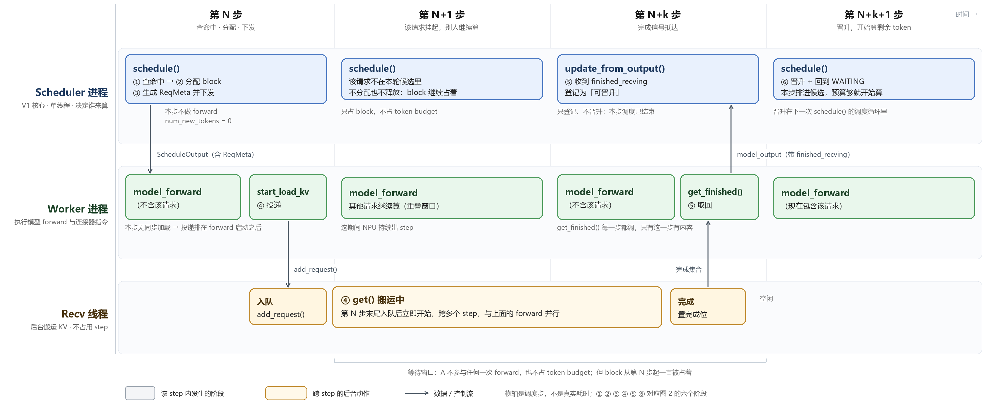
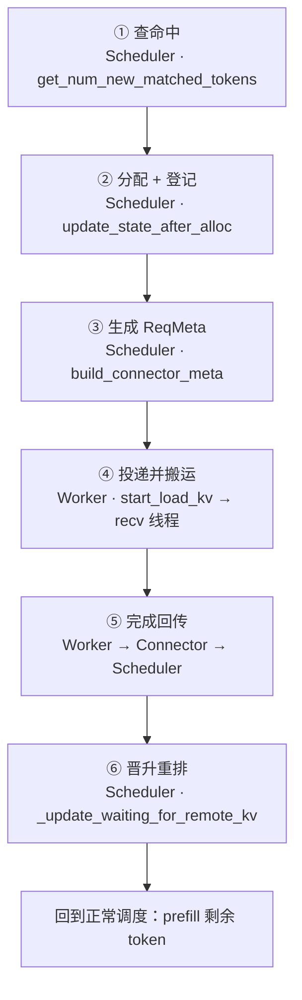
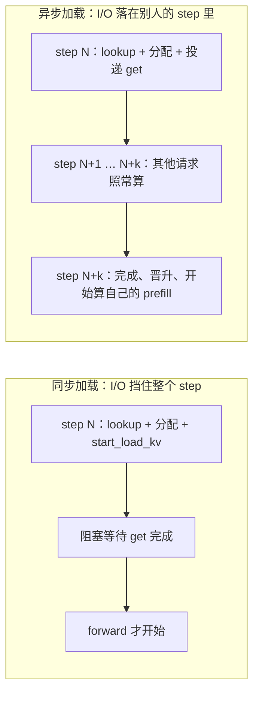
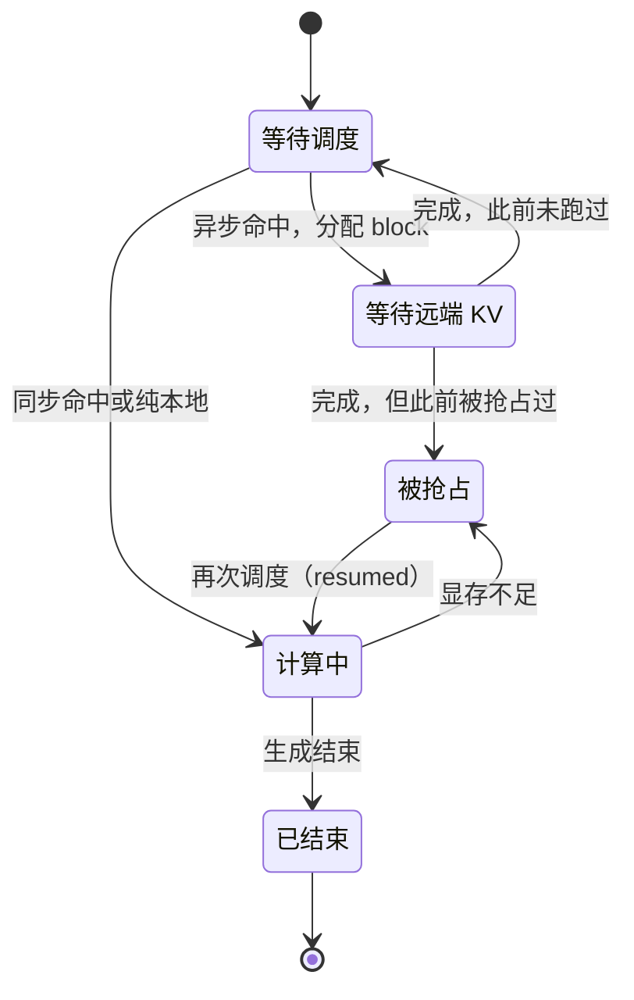
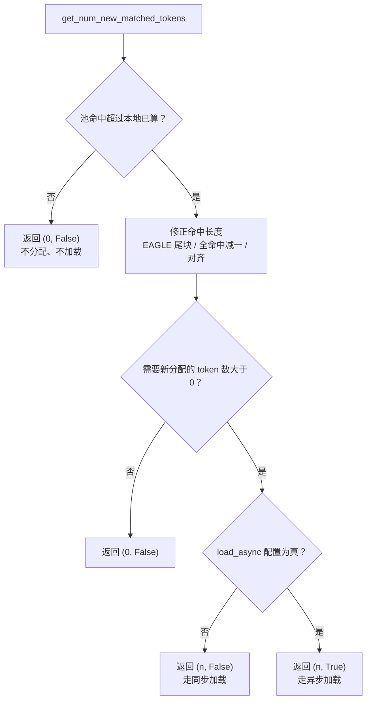
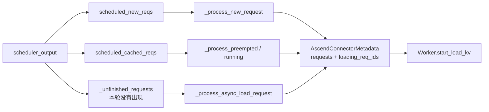
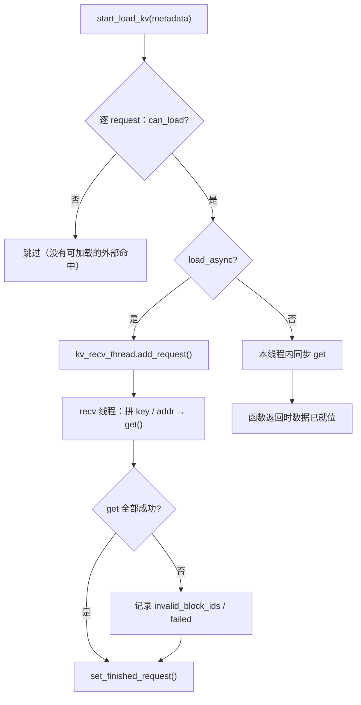
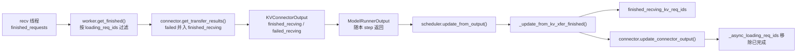
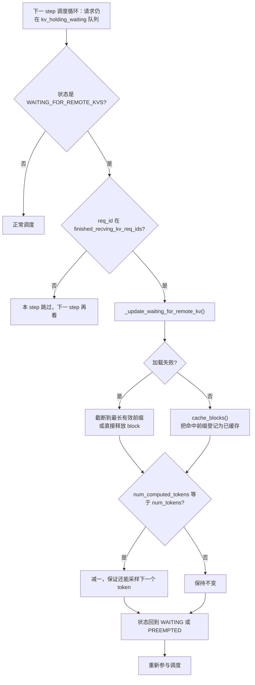
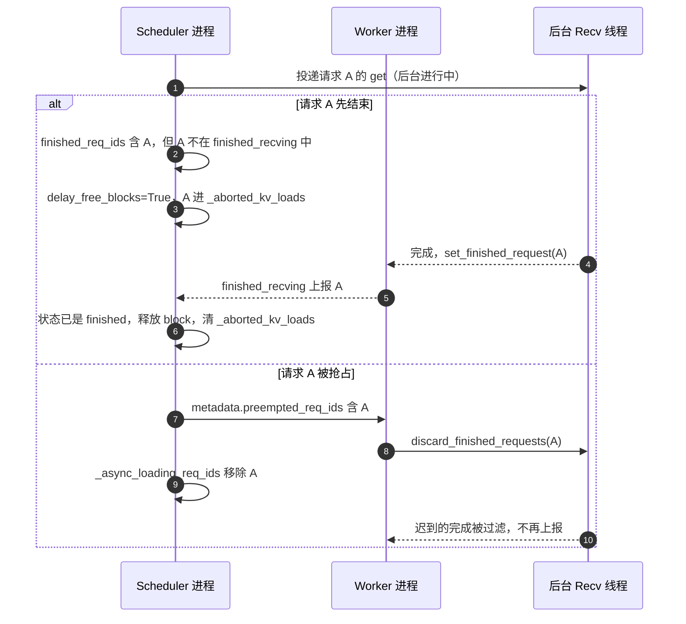

# KV Pool 异步加载与 V1 Scheduler 联动详解

> 一个请求在池里命中 4K token，接下来会发生什么？如果这 4K token 的 KV 需要 20 ms 才能从池里搬回来，同步方案会让**整个 step 的所有请求**一起等这 20 ms；异步方案让这个请求先"挂起"，别人继续算，等数据到了再把它放回队列。
>
> 这篇文档就讲这个"挂起—放回"是怎么实现的：状态机怎么改、元数据怎么下发、完成信号怎么跨进程传回来、失败和竞态怎么收场。全文沿着一条请求的时间线走，最后给出我的判断。

---

## 0. 导读

### 0.1 一句话

**异步加载的本质不是"开个线程去读"，而是把"等待远端 I/O"从 step 的关键路径，搬进请求的状态机里——用状态换重叠。**

线程只是执行手段；真正决定这套机制能不能用的，是调度器愿不愿意承认"有一个已分配 block、但还不能计算"的请求存在。vLLM V1 为它新增了一个状态：`WAITING_FOR_REMOTE_KVS`。

### 0.2 读完你应该能回答

| 问题 | 对应章节 |
|---|---|
| 一条请求从入队到开始计算，中间经过哪几个阶段？ | §1、§2 |
| 异步加载时，调度器为什么要把请求"藏起来"？藏在哪个状态？ | §3 |
| `get_num_new_matched_tokens` 的第二个返回值到底控制什么？ | §4 |
| 这个请求本轮没有被调度，为什么还要给它发 `ReqMeta`？ | §6 |
| Worker 的完成信号是怎么跨进程回到 Scheduler 的？ | §8 |
| 为什么"完成"不等于"成功"？失败了怎么兜底？ | §10 |
| 异步到底省了多少时间？什么情况下白省？ | §11 |
| layerwise 为什么不在这个链路里？ | §12 |

### 0.3 与上一篇的关系

同目录下的《AscendStore KV 池化设计方案详解》讲的是**池化整体架构**：key 怎么设计、控制面数据面怎么切、hybrid/TP/PP 怎么对齐。这一篇只切一个横截面：**一次请求的异步加载链路**，以及它与 vLLM V1 Scheduler 的握手。

两篇有重叠的部分（比如 `LoadSpec` 的两段式、`PoolKey` 的构成），本文只在必要处一句话带过，不重复展开。

### 0.4 代码基线

- 连接器侧：`vllm-ascend/vllm_ascend/distributed/kv_transfer/kv_pool/ascend_store/`
- 调度器侧：`vllm/vllm/v1/core/sched/scheduler.py`、`vllm/vllm/v1/worker/kv_connector_model_runner_mixin.py`
- 文中行号以当前检出为准，仅作导航；版本演进见 §14。
- 图 1 是位图（`images/kv-pool-async-timeline.png`），其余图均为 Mermaid，可直接在编辑器里渲染。
- 本文是代码阅读笔记，**未在 NPU 真机做性能实测**，所有"省多少时间"都是结构性分析，不是 benchmark 数字。

---

## 1. 大图：一条请求的完整流转

先看全景。设想一条请求 A，它的 prompt 在池里命中了 4096 个 token（占一半），走异步加载。下面这张图横轴按**调度步**切开，纵轴是三个执行体：调度器、Worker、后台搬运线程。建议这样读：先横向扫一遍，看时间怎么推进；再纵向扫一遍，看每一步里谁在干活、谁在闲着；最后顺着箭头，看数据怎么从一行传到另一行。


<p align="center">图 1 · 一次异步加载的时间线：第 N 步分配并投递，之后请求"消失"若干步，第 N+k 步完成信号回来，第 N+k+1 步才晋升</p>

读这张图，只需要盯住三件事：

1. **第 N 步之后，请求 A 从上面两行里一起消失了**——它没进 running，也不在任何一次 forward 里；
2. **block 从第 N 步就被占住**，一直到第 N+k+1 步才真正开始算，中间这几步是纯等待；
3. **"完成"和"晋升"差了一个 step**：第 N+k 步数据就到了，但要等到第 N+k+1 步的 `schedule()` 里、调度循环轮到它时才改状态。

### 1.1 四个时间切片

| 时间切片 | Scheduler 在做什么 | Worker 在做什么 | 后台线程 | 这时 A 的处境 |
|---|---|---|---|---|
| **第 N 步** | 查到命中 4096 token，分配 block，置 `WAITING_FOR_REMOTE_KVS`，`num_new_tokens = 0` 后跳过 | forward 不含 A；forward 启动之后才执行 `start_load_kv` 投递 | 收到工单，入队，开始搬 | block 已占，token 未算 |
| **第 N+1 步** | 扫等待队列，A 已是 blocked 状态，不在候选里 | 照常算别人的请求 | `get()` 搬运中 | 不占算力，只占 HBM |
| **第 N+k 步** | `update_from_output` 收到 `finished_recving`，**只登记不晋升** | forward + `get_finished()` 取回完成集合 | 数据写完，`set_finished_request()` | 数据已就位，但还是不能算 |
| **第 N+k+1 步** | `schedule()` 里轮到它：`_handle_blocked_waiting_request` 查完成集合，齐了就晋升（`cache_blocks`、状态回 `WAITING`、重新入队） | forward 里现在包含 A | 空闲 | 回到正常调度，本步可能开算 |

### 1.2 每一步到底发生了什么

**第 N 步 · 命中、分配、投递。** `get_num_new_matched_tokens` 告诉调度器两件事：池里还有 4096 个 token 的 KV 可用，而且连接器要求异步。调度器于是做了一件平时不会做的事——先把 block 分配出去、把 `num_computed_tokens` 直接写成 4096，再把 `num_new_tokens` 设成 0，然后**跳过这个请求**。它没进 running，也不在这一步的 forward 里。同一时刻，这一步的 forward 照常跑别人的 token；等 forward 启动之后，`start_load_kv` 才把它的工单投进后台队列。放在 forward 之后不是笔误，是为了把这部分 CPU 开销藏进计算时间里（见 §8.3）。

**第 N+1 步 · 它消失了。** 调度器扫一遍等待队列，A 已经是 blocked waiting，不在候选里；Worker 的 forward 里也找不到它。但它的 block 还占着，后台线程正在搬数据。于是系统进入一个看起来矛盾的状态：**资源被占着，算力却没被使用**。这正是异步的代价，也是它收益的来源——这几十毫秒里 NPU 上跑的全是别人的 token。

**第 N+k 步 · 数据到了，但还不能算。** 搬运线程把数据写进 block，调用 `set_finished_request(A)`。这只是线程内部的完成，不会直接惊动调度器。同一步收尾时，Worker 的 `get_finished()` 把这批完成 id 取出来，随 `model_output` 上报；调度器在 `update_from_output` 里只做一件事：把 A 记进待晋升集合。**它没有改状态，也没有重新入队。** 因为这一步的调度早就结束了（`update_from_output` 发生在 forward 之后），此刻改状态也排不进这一轮，只会让"本步调度结果不可变"这条不变量变得可疑。

**第 N+k+1 步 · 晋升。** 下一次 `schedule()` 的调度循环一开始并**不会**专门扫描待晋升集合，而是照常从队列里取请求——A 此刻正躺在 `kv_holding_waiting` 这个"占着 block 的等待队列"里（`scheduler.py:235`）。循环 peek 到它，调 `_handle_blocked_waiting_request` 问一句"数据到了吗"：没到就跳过，下个 step 再看；到了就当场晋升——`cache_blocks` 把加载好的 block 登记成前缀缓存、状态改回 `WAITING`（若曾被抢占则是 `PREEMPTED`）、重新入队，然后继续走正常调度分支。所以 A 在本步就有可能被排上，预算够的话这一步就开始算剩下的 token（`num_computed_tokens` 已经是 4096 了）。从"数据到了"到"开始计算"差的那一个 step，就是图里那条错位箭头的来源。

把六个阶段拆成框架图更清楚：


<p align="center">图 2 · 六个阶段与各自的负责人：①②③⑥ 在 Scheduler 进程，④⑤ 跨到 Worker 进程</p>

| 阶段 | 在哪里发生 | 输入 | 输出 | 关键函数 |
|---|---|---|---|---|
| ① 查命中 | Scheduler 进程 | 请求、本地已算 token 数 | 还能复用多少、同步还是异步 | `get_num_new_matched_tokens` |
| ② 分配 + 登记 | Scheduler 进程 | 命中长度 | block 分配、`LoadSpec.can_load`、状态切换 | `update_state_after_alloc` |
| ③ 生成 ReqMeta | Scheduler 进程 | 本 step 的调度结果 | 每个请求的读写工单 | `build_connector_meta` |
| ④ 投递 + 搬运 | Worker 进程 | ReqMeta | 后台线程里的 `get()` | `start_load_kv`、`add_request` |
| ⑤ 完成回传 | Worker → Scheduler | 后台线程的完成集合 | `finished_recving` | `get_finished`、`get_transfer_results` |
| ⑥ 晋升 | Scheduler 进程 | 完成集合 | 状态回 `WAITING`、缓存登记 | `_handle_blocked_waiting_request` |

---

## 2. 为什么需要异步：先把"代价"说清楚

### 2.1 同步加载贵在哪

同步路径很好理解：`start_load_kv()` 在 forward 之前把 `get()` 做完，数据就位，然后整批请求一起算。

问题在于 `get()` 的耗时不由计算决定，而由池的带宽、网络、后端排队决定。它可能只有 2 ms，也可能 50 ms。而在这段时间里：

- 本 step 已经调度好的**所有**请求都在等；
- NPU 上的计算队列是空的；
- 下一个 step 也发不出去。

所以同步加载的代价不是"这个请求慢了 20 ms"，而是"**这一步整批请求一起慢了 20 ms**"。批量越大，浪费越大。这也是为什么池化在压测里经常"单请求看还行，一上并发 TTFT 就抖"。

### 2.2 异步要买的是什么

异步方案把这段时间让出来：请求 A 的加载任务被投递进后台线程后，A 自己就退出调度，其他请求继续按 step 推进；A 的数据到了再回来。


<p align="center">图 3 · 同步把等待压在 step 里，异步把等待挪到 step 之外</p>

注意一个容易忽略的点：异步**不减少**总传输量，也不保证单请求更快。它换的是"整批不被拖住"。如果一个 batch 里只有这一个请求，异步几乎等于没收益——甚至更差，因为它多占了 block 和一次状态往返（见 §11）。

### 2.3 要付的三笔账

1. **状态机变复杂**：多一个状态、多一套"谁在等"的登记；
2. **资源提前占用**：block 在加载前就分配好，池子慢的时候会挤压别人；
3. **失败语义变绕**：完成不等于成功，失败要"先晋升再修正"。

后面每一节，其实都是在还这三笔账。

---

## 3. 状态机：多出来的那个状态

### 3.1 请求多活了一段

V1 的请求状态原本是 `WAITING → RUNNING → FINISHED`，加上 `PREEMPTED`。异步加载插入了一个新的中间态：


<p align="center">图 4 · 异步加载让请求多了一个"占着 block 但不计算"的状态</p>

`WAITING_FOR_REMOTE_KVS` 的语义很精确：**block 已分配、目标地址已确定、数据还没到、本 step 不参与调度**。少了任何一条，这套机制都不成立。

### 3.2 为什么不能塞进 running

如果让异步请求留在 running，会有两个立刻爆炸的问题：

- **token budget 被占**：调度器按"本 step 要算多少 token"分配预算，一个不算 token 的请求占着名额，其他请求就排不进来；
- **forward 会读脏数据**：模型会把它当成"已算好前缀、继续算下一个 token"，而 KV 还没到。

所以必须有一个"不算 token、但也不释放 block"的状态。这也是调度器要配合改动的根本原因：这不是连接器自己能解决的，必须改核心状态机。

### 3.3 三个字段，各自记账

异步链路里最容易搞混的是"谁在等"这件事被记在了三个地方：

| 记账位置 | 归属 | 回答的问题 | 什么时候清 |
|---|---|---|---|
| `_async_loading_req_ids` | 连接器（Scheduler 侧） | 本实例还有哪些请求在等池 | 收到 `finished_recving` 时差集移除 |
| `finished_requests` | 接收线程（Worker 侧） | 哪些请求的 `get()` 已经返回 | 被 `get_and_clear_finished_requests` 取走 |
| `finished_recving_kv_req_ids` | V1 Scheduler 核心 | 哪些请求现在可以晋升 | 晋升时移除 |

三者名字相似、生命周期不同，但职责其实很清楚：

- `_async_loading_req_ids` 是**下发与过滤的依据**（metadata 里的 `loading_req_ids` 就是它的快照）；
- `finished_requests` 是**事实**（线程干完活就登记）；
- `finished_recving_kv_req_ids` 是**许可**（调度器说"可以放回来了"）。

排障时最常见的困惑是"日志里明明完成了，为什么没晋升"——多半是三个集合里有一个没对上，§10 会展开。

---

## 4. 阶段一：查命中，顺便决定同步还是异步

### 4.1 一个函数，两个返回值

`get_num_new_matched_tokens(request, num_computed_tokens)` 返回 `(ext_tokens, load_kv_async)`：

- **第一个值**：除了本地已算的，还能从池里复用多少 token（决定要分配多少 block）；
- **第二个值**：这次加载走同步还是异步。

在 vllm-ascend 里，第二个值就是配置开关本身：

```python
# pool_scheduler.py
return need_to_allocate, self.load_async
```

也就是说，**是否异步是进程级配置**（`kv_connector_extra_config.load_async`，默认 `False`），不是每个请求单独判断。这个设计很务实：异步与否影响的是整条链路的行为，混用只会让状态机更难推理。

### 4.2 分叉点在哪


<p align="center">图 5 · 命中长度决定"分配多少"，配置决定"怎么加载"</p>

这里有三个细节值得单独说：

1. **全命中要减一**：如果池里的命中长度正好等于 prompt 长度，会执行 `num_external_hit_tokens -= 1`。原因是采样下一个 token 需要最后一个位置的 logits 和 KV，全命中会导致"没有 token 可算"，所以留一个 token 重算。这是"看起来少省了一个 token，实际是正确性必需"。
2. **EAGLE 尾块修正**：启用投机解码时，池里的命中不能覆盖 prompt 的最后一个粒度块，否则 draft 模型的隐状态没法重建，命中长度会被回退。
3. **私有压缩状态**：某些模型的部分 KV 不能直接复用，需要按传输粒度向下取整，`_floor_to_cache_transfer_granularity` 就是干这个的。

### 4.3 同步和异步的第一个区别，其实在调度器里

连接器返回 `True` 之后，决定权交给 vLLM 核心。核心做的是：

```python
if load_kv_async:
    assert num_external_computed_tokens > 0
    num_new_tokens = 0          # 本 step 不为它算 token
```

紧接着设置状态、写 `num_computed_tokens`、跳过本 step 的 forward。所以"异步"从这一刻起就不是连接器的私有行为了，而是**调度器承认的一种请求形态**。

---

## 5. 阶段二：分配与登记

### 5.1 block 先到手，数据后到

`update_state_after_alloc(request, blocks, num_external_tokens)` 是分配回调。它做三件事：

1. 把请求登记进 `_unfinished_requests`（**即使没有任何外部命中**）；
2. 断言 `num_external_tokens == kvpool_cached_tokens - vllm_cached_tokens`，防止"查到的"和"分配的"对不上；
3. 把 `LoadSpec.can_load` 置为 `True`；如果配置了异步，再把自己加进 `_async_loading_req_ids`。

第 1 条容易被忽略：为什么没命中也要登记？因为 `_unfinished_requests` 是"这个请求在本实例还有账没结"的唯一凭据。异步加载的请求在本 step 之后就不在 `scheduled_*` 列表里了，连接器只能靠这本账找到它，否则下一节那张"给未调度请求发工单"的逻辑就无从下手。

### 5.2 `can_load` 是两段式的第二段

上一节已经确认"能复用多少"，这里才确认"目标地址有了"。`can_load` 置真之前，Worker 不会发 `get()`——因为还不知道往哪儿写。

这个顺序不能反：先查后分配，分配失败（显存不够）时请求会退回 waiting，`LoadSpec` 被丢弃，下次重新查。**"查到了"和"用得上"之间隔着一次分配**，这正是两段式存在的意义。

### 5.3 块提前占用的代价

注意一个事实：**block 在这一步就已经被这个请求占住了**，哪怕数据要 50 ms 后才到。

这带来两个后果：

- 好处——目标地址稳定，加载期间不会被别人复用，异步写入是安全的；
- 代价——池子慢的时候，一堆"等数据"的请求会把 KV 空间吃满，压缩真正在算的请求的空间，严重时触发抢占。

这就是"异步加载需要背压"的根源。上游后来加了 `--max-num-inflight-kv-loads`，但它只对"声明自己可能异步加载"的连接器生效（`may_load_async`，默认只对 P/D 的 `do_remote_prefill` 返回真）；AscendStore 没有覆写这个方法，所以**池化场景目前没有在途上限**。这一点我在 §13 会展开。

---

## 6. 阶段三：给"没被调度"的请求发工单

### 6.1 一个 step 的工单从三处来

`build_connector_meta()` 每个 step 都会被调用一次，它要覆盖三类请求：


<p align="center">图 6 · 第三类来源是异步链路特有的：请求不在本轮调度结果里，但它的加载还没做完</p>

前两类是常规请求；第三类才是异步的关键。它做的事很朴素：

```python
if self._unfinished_requests:
    unscheduled_request_ids = set(self._unfinished_requests)
    unscheduled_request_ids.difference_update(
        req.req_id for req in scheduler_output.scheduled_new_reqs
    )
    if len(unscheduled_request_ids) == 1:
        # 单元素只需一次 membership 判断，不必为 cached_reqs 建索引
        request_id = next(iter(unscheduled_request_ids))
        if request_id in cached_reqs.req_ids:
            unscheduled_request_ids.clear()
    elif unscheduled_request_ids:
        unscheduled_request_ids.difference_update(cached_reqs.req_ids)
    for request_id, (request, block_ids) in self._unfinished_requests.items():
        if request_id in unscheduled_request_ids:
            req_meta = self._process_async_load_request(request_id, request, block_ids)
            if req_meta is not None:
                meta.add_request(req_meta)   # 本 step 唯一给它的工单
```

先做差集，再遍历 `_unfinished_requests`（保持字典顺序）。注释里还特意写了优化：单元素用一次 `in` 判断，多元素才按两边规模决定"整体差集"还是"稀疏查找"——因为这段是每 step 都要跑的，decode 批次一大，差集本身就成了开销。

这段代码值得多看一眼：**它在为一批"本轮根本不存在于调度结果里"的请求生成工单**。常规连接器不需要这种逻辑（没被调度就没有工作），只有异步加载会要求"请求不在本 round，但它的加载还没做完，要继续推进"。

### 6.2 `_process_async_load_request` 只做三件事

它不复用 `_process_new_request`，因为两者的"token 长度从哪来"根本不同：新请求看的是本轮调度了多少 token，异步请求看的是**池里命中了多少 token**。

所以它只做：

1. 从 `load_specs` 里取出并弹出 `LoadSpec`；
2. 用 `kvpool_cached_tokens` 构造一个临时 `RequestTracker`（`num_saved_tokens=0`，`token_len` 是命中长度）；
3. 生成 `ReqMeta`，带上 `skip_save=None`（此时还不该决定保存策略）。

这个 `ReqMeta` 的唯一用途就是"告诉 Worker 从哪读到哪"。请求真正被晋升之后，会重新走 `_process_new_request`，tracker 也是那时重建的。

### 6.3 `loading_req_ids` 随 metadata 下发

`AscendConnectorMetadata` 里除了 `requests`，还有一个 `loading_req_ids`，它是 `_async_loading_req_ids` 在当前 step 的快照。

Worker 侧用它做**上报过滤**：

```python
done_recving = self.kv_recv_thread.get_and_clear_finished_requests(meta.loading_req_ids)
```

只有"调度器认为在等"的请求，完成才会被上报。这样即使线程里残留了某个已经被抢占、被清理的请求的完成记录，也不会被误报上去。这是一个很便宜的防御性设计：**用快照对齐两个进程的认知**。

---

## 7. 阶段四：Worker 真正搬数据

### 7.1 `start_load_kv` 的三条分支


<p align="center">图 7 · 异步分支只做一件事：把请求塞进队列；真正的 I/O 在另一个线程</p>

注意异步分支里的 `continue`：它不等待、不返回结果，只负责投递。`start_load_kv` 的语义因此变成"启动加载"而不是"完成加载"——这也是这个 API 名字的由来。

### 7.2 队列与线程

接收线程是一个常驻 `daemon` 线程，结构非常传统：

- `queue.Queue()` 无界队列，`add_request()` 加锁投递（`_request_submit_lock`）；
- 线程 `run()` 里 `get()` 出队，调用 `_handle_request`；
- 出队后如果有异常，设置 `_fatal_error` 并**退出线程**；之后 `add_request` 直接拒收，调度器在后面某次 `raise_if_failed` 里看到异常并崩掉（对，是故意崩，而不是静默降级）。

提交锁（`_request_submit_lock`）不是为了吞吐，而是为了正确性：代码注释写得很清楚，它把"投递新任务"与"进入 fatal 状态"串行化。否则生产者可能在消费者已经排空队列之后又塞进一个任务，留下一个永远没人处理的工作项——而调度器正等着它的回音。

这里有一个明确的设计选择：**加载线程不重试、不降级、不吞异常**。因为吞掉异常会让"请求一直等一个永远不会完成的加载"，那比崩掉更难查。

### 7.3 线程里干什么

`_handle_request` 的逻辑和同步路径几乎一样：遍历 group，拼 key / addr / size，按 tp_rank 旋转列表（让不同 rank 的访问错开），调用 `m_store.get()`，然后按逐 key 返回值记录失败 block。

唯一的差别是结尾：**无论成功失败，都要 `set_finished_request(req_id)`**。失败时还会把缺失的 block 记进 `_invalid_block_ids`（单 group）或 `failed_requests`（多 group）。

失败记法还有一个更保守的分支：Memcache 后端一旦返回不合法（长度不符或有非零返回码），代码直接把整个请求的 block 全部标为无效（单 group）或整请求失败（多 group），不做"部分命中"的精细化处理。这相当于用"多算一点"换"少一类静默错误"，在跨机缓存这种不可靠介质上是合理的取舍。

这一步是整条链路的"承诺"：既然调度器在等，就一定要给个回音。哪怕回音是"我失败了"。

### 7.4 为什么失败也要置完成

因为调度器卡在 `WAITING_FOR_REMOTE_KVS` 的请求不会自己超时。如果失败不置完成，这个请求会永远占着 block、永远等下去，最终把整个实例拖死。

所以策略是：**完成集合只表达"这件事结束了"，成功与否走另一条通道**。调度器晋升时再根据失败信息修正前缀。这个"乐观完成 + 事后修正"是整套机制能收敛的关键，§10 会讲修正怎么做。

---

## 8. 阶段五：完成信号怎么回到 Scheduler

### 8.1 三段接力

跨进程传一个 `set[str]`，vLLM 用的是"随 step 捎带"的方式，而不是回调或消息队列：


<p align="center">图 8 · 完成信号的三段接力：线程集合 → 连接器输出 → 调度器集合</p>

### 8.2 一个容易漏掉的细节：失败也上报为"完成"

`get_transfer_results()` 里有一行：

```python
if self.connector_worker.load_async and not self.use_layerwise:
    done_recving |= failed
```

失败请求被**合并进** `finished_recving`，同时单独放在 `failed_recving` 里。这样调度器一定会把它晋升（不会卡死），又能从 `failed_recving` 知道"这次晋升是失败的，要修正前缀"。

如果只上报 `finished_recving` 而不带失败信息，调度器会把没加载成功的 block 当成有效缓存，直接算出错误结果——这是最危险的一类 bug（静默错误，不是崩溃）。

### 8.3 `start_load_kv` 到底在 forward 前还是后

同步和异步在这里还有一个不对称：

- 本 step 有同步加载（`has_sync_kv_loads=True`）→ `start_load_kv` 必须在 forward 之前，因为数据要喂给这次 forward；
- 本 step 只有异步加载 → `start_load_kv` 被挪到 forward **启动之后**（`start_after_forward`），连投递的几十微秒都不想挡在计算前面。

这个细节说明优化已经做到了"连入队开销都要藏"的程度。反过来说，如果你的 async 加载在 profile 上仍然挡住了 step，先看是不是被同步加载带回了前一条路径。同一段注释还交代了另一半原因：启动加载必须排在"block 清零"之后，否则清零可能把刚写进去的 KV 又抹掉。

还有一个时序上的直觉修正：异步投递和完成收集发生在**同一个 step** 的收尾里，所以 `get_transfer_results` 在投递后立刻查一次，通常什么都拿不到。真正的完成要等到后面某一 step 的收尾，这也是 §1 图里"完成回传"和"投递"之间隔着若干 step 的原因。

### 8.4 发送侧为什么不走这条路

`get_finished` 里发送侧永远是空集合，注释写得很直白：**保存由 `wait_for_save()` 同步等待完成**，调度器不需要等请求级的 `finished_sending`。

也就是说这套系统是"读异步、写同步"。读路径优化到极致，写路径仍然可能在 step 末尾挡一下。这是权衡：写失败只影响"下次命中"，同步等待可以把释放 block 的时机做得更确定；读失败会影响当前请求，异步反而更安全（可以回退重算）。

---

## 9. 阶段六：晋升，回到人间

### 9.1 为什么不在收到完成时立刻晋升

`_update_from_kv_xfer_finished` 只做登记，不做晋升。晋升发生在**下一次调度**时：请求还躺在 `kv_holding_waiting` 队列里（`scheduler.py:235`），调度循环每 peek 到它就问一次 `_handle_blocked_waiting_request`（`scheduler.py:3679`）——完成集合里没有就跳过（下个 step 再看），有就当场晋升。

原因很实际：`update_from_output` 是 step 的收尾，此时这一步的调度早就做完了，就算立刻把请求放回队列也排不进这一轮。放到下一次调度时顺手处理，逻辑更简单，而且天然幂等——今天排不进，明天再试，不需要任何重试机制。

### 9.2 晋升时做四件事


<p align="center">图 9 · 晋升不是一个动作，而是"登记缓存 + 修正 + 状态回退"的组合</p>

四件事分别是：

1. **登记缓存**：`kv_cache_manager.cache_blocks(request, num_computed_tokens)`，让这批 block 正式成为前缀缓存的一部分（后续请求可以命中它）；
2. **失败修正**：如果这个请求在失败名单里，`num_computed_tokens` 已经被截断到最长有效前缀，这里只缓存有效部分；如果一点都没加载成功（等于 0），直接释放 block，等下次重试；
3. **全命中减一**：和 §4.2 同一个原因，晋升后如果"已算 token 数 == 总 token 数"，要减一，否则没法采样；
4. **状态回退**：`num_preemptions` 为 0 回 `WAITING`，否则回 `PREEMPTED`——被抢占过的请求要以 resumed 的身份重新进来，调度器才会给它正确的优先级和 block 处理。

### 9.3 晋升之后

请求回到 `WAITING`（或 `PREEMPTED`）后，和普通请求没有区别：下一轮调度会重新走 `get_num_new_matched_tokens`（本地前缀缓存此时已经包含刚加载的那段，所以命中会变成"本地命中"），然后只对剩余 token 做 prefill。

整个异步加载的故事到这里就闭环了：**一次跨进程的 I/O，被包装成了一次状态往返**。

---

## 10. 失败与竞态：异步路径上的五个坑

### 10.1 两条失败通道

| 通道 | 粒度 | 适用 | 后果 |
|---|---|---|---|
| `invalid_block_ids` | block id | 单 group | 调度器扫描所有请求，把受影响的前缀截断 |
| `failed_recving` | 请求 id | 多 group / hybrid | 调度器按请求修正，不依赖 block id 唯一性 |

为什么需要两条？因为 block id 只在 group 内唯一。hybrid 模型有多个 group，同一个 id 可能对应两个不同的 block，拿一个扁平集合无法反查。"把请求整体标失败"虽然粗，但不会误伤。

当前上游甚至会在多 group 场景下直接对 `invalid_block_ids` 抛错，逼连接器改用 `failed_recving`。AscendStore 的实现里，hybrid 失败就是走请求级通道，单 group 才记 block——这个边界在排障时很重要。

### 10.2 请求先结束了怎么办


<p align="center">图 10 · 两种"加载还在路上，请求已经不在"的情形，收场方式不同</p>

- **结束**：不能立刻释放 block（I/O 还在写这些地址），要延迟释放，等完成信号到了再释放；
- **抢占**：请求还要回来，但 block 会被重新分配，所以直接在两侧都丢弃完成记录，避免"旧完成"污染"新一次加载"。

这两条路径解释了为什么 `get_finished` 里既要 `discard_finished_requests(preempted)`，又要按 `loading_req_ids` 过滤。

### 10.3 线程挂了怎么办

`KVTransferThread.run()` 捕获异常后设置 `_fatal_error` 并退出。之后：

- `add_request` 拒收新任务（不会静默堆积）；
- `raise_if_failed` 在后续调用点抛 `RuntimeError`，让实例尽快暴露问题。

对"异步"系统来说，这是正确的失败方式：**宁可整体失败，也不要部分请求永远挂着**。

### 10.4 完成集合的重复与遗漏

三个集合的清理时机不同，可能出现"完成信号到了，但调度器已经不需要它"的情况。当前实现的防御是：

- 侧侧 `discard`：抢占时两侧同时丢；
- 过滤：上报时以 `loading_req_ids` 为准；
- 幂等：晋升只处理 `WAITING_FOR_REMOTE_KVS` 的请求，其他状态直接跳过。

### 10.5 池返回部分成功

`get()` 返回逐 key 结果时，缺失的 block 会被记录，请求本身仍然会被晋升。晋升时 `num_computed_tokens` 被截断到"连续有效前缀"，后面的 token 重新计算。

这就是 §2.3 说的"失败语义变绕"的具体代价：读侧要处理"部分命中"，逻辑复杂度实打实上升。

---

## 11. 时间账：异步到底省了多少

### 11.1 一个粗略模型

设单次 `get()` 耗时 `T_load`，本 step 其他请求可提供的计算时间 `T_overlap`：

- **同步**：step 时间 ≈ `T_lookup + T_load + T_compute`，所有请求平摊这次等待；
- **异步**：请求自身的额外等待 ≈ `max(0, T_load - T_overlap)`，step 本身不再被阻塞。

所以异步的收益取决于"**有没有别人在算**"：

| 场景 | `T_overlap` | 收益 |
|---|---|---|
| 高并发、decode 请求多 | 大 | 几乎完全隐藏 |
| 中等并发、有 prefill 排队 | 中 | 部分隐藏 |
| 单请求 / 队列空 | ≈ 0 | 没有收益，还多占 block |
| 池带宽打满 | `T_load` 变大 | 只能隐藏一部分，甚至更差 |

### 11.2 一个容易被忽略的成本

异步并不只带来好处。块提前占用会减少可用 KV 空间，可能让别的请求提前触发抢占；加载线程本身也占 CPU 和一点内存。

在 KV 空间紧张的场景（长上下文、大 batch），开异步之后**吞吐反而下降**是有可能的——不是因为异步错了，而是因为"用空间换时间"在这里换亏了。

### 11.3 什么时候值得开

- 有稳定的并发（≥ 数个请求同时在跑）；
- 池的 `get` 时延在毫秒级、且抖动可控；
- KV 空间有富余，能容忍若干"等数据"的请求占块；
- 请求前缀重复率高（否则连命中都没有，异步无从谈起）。

反过来，单请求压测、TTFT 敏感且请求稀疏、KV 空间吃紧，都不适合开。

---

## 12. 为什么 layerwise 不在这个链路里

layerwise 模式也有"异步"的味道：每层算完就保存、下一层开始前等待加载。但它的完成粒度是**层**，不是**请求**。


<p align="center">图 11 · 两种"异步"的完成粒度不同，不能共用一套通知</p>

代码上体现得很直接：`get_finished` 里只有 `load_async and not use_layerwise` 才收集 `done_recving`；layerwise 的 `wait_for_save` 也直接返回。它靠的是 attention 计算前的门控（`attention_fence.py`），而不是调度器的状态机。

这意味着：**layerwise 与本文讲的异步加载是两条互斥的路径**。开 `use_layerwise` 时，`load_async` 基本不起作用（或者说，请求不会进入 `WAITING_FOR_REMOTE_KVS` 的那套流程）。看代码时如果发现"异步没生效"，先确认自己开的是哪条路。

---

## 13. 我的看法

### 13.1 四个漂亮的地方

**第一，用"状态"表达异步，而不是回调或协程。**

vLLM 的调度器是单线程同步的，worker 在另一个进程。在这种结构里引入 future/await 会牵动整条调用链；而加一个状态 + 一个完成集合，改动被限制在"调度器愿不愿意承认这个状态"这一件事上。API 表面几乎没变（还是 `get_num_new_matched_tokens` / `build_connector_meta` / `start_load_kv` / `get_finished` 四件套），这是很克制的设计。

**第二，"完成"与"成功"解耦。**

失败也置完成，失败信息另走通道。这个选择避免了最糟糕的失败模式——请求永远挂在 `WAITING_FOR_REMOTE_KVS`。很多自研缓存系统就死在这里：I/O 失败没人通知，调度器一直等，最后靠超时兜底，而超时值又很难定。

**第三，三个集合职责清晰。**

`_async_loading_req_ids`（谁在等）、`finished_requests`（事实）、`finished_recving_kv_req_ids`（许可）。虽然名字像、排障时容易看错，但拆分是对的：一个"事实"集合同时承担"过滤"和"许可"两种职责，迟早会出问题。

**第四，晋升放在调度阶段，天然幂等。**

不需要重试、不需要定时器、不需要"完成后主动唤醒"。本 step 排不进就下一步，一轮一轮试，直到成功。对一个每步都会跑的函数来说，这是最省心的写法。

### 13.2 六个隐忧

1. **没有在途上限，块会被慢加载吃光。** 上游的 `--max-num-inflight-kv-loads` 只对 `may_load_async` 为真的连接器生效，AscendStore 没覆写，所以池化场景下"多少请求可以同时占着 block 等 I/O"是没有约束的。池抖动时，这会直接转化为抢占。
2. **没有 per-request 超时或取消。** `get()` 一旦发出就只能等；线程挂了走 fatal。长尾请求可能把 block 占很久。
3. **完成粒度太粗。** 只有"整段前缀加载完"这一个信号，没有进度、没有分块完成。一个 8K 前缀的加载，在前 7K 都到位时，调度器仍然什么都做不了。
4. **失败通道有两条，hybrid 必须用请求级那条。** 这不算设计缺陷，但确实提高了实现和排障门槛；一旦用错，多 group 场景会直接抛错。
5. **读异步、写同步，叙事上不统一。** `wait_for_save` 仍然在 step 末尾同步等待发送，写侧的压力没有消失。读侧优化到"连入队都挪到 forward 之后"，写侧还在原地，这个不对称值得注意。
6. **可观测性偏弱。** 没有暴露"异步等待时长""在途加载数""完成到晋升的延迟"这类指标，排障基本靠 debug 日志。§10 那三个集合对不上时，日志里很难一眼看出是哪一环。

### 13.3 如果我来改

| 方向 | 做法 | 预期收益 |
|---|---|---|
| 在途上限 + 背压 | 覆写 `may_load_async`，或自建计数：超过阈值退回同步/排队 | 池慢时不再无限制占块 |
| 队列内预热 | 在 waiting 阶段就发起 `get`，不占 running slot | 缩短首次 token 延迟，重叠窗口更大 |
| 分块完成 + deadline | `get` 按 chunk 上报进度，超时按失败处理 | 长前缀可渐进晋升，长尾可控 |
| 统一失败通道 | 全部走 `failed_recving`，`invalid_block_ids` 仅作兼容 | 少一条分支，少一类 bug |
| 指标补齐 | 等待时长 P50/P99、在途数、完成→晋升延迟、按 group 失败率 | 可定位、可容量规划 |
| 写侧异步化 | `wait_for_save` 改为完成集合（与读侧对称） | step 末尾不再被发送阻塞 |

前两条我认为收益最大：它们直接决定"异步能不能在池抖动时仍然稳定"。

### 13.4 什么时候别开 `load_async`

- **单请求、低 QPS**：没有可重叠的计算，异步只是把等待挪个地方，还多占 block；
- **KV 空间紧张**：块提前占用会加剧抢占，吞吐可能下降；
- **池带宽已经打满**：加载时间远大于可重叠时间，收益趋近于零；
- **开了 `use_layerwise`**：两条路径互斥，`load_async` 不会按本文流程生效；
- **要求严格可预测的 TTFT**：异步把"确定性等待"变成"依赖别人算多久"，抖动来源变多了。

---

## 14. 与原文的差异（版本演进）

原文基于较早的实现。以下是当前检出里对得上的差异，读原文时以本节为准：

| 原文所述 | 当前检出 |
|---|---|
| `_loading_req_ids` | 连接器侧是 `_async_loading_req_ids`；metadata 里叫 `loading_req_ids`（下发快照） |
| `LoadSpec` / `ReqMeta` 定义在 `config_data.py` | 当前检出没有 `config_data.py`，两者都在 `metadata.py`（`LoadSpec` 第 769 行、`ReqMeta` 第 927 行） |
| `KVPoolWorker.start_load_kv` 在第 1378 行 | 当前在第 849 行；第 1357 行是 `get_finished` |
| `_try_promote_blocked_waiting_request` | 当前叫 `_handle_blocked_waiting_request` |
| `get_finished` 直接返回完成集合 | 当前经 `get_transfer_results`，额外返回 `failed_recving`，并把失败并入 `finished_recving` |
| 未提及启动时机 | 上游新增 `has_sync_kv_loads`：没有同步加载时，`start_load_kv` 被挪到 forward 启动之后 |
| 未提及在途上限 | 上游新增 `--max-num-inflight-kv-loads` 与 `may_load_async`；AscendStore 未覆写，故不生效 |
| 未提及请求级失败 | `KVConnectorOutput` 新增 `failed_recving`；`done_recving |= failed` 是当前实现的关键一行 |

这些差异不影响原文的机制描述，但影响"该去哪个文件、看哪个函数"。

---

## 15. 代码索引

路径相对仓库根，行号以当前检出为准。

| 主题 | 文件 | 关键符号 |
|---|---|---|
| 命中与异步开关 | `.../ascend_store/pool_scheduler.py` | `get_num_new_matched_tokens`（第 239 行，返回第 329 行） |
| 分配后登记 | 同上 | `update_state_after_alloc`（第 347 行）、`_async_loading_req_ids.add`（第 396 行） |
| 未调度请求的工单 | 同上 | `_process_async_load_request`（第 569 行） |
| 元数据组装 | 同上 | `build_connector_meta`（第 609 行）、未调度扫描（第 685–707 行） |
| 完成回传（Scheduler 侧） | 同上 | `update_connector_output`（第 717 行） |
| 数据面入口 | `.../ascend_store/pool_worker.py` | `start_load_kv`（第 849 行）、异步投递（第 884 行） |
| 完成收集 | 同上 | `get_finished`（第 1357 行）、按 `loading_req_ids` 过滤（第 1388 行） |
| 失败收集 | 同上 | `get_failed_requests`（第 1037 行）、`get_block_ids_with_load_errors`（第 1046 行） |
| 传输线程 | `.../ascend_store/kv_transfer.py` | `add_request`（第 98 行）、`get_and_clear_finished_requests`（第 126 行）、`set_finished_request`（第 152 行）、`run`（第 316 行） |
| 异步加载实现 | 同上 | `_handle_request`（第 1042 行）、`get` 调用（第 1119 行）、失败记录（第 1132–1159 行） |
| 连接器聚合 | `.../ascend_store/ascend_store_connector.py` | `get_finished`（第 467 行）、`get_transfer_results`（第 479 行）、`done_recving |= failed`（第 484 行） |
| 元数据结构 | `.../ascend_store/metadata.py` | `LayerTransferTask`（第 157 行）、`ChunkedTokenDatabase`（第 307 行）、`LoadSpec`（第 769 行）、`ReqMeta`（第 927 行） |
| vLLM 侧入口 | `vllm/v1/worker/kv_connector_model_runner_mixin.py` | `_get_kv_connector_output`（第 67 行）、`start_after_forward`（第 83 行） |
| 状态与异步决策 | `vllm/v1/core/sched/scheduler.py` | `load_kv_async`（第 1179 行）、`num_new_tokens = 0`（第 1341 行）、设 `WAITING_FOR_REMOTE_KVS`（第 1587 行） |
| 完成处理 | 同上 | `_update_from_kv_xfer_finished`（第 3716 行）、`_update_waiting_for_remote_kv`（第 3627 行） |
| 晋升 | 同上 | `_handle_blocked_waiting_request`（第 3679 行）、`_is_blocked_waiting_status`（第 2775 行） |
| 输出结构 | `vllm/v1/outputs.py` | `KVConnectorOutput`（`finished_recving` / `failed_recving` / `invalid_block_ids`） |
| 在途上限（未启用） | `vllm/v1/core/sched/scheduler.py` | `_admits_inflight_kv_loads`、`async_kv_waiting` 队列 |

---

## 附录 A：开关与排障速查

**开关**

| 配置 | 默认 | 作用 |
|---|---|---|
| `kv_connector_extra_config.load_async` | `False` | 走本文的异步加载链路 |
| `kv_connector_extra_config.consumer_is_to_load` | `False` | 纯 consumer 角色默认不加载；置真才会查池 |
| `kv_role` | — | `kv_producer` / `kv_consumer` / `kv_both`，决定读写能力 |
| `kv_load_failure_policy` | `recompute` | 失败回退重算 |

**日志关键字**

- `kvpool hit tokens` / `need to load`：命中与分配决策；
- `load spec enabled`：`can_load` 置真、异步登记；
- `start_load_kv requests=`：本 step 下发了多少工单；
- `async recv calls backend get`：后台线程开始搬运；
- `Finished recving KV transfer`：完成信号到达调度器；
- `still in WAITING_FOR_REMOTE_KVS`：还没完成，本 step 跳过；
- `Skip invalid-block fallback`：hybrid 失败走了请求级通道。

**排障顺序**

1. 有命中吗？看 `kvpool hit tokens` 是否大于 0；
2. 有工单吗？看 `start_load_kv requests=` 是否包含该请求；
3. 在搬吗？看 `async recv calls backend get`；
4. 完成上报了吗？看 `Finished recving KV transfer`；
5. 晋升了吗？看是否还打印 `still in WAITING_FOR_REMOTE_KVS`；
6. 晋升后算得对吗？看请求的 `num_computed_tokens` 与前缀长度是否一致。

---

## 一句话总结

> **异步加载不是"把 I/O 扔给后台线程"，而是让调度器承认一种"已分配、未就绪"的请求形态，并用一个完成集合把它接回来；真正的难点从来不是搬数据，而是让"完成"和"成功"这两个语义在跨进程之后仍然各自清晰。**
